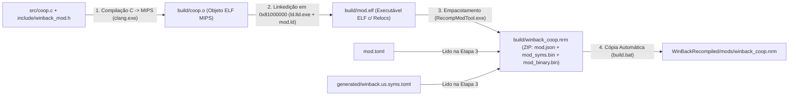

# Guia Completo do Fluxo de Compilação do Mod (`winback_coop.nrm`)

Este documento explica exclusivamente **como funciona o processo de compilação** do mod `winback_coop`, desde o código-fonte em C ([coop.c](file:///C:/Users/Alberto/Documents/projetos/game/winback/winback_coop/winback_coop/src/coop.c)) até a geração do pacote final [winback_coop.nrm](file:///C:/Users/Alberto/Documents/projetos/game/winback/WinBackRecompiled-v0.3.0-Windows-x64/mods/winback_coop.nrm) carregado pelo `WinBackRecompiled.exe`.

---

## 1. Visão Geral do Pipeline

Mesmo rodando no PC (Windows x64), um mod `.nrm` do `N64Recomp` **não é compilado para x86_64** — ele é compilado para **código de máquina MIPS de 32 bits (Big-Endian) do Nintendo 64**. Quando o jogo (`WinBackRecompiled.exe`) inicia e carrega o `.nrm`, o runtime do `N64Recomp` lê esse binário MIPS + a tabela de símbolos/relocations e o recompila em tempo de execução (*JIT/AOT mod recompiler*) conectando os hooks às funções do jogo.



---

## 2. Arquivos e Ferramentas Envolvidos

| Arquivo / Ferramenta | Caminho no Projeto | Papel na Compilação |
| :--- | :--- | :--- |
| **Código-fonte C** | [src/coop.c](file:///C:/Users/Alberto/Documents/projetos/game/winback/winback_coop/winback_coop/src/coop.c) | Implementação dos hooks e da lógica do Co-op. |
| **Header da API de Mods** | [include/winback_mod.h](file:///C:/Users/Alberto/Documents/projetos/game/winback/winback_coop/winback_coop/include/winback_mod.h) | Define as macros `RECOMP_HOOK`, `RECOMP_HOOK_RETURN`, `RECOMP_PATCH` e imports (`recomp_get_config_u32`, `recomp_printf`, etc.). |
| **Linker Script** | [mod.ld](file:///C:/Users/Alberto/Documents/projetos/game/winback/winback_coop/winback_coop/mod.ld) | Define o endereço virtual base do mod (`RAMBASE = 0x81000000`, fora dos `8 MB` originais do N64 `0x80000000..0x807FFFFF`). |
| **Manifesto do Mod** | [mod.toml](file:///C:/Users/Alberto/Documents/projetos/game/winback/winback_coop/winback_coop/mod.toml) | Metadados (`id`, `version`, `display_name`), caminhos de entrada e opções de configuração do menu. |
| **Símbolos da ROM** | [generated/winback.us.syms.toml](file:///C:/Users/Alberto/Documents/projetos/game/winback/generated/winback.us.syms.toml) | Mapeia o nome de cada função da ROM (`func_800593EC`, `func_800A8B10`, etc.) para seu endereço VRAM e tamanho exato. |
| **Compilador C (MIPS)** | `C:\msys64\mingw64\bin\clang.exe` | Compila C para instruções MIPS II Big-Endian (`build/coop.o`). |
| **Linker ELF (MIPS)** | `C:\msys64\mingw64\bin\ld.lld.exe` | Linka `build/coop.o` em `build/mod.elf` preservando todas as relocations (`--emit-relocs`). |
| **Empacotador NRM** | [RecompModTool.exe](file:///C:/Users/Alberto/Documents/projetos/game/winback/winback_coop/winback_coop/RecompModTool.exe) | Converte `mod.toml` + `build/mod.elf` + `winback.us.syms.toml` no arquivo final `.nrm`. |
| **Script Automatizado** | [build.bat](file:///C:/Users/Alberto/Documents/projetos/game/winback/winback_coop/winback_coop/build.bat) | Executa todas as etapas em sequência e copia o `.nrm` gerado para a pasta `mods` do jogo. |

---

## 3. Passo a Passo Detalhado das 4 Etapas

### Etapa 1: Compilação do C para Objeto MIPS (`coop.c` $\rightarrow$ `build/coop.o`)

Comando executado pelo [build.bat](file:///C:/Users/Alberto/Documents/projetos/game/winback/winback_coop/winback_coop/build.bat):
```bat
clang.exe -target mips -mips2 -mabi=32 -O2 -G0 -mno-abicalls -fno-pic -ffreestanding -nostdlib -Wall -Wextra -Iinclude -c src/coop.c -o build/coop.o
```

**O que cada flag faz e por que é obrigatória:**
- `-target mips`: Gera código MIPS de 32 bits **Big-Endian** (arquitetura da CPU VR4300 do Nintendo 64).
- `-mips2`: Conjunto de instruções MIPS II suportado pelo N64 e pelo recompilador `N64Recomp`.
- `-mabi=32`: Convenção de chamada padrão **O32** (argumentos em `$a0..$a3`, retorno em `$v0`, registradores salvos `$s0..$s7`, `$ra`).
- `-O2`: Otimização de código.
- `-G0`: Desativa o uso do registrador `$gp` (*Global Pointer / Small Data*), garantindo que todas as variáveis globais/estáticas sejam acessadas via pares explícitos `lui` (`R_MIPS_HI16`) + `lw`/`sw`/`addiu` (`R_MIPS_LO16`).
- `-mno-abicalls -fno-pic`: Desativa código dependente de posição (PIC/GOT) de sistemas Linux, gerando chamadas diretas `jal` (`R_MIPS_26`).
- `-ffreestanding -nostdlib`: Compila sem depender da biblioteca padrão C (`libc`) do sistema operacional.
- `-Iinclude`: Inclui a pasta `include/` onde está o [winback_mod.h](file:///C:/Users/Alberto/Documents/projetos/game/winback/winback_coop/winback_coop/include/winback_mod.h).

> **Como funcionam as macros `RECOMP_HOOK` durante esta etapa:**
> No [winback_mod.h](file:///C:/Users/Alberto/Documents/projetos/game/winback/winback_coop/winback_coop/include/winback_mod.h), quando você escreve:
> ```c
> RECOMP_HOOK("func_800593EC") void coop_p2_model(void)
> ```
> A macro cria automaticamente uma string especial na seção `.recomp_export` do arquivo `.o` (com o prefixo `@recomp_hook:func_800593EC:coop_p2_model`), que o `RecompModTool.exe` lerá na Etapa 3 para saber qual função do jogo deve acionar essa função do mod.

---

### Etapa 2: Linkedição para ELF Relocável (`build/coop.o` $\rightarrow$ `build/mod.elf`)

Comando executado pelo [build.bat](file:///C:/Users/Alberto/Documents/projetos/game/winback/winback_coop/winback_coop/build.bat):
```bat
ld.lld.exe -m elf32btsmip -nostdlib -T mod.ld --emit-relocs --unresolved-symbols=ignore-all -e 0 build/coop.o -o build/mod.elf
```

**O que cada flag faz:**
- `-m elf32btsmip`: Instrui o `ld.lld` do MSYS2 a operar no modo linker **ELF 32-bit Big-Endian Traditional MIPS** (em vez do modo Windows PE/COFF).
- `-T mod.ld`: Usa o script [mod.ld](file:///C:/Users/Alberto/Documents/projetos/game/winback/winback_coop/winback_coop/mod.ld), que aloca o código e dados do mod a partir do endereço `0x81000000` e descarta seções desnecessárias (`.got`, `.MIPS.abiflags`, `.reginfo`, `.comment`).
- `--emit-relocs`: **Essencial!** Mantém as tabelas de relocação (`.rel.text`) dentro do `mod.elf` final. Sem essa flag, o `RecompModTool.exe` não saberia onde estão os saltos (`jal`), ponteiros de strings (`%hi`/`%lo`) e variáveis estáticas (`BSS`).
- `--unresolved-symbols=ignore-all`: Permite que símbolos externos (como funções internas da ROM `func_800A8B10`, `func_8004D6E8`, `func_8006B3B8` e funções da API `recomp_get_config_u32`, `recomp_printf`) fiquem como símbolos indefinidos (`SHN_UNDEF`) no ELF para que o `RecompModTool.exe` os resolva na Etapa 3.
- `-e 0`: Define o ponto de entrada do ELF como `0` (já que um mod é uma coleção de hooks e não tem função `main`).

---

### Etapa 3: Empacotamento em `.nrm` (`RecompModTool.exe`)

Comando executado pelo [build.bat](file:///C:/Users/Alberto/Documents/projetos/game/winback/winback_coop/winback_coop/build.bat):
```bat
RecompModTool.exe mod.toml build
```

O [RecompModTool.exe](file:///C:/Users/Alberto/Documents/projetos/game/winback/winback_coop/winback_coop/RecompModTool.exe) lê três entradas:
1. O manifesto [mod.toml](file:///C:/Users/Alberto/Documents/projetos/game/winback/winback_coop/winback_coop/mod.toml);
2. O executável MIPS `build/mod.elf` (caminho definido em `elf_path = "build/mod.elf"` no `mod.toml`);
3. O arquivo de símbolos da ROM [generated/winback.us.syms.toml](file:///C:/Users/Alberto/Documents/projetos/game/winback/generated/winback.us.syms.toml) (caminho definido em `func_reference_syms_file = "../../generated/winback.us.syms.toml"`).

A partir deles, o `RecompModTool.exe` valida todos os hooks e chamadas externas e gera o arquivo `build/winback_coop.nrm` (que é um arquivo `.zip` contendo 3 arquivos internos):

1. **`mod.json`:** Versão em JSON do manifesto e das opções de configuração do `mod.toml`.
2. **`mod_binary.bin`:** Os bytes brutos das seções `.rodata`, `.text` e `.data` extraídos do `build/mod.elf`.
3. **`mod_syms.bin` (formato binário `N64RSYMS`):**
   - Lista de funções do mod (offset e tamanho de cada função em `mod_binary.bin`);
   - Lista de relocations convertidas do ELF (indicando se cada instrução aponta para a própria seção do mod `0x80000000`, para uma função importada de API `0xFFFFFFFE`, ou para uma função da ROM base na seção `0x00001000`);
   - Lista de hooks (`RECOMP_HOOK` / `RECOMP_HOOK_RETURN`) ligando o índice da função do mod ao endereço VRAM da função na ROM original.

---

### Etapa 4: Instalação Automática na Pasta `mods`

Ao final do [build.bat](file:///C:/Users/Alberto/Documents/projetos/game/winback/winback_coop/winback_coop/build.bat):
```bat
copy /y build\winback_coop.nrm "..\..\WinBackRecompiled-v0.3.0-Windows-x64\mods\winback_coop.nrm" >nul
copy /y build\winback_coop.nrm "..\..\winback_coop.nrm" >nul
```
O arquivo recém-compilado é copiado automaticamente para a pasta `mods` do jogo executável ([WinBackRecompiled-v0.3.0-Windows-x64/mods/winback_coop.nrm](file:///C:/Users/Alberto/Documents/projetos/game/winback/WinBackRecompiled-v0.3.0-Windows-x64/mods/winback_coop.nrm)) e para a raiz do projeto.

---

## 4. Como Compilar na Prática

### Pelo Terminal (CMD ou PowerShell) ou Duplo-Clique:
Basta executar o script [build.bat](file:///C:/Users/Alberto/Documents/projetos/game/winback/winback_coop/winback_coop/build.bat):
```powershell
C:\Users\Alberto\Documents\projetos\game\winback\winback_coop\winback_coop\build.bat
```
> **Atenção:** Certifique-se de que o jogo (`WinBackRecompiled.exe`) esteja **fechado** no momento em que rodar o `build.bat`, pois o Windows bloqueia a substituição do arquivo `mods\winback_coop.nrm` enquanto o jogo estiver aberto.

---

## 5. Como Adicionar Novos Hooks ou Novas Funções da ROM no Futuro

Se você quiser chamar ou colocar um hook em uma **nova função da ROM** (por exemplo, `func_800XXXXX`) dentro do [coop.c](file:///C:/Users/Alberto/Documents/projetos/game/winback/winback_coop/winback_coop/src/coop.c):

1. **Verifique se a função está em [generated/winback.us.syms.toml](file:///C:/Users/Alberto/Documents/projetos/game/winback/generated/winback.us.syms.toml):**
   - Se ainda não estiver listada lá, adicione uma linha na lista `functions = [ ... ]` em ordem crescente de `vram`:
     ```toml
     { name = "func_800XXXXX", vram = 0x800XXXXX, size = 0x100 },
     ```
2. **Use no [coop.c](file:///C:/Users/Alberto/Documents/projetos/game/winback/winback_coop/winback_coop/src/coop.c):**
   - Para **interceptar** a função: use `RECOMP_HOOK("func_800XXXXX")` ou `RECOMP_HOOK_RETURN("func_800XXXXX")`.
   - Para **chamar** a função diretamente: declare `extern void func_800XXXXX(...);` no topo do `coop.c` e chame-a normalmente.
3. **Execute o [build.bat](file:///C:/Users/Alberto/Documents/projetos/game/winback/winback_coop/winback_coop/build.bat)** para gerar e atualizar o `.nrm`.
