# Funcionamento Detalhado do Mod `winback_coop` (Story Co-op)

Este documento explica em detalhes técnicos como o mod **Story Co-op** ([coop.c](file:///C:/Users/Alberto/Documents/projetos/game/winback/winback_coop/winback_coop/src/coop.c)) funciona por dentro, como ele interage com o motor original de *WinBack: Covert Operations* (Nintendo 64) e como cada hook manipula a memória e as funções internas da ROM.

---

## 1. Ideia Central e Arquitetura

O motor original do *WinBack* já possui suporte nativo a tela dividida (*split-screen*), múltiplos controles, múltiplas câmeras e múltiplos personagens por causa do modo **Multiplayer Versus**. No entanto, o modo **Story (Campanha)** foi programado assumindo apenas **1 jogador** em cerca de 140 pontos diferentes do código (scripts de fases, tabelas de spawn, portas, cutscenes, IA de inimigos e gerenciamento de memória).

Se simplesmente mudarmos o modo de jogo para Multiplayer (`MODE = 2`) ou deixarmos `PLAYERS = 2` o tempo todo durante o carregamento da fase:
- O carregador de fase tenta buscar pontos de spawn de Multiplayer que não existem nos mapas de campanha;
- O carregador de modelos tenta montar listas de personagens de Versus em vez dos inimigos da fase;
- O spawner de inimigos apaga o slot do Jogador 2;
- Os inimigos ignoram o Jogador 2 e desaparecem quando o Jogador 1 muda de sala.

### A Estratégia do Mod
O `winback_coop` resolve isso interceptando **apenas os pontos exatos** do ciclo de vida da fase e do frame usando hooks do `N64Recomp` (`RECOMP_HOOK` e `RECOMP_HOOK_RETURN`):

```mermaid
flowchart TD
    A["1. Carregamento da Fase (func_8004C438)"] -->|"coop_stage_load: força PLAYERS = 1"| B["Fase carrega spawns, modelos e scripts do modo Story"]
    B --> C["2. Inicialização dos Jogadores (func_8006B310)"]
    C -->|"coop_stage_players: copia spawn P1 -> P2 (+offset X), define PLAYERS = 2 e cria objeto HUD"| D["3. Criação de cada Jogador (func_800593EC)"]
    D -->|"coop_p2_model (2ª chamada): troca P2 para Engineer (0x3A), descompacta modelo e recarrega juntas dinâmicas"| E["4. Setup do Spawner de Inimigos (func_80034364)"]
    E -->|"coop_keep_slot: reativa flag in_use (p2 + 0x92 = 1) para proteger o P2"| F["Loop de Gameplay (60 FPS)"]
    F --> G["IA dos Inimigos (func_800337A8)"]
    G -->|"coop_enemy_begin/end: faz inimigo mirar no jogador vivo mais próximo e mantém visibilidade nas salas de P1 e P2"| H["Colisão de Tiros (func_800B876C)"]
    H -->|"coop_bullet_begin/end: ativa MODE = 2 temporariamente se Friendly Fire estiver ligado"| K["Cover e Colisão (func_800ABC04 / func_8003FCE4 / func_800AB594)"]
    K -->|"coop_wall_cover / coop_box_col / coop_kick: libera cover na parede/caixas e evita chute entre aliados"| L["Itens e Eventos (func_800873A4 / func_800C958C / func_800A8620 / func_800944E0)"]
    L -->|"should_p2_pick_item + merge de botões: P2 coleta itens e fecha mensagens"| M["Cutscenes (func_8004DE48 / func_800A8ED0 / func_8009E1E0 / func_80098F20)"]
    M -->|"trigger_player + set_protagonist: quem acionou o gatilho protagoniza a cutscene"| J["Atualização de Dados da HUD (func_800D1E24)"]
    J -->|"coop_hud_update_begin/end: ativa MODE = 2 temporariamente para atualizar vida, arma e munição de P1 e P2"| I["Renderização do Frame (func_80025F10)"]
    I -->|"coop_draw_begin/end: restaura buffers do Engineer, define 0x8010F848 = 0x10, ativa MODE = 2 (split-screen + HUD) e restaura no fim"| F
```



---

## 2. Mapa de Memória (RAM do N64)

### 2.1. Variáveis Globais do Jogo

| Endereço VRAM | Nome no `coop.c` | Tipo | Função no Motor do Jogo |
| :--- | :--- | :--- | :--- |
| `0x8016A40E` | `MODE` | `u8` | Modo de jogo/renderização: `1` = Story (1 tela), `2` = Multiplayer Split-Screen (2 telas). |
| `0x8016A41C` | `STATE` | `u16` | Flags de estado da partida: bit `0` (`& 1`) indica gameplay normal ativo; bit `3` (`& 8`) indica cutscene inicial. |
| `0x8016A4EE` | `PLAYERS` | `u8` | Quantidade de jogadores ativos (`1` ou `2`). |
| `0x8016A424` | `START_POS` | `float[3]` por jogador | Posição inicial `(X, Y, Z)` de cada jogador (`12` bytes por jogador). P1 em `+0`, P2 em `+12`. |
| `0x8016A39A` | `START_ID` | `u16` por jogador | ID da sala/área inicial de cada jogador (`2` bytes por jogador). P1 em `+0`, P2 em `+2`. |
| `0x8016A454` | `START_HEAD` | `float` por jogador | Ângulo (rotação inicial) de cada jogador (`4` bytes por jogador). P1 em `+0`, P2 em `+4`. |
| `0x8016A464` | `START_CAM` | `float[3]` por jogador | Posição inicial `(X, Y, Z)` da câmera de cada jogador (`12` bytes por jogador). |
| `0x801390C0` | `PLAYER_PTRS` | `u32[4]` | Array de ponteiros para as structs dos jogadores: `0x801390C0` = P1, `0x801390C4` = P2. |
| `0x80179280` | — | `u32[2]` | Ponteiros/estados das câmeras ativas do Jogador 1 (`0x80179280`) e Jogador 2 (`0x80179284`). |
| `0x8016A410` | — | `u16[2]` por jogador | Salas visíveis pela câmera do P1 (`0x8016A410`, `0x8016A412`) e pela câmera do P2 (`0x8016A414`, `0x8016A416`). |
| `0x8016A495` | — | `u8` | Regra de submodo Versus (definido como `1` durante o desenho para exibir barras de vida da HUD de 2 jogadores). |
| `0x8016A4C1` | — | `u8` | Índice de variante de HUD (definido como `0` durante o desenho). |
| `0x8016A4BD` | — | `u8` | Timer/ícone especial de HUD (definido como `0xFF` durante o desenho para ocultar placar de tempo de Versus). |
| `0x8010F848` | — | `u8` | Flag de estado da HUD Versus (`0` = inativa, `0x10` = partida em andamento). Se for `0`, `func_800B5400` aborta sem desenhar a HUD. |
| `0x8010F844` | — | `u8[4]` | Status de vitória/derrota por jogador na HUD Versus (`0` = jogando normalmente). |
| `0x801B1168` | — | `u16[4]` | Valor visual da barra de vida na HUD por jogador (`0..1000`, equivalente a `HP * 10`). P1 em `0x801B1168`, P2 em `0x801B116A`. |
| `0x8011FB80` | — | `struct[4]` (`0x2C` bytes cada) | Estado visual de armas, munição, *reload* e laser na HUD para cada jogador (`player_idx * 0x2C`). |
| `0x80172500` | — | `struct[15]` (`0x10` bytes cada) | Inventário global compartilhado de **itens de chave / missão** da campanha (Key Cards, itens de puzzle). |
| `0x80138EEC` | — | `u32[3]` | Três ponteiros globais (`0x80138EEC`, `0x80138EF0`, `0x80138EF4`) onde o mod salva os buffers de Display List, Textura e Vértices do Engineer. |
| `0x80179350` | `SLOT0_DATA` | `struct` (`0x1980` bytes) | Dados do personagem do Jogador 1 (slot `0`). |
| `0x8017ACD0` | `SLOT1_DATA` | `struct` (`0x1980` bytes) | Dados do personagem do Jogador 2 (slot `1`). |
| `0x80187FB0` / `0x80187FB2` | `BTN_NEW_P1` / `P2` | `u16` | Botões recém-pressionados neste frame pelo Controle 1 (`0x80187FB0`) e Controle 2 (`0x80187FB2`). |
| `0x80187FC0` / `0x80187FC2` | `BTN_MASK_P1` / `P2` | `u16` | Máscara/estado de botões para confirmação de mensagens e skip de cutscenes (P1 e P2). |
| `0x8010EDE4` | `CUTSCENE_FLAG` | `u8` | Flag de cutscene in-game (modo `3` de `func_8009E1E0`, usada na cutscene de morte); desvia o tick do jogador de `func_80059E5C` para `func_800CB660`. |
| `0x8011F784` | `CUTSCENE_CAM` | `u8` | Flag indicando câmera/ator de cutscene ativo. |
| `0x8010E0F4` | `SCRIPT_FLAGS` | `u16` | Flags de execução de script (bit `0x0010` ativo enquanto um script/cutscene está rodando). |
| `0x8010E0FA` | `DEATH_FLAG` | `u8` | Flag global de morte definida como `1` por `func_8009CBA0` quando o HP de um jogador chega a `<= 0` no modo Story. |
| `0x8015D6D8`, `0x801B0CE8`, `0x80178FB0` | — | `float[2]` cada | Coordenadas globais `(X, Y, Z)` do **Eye** (posição) da câmera de gameplay por jogador (`+0` = P1, `+4` = P2). |
| `0x80158748`, `0x8015D268`, `0x801C3808` | — | `float[2]` cada | Coordenadas globais `(X, Y, Z)` do **LookAt** (alvo) da câmera de gameplay por jogador (`+0` = P1, `+4` = P2). |

---

### 2.2. Campos Importantes da Struct de Personagem (`p1`, `p2`, `enemy`)

No *WinBack*, os personagens ocupam um array estático de 8 slots (`0..7`), onde cada struct tem tamanho `0x1980` (`6.528` bytes), começando no slot 0 em `0x80179350` e slot 1 em `0x8017ACD0`:

| Offset na Struct | Tipo | Descrição |
| :--- | :--- | :--- |
| `+0x00`, `+0x04`, `+0x08` | `float` | Coordenadas `X`, `Y`, `Z` do personagem no mundo. |
| `+0x8E` | `u16` | ID da sala (*room*) em que o personagem está. |
| `+0x90` | `s16` | Índice do slot do personagem (`0` para P1, `1` para P2, `2..7` para inimigos). |
| `+0x92` | `u16` | Flag `in_use` (`1` = slot ocupado/ativo, `0` = slot livre). |
| `+0xF4` | `u32` | Flags gerais do personagem (bit `0x100` = oculto por culling de sala). |
| `+0x16F5` | `u8` | **ID do modelo 3D (`model_id`)**: `0x22` (`34`) = Jean-Luc; `0x3A` (`58`) = Engineer. |
| `+0x1734` .. `+0x1742` | `u8` / `s16` | **Inventário individual de armas, munição e pente atual** do jogador (Submachine Gun, Shotgun, Rocket Launcher, C4, etc.). |
| `+0x1744` | `u32` | Ponteiro para a tabela de offsets de Display Lists dos 15 ossos do esqueleto (varia conforme o LOD). |
| `+0x1758` | `u8` | **ID da arma atualmente equipada** (`0` = Handgun/Pistola, `1` = Submachine Gun, `2` = Shotgun, `3` = Rocket Launcher, `0x14` = C4). |
| `+0x1768` | `u8` | Nível atual de LOD (*Level of Detail*: `1` = perto/alta definição com juntas dinâmicas, `2`/`3` = longe). |
| `+0x176B` | `s8` | Pontos de vida (**HP**) atuais do personagem (`100` = vida cheia, `<= 0` = morto). |
| `+0x179B` | `s8` | Índice do slot (`0..7` ou `-1`) no pool `D_801DC710` que guarda os vértices deformáveis das articulações. |
| `+0x188C` | `u32` | Ponteiro para o buffer RAM de **Display Lists** descompactadas do modelo. |
| `+0x1890` | `u32` | Ponteiro para o buffer RAM de **Texturas** descompactadas do modelo. |
| `+0x1894` | `u32` | Ponteiro para o buffer RAM de **Vértices rígidos** descompactados do modelo. |
| `+0x16EC` | `u16` | Estado da ação atual do jogador (`0`/`1` = livre, `17` = pegando item, `18` = controlado por cutscene, `22` = morto). |
| `+0x16F0` | `u8` | Flag de bloqueio/parada de ação em transições de cutscene (`1` = parado). |
| `+0x18CC` | `u8` | ID de personagem em scripts de cutscene (`0xFF` = protagonista buscado por `func_8009D558(0xFF)`; bit `0x80` mantém o slot vivo ao sair da cutscene). |
| `+0x18CD` | `u8` | Flags de transição de modelo/cutscene (bit `1` = força chamada a `func_800A8B10` no início do gameplay; deve ser `0` para `func_8009CC10` aceitar comandos de animação de script). |
| `+0x18CE` | `u8` | Subestado de comando de script em cutscene (`0` = nenhum, `1..5` = movimentação/rotação, `6` = animação especial como morte `1072` / `0x430` processada por `func_800CB660` -> `func_800CC57C`). |
| `+0x18DC` / `+0x18E0` | `float` | Parâmetros de comando de cutscene gravados por `func_8009CC10` (no modo `6`, `+0x18DC = 999.0f` e `+0x18E0 = 1072.0f` = ID da animação de morte `0x430`). |

---

### 2.3. Separação de Vida, Armas, Munição e Itens de Chave

| Sistema | Separado ou Compartilhado? | Como funciona na memória |
| :--- | :--- | :--- |
| **Vida (HP) e Medkits** | **100% Separado (Individual)** | Cada jogador tem seu próprio HP em `player + 0x176B` (máx. `100`) e sua própria barra de vida na HUD (`0x801B1168` para P1 e `0x801B116A` para P2). Pegar um item de cura recupera apenas a vida de quem encostou no item. |
| **Armas e Munição** | **Pente separado; inventário global (o mod separa, Passo 25)** | A arma equipada fica em `player + 0x1758` e as armas/munições/pentes ficam em `player + 0x1734..0x1742` dentro da struct de cada jogador (`0x80179350` para P1, `0x8017ACD0` para P2). |
| **Itens de Chave / Missão (Key Cards)** | **Compartilhado (Equipe) — local ainda não confirmado** | Ficam no array global `0x80172500`. Tanto o P1 quanto o P2 podem coletar chaves/cartões no mapa e qualquer um dos dois pode destrancar portas e objetivos da fase. |

---

## 3. Explicação Detalhada de Cada Função do `coop.c`

### Passo 1: `coop_stage_load` — Carregamento Limpo da Fase
```c
RECOMP_HOOK("func_8004C438") void coop_stage_load(void) {
    if (U8(MODE) & 1) {
        U8(PLAYERS) = 1;
    }
}
```
- **Quando roda:** Na entrada de `func_8004C438`, que é a função principal de carregamento de uma fase.
- **Por que existe:** Se `PLAYERS` já estiver em `2` quando uma nova fase começa a carregar, `func_8004C438` e `func_8004C108` tentam carregar dados de Multiplayer em vez dos pontos de entrada e inimigos do modo Story. Voltando `PLAYERS = 1` nesse momento, a fase inteira é montada exatamente como no modo campanha original.

---

### Passo 2: `coop_stage_players` — Spawn do Player 2 e Criação do HUD
```c
RECOMP_HOOK("func_8006B310") void coop_stage_players(void)
```
- **Quando roda:** Na entrada de `func_8006B310`, logo **depois** que os pontos de partida da fase Story foram carregados para o Player 1, mas **antes** do loop que cria os objetos dos jogadores (`func_800593EC`) e suas câmeras.
- **O que faz:**
  1. Lê a opção `spawn_distance` (padrão `100` unidades; antes `spawn_offset` = 40, renomeada para descartar o valor salvo antigo) e copia a posição inicial (`START_POS`), a sala inicial (`START_ID`), a orientação (`START_HEAD`) e a posição inicial da câmera (`START_CAM`) do Jogador 1 para o Jogador 2, colocando o P2 ao lado do P1 (esquerda ou direita, opção `spawn_side`, calculada pela direção câmera → jogador no início da fase). Nos primeiros 90 quadros, se o P2 aparecer colado no P1 (menos da metade da distância), o mod o afasta.
  2. Define `U8(PLAYERS) = 2` e zera o contador `spawn_calls = 0`. A partir daqui, o loop seguinte do motor executará `func_800593EC(0)` (criando o P1 com controle 1 e câmera 1) e `func_800593EC(1)` (criando o P2 com controle 2 e câmera 2).
  3. **Injeção do HUD de 2 Jogadores:** No modo Story normal, o HUD de tela dividida não é criado. Quando a opção `hud` está ligada (`0`), o hook chama o alocador de objetos de tarefa do jogo `func_80027470(3, 4, 0x100)` e configura os callbacks do objeto criado:
     - `U32(obj + 0x24) = 0x8007BAC4` (callback de update vazio/no-op);
     - `U32(obj + 0x28) = 0x800B5400` (callback de renderização do HUD de Death Match para 2 jogadores, que desenha barra de vida, arma e munição nos dois viewports).

---

### Passo 3: `coop_keep_slot` — Proteção do Slot de Memória do Player 2
```c
RECOMP_HOOK_RETURN("func_80034364") void coop_keep_slot(void) {
    if (coop_active()) {
        unsigned int p2 = U32(PLAYER_PTRS + 4);
        if (p2 != 0) {
            U16(p2 + 0x92) = 1;
        }
    }
}
```
- **Quando roda:** No retorno de `func_80034364` (inicializador do spawner de inimigos da fase).
- **Por que existe:** Como o modo Story original só tem 1 jogador (no slot `0`), a função `func_80034364` faz um loop limpando `slot->in_use (+0x92) = 0` nos slots `1` até `7` para deixá-los livres para inimigos. Como o Player 2 está justamente no **slot `1`** (`0x8017ACD0`), se não restaurarmos `U16(p2 + 0x92) = 1` imediatamente após `func_80034364`, o primeiro inimigo da fase sobrescreve a memória do Player 2! Com `p2 + 0x92 = 1`, os inimigos passam a usar apenas os slots `2` a `7`.

---

### Passo 4: `coop_p2_model` — O Modelo Engineer (`0x3A`) e suas Articulações
```c
RECOMP_HOOK_RETURN("func_800593EC") void coop_p2_model(void)
```
- **Quando roda:** No retorno de `func_800593EC` (função que cria e inicializa um jogador). Na 1ª chamada (`spawn_calls == 1`) ela cria o Player 1 (Jean-Luc); na **2ª chamada (`spawn_calls == 2`)** ela acaba de criar o Player 2.
- **Como o motor do WinBack renderiza um personagem:**
  Cada personagem humano no *WinBack* é dividido em duas partes na hora de desenhar (`func_80057100`):
  1. **15 partes rígidas do corpo** (cabeça, tórax, braços, antebraços, coxas, canelas, pés): usam os buffers apontados por `p->0x188C` (Display Lists), `p->0x1890` (Texturas) e `p->0x1894` (Vértices rígidos).
  2. **Articulações dinâmicas ("juntas" de conexão — pescoço, ombros/cotovelos, pulsos/mãos, cintura/quadril e joelhos)**: como os ossos giram, o jogo **recalcula na CPU a cada frame** (`func_8006B564`) a posição dos vértices que costuram um osso ao outro, e depois monta Display Lists dinâmicas (`func_8006C68C` e `func_8006EF90`) lendo um buffer de `0x700` (`1.792`) bytes em `D_801DC710[slot]`.
- **O que acontecia antes (causa do bug visual do Engineer):**
  1. Dentro de `func_800593EC(1)`, o jogo criava o Player 2 como Jean-Luc (`0x22`) e chamava `func_8006B3B8(p2)`, copiando da ROM os vértices de juntas do **Jean-Luc** para `D_801DC710[1]`. Quando o hook trocava `p2->0x16F5 = 0x3A` (Engineer) no final, ele **não recarregava `D_801DC710[1]`**, então o jogo desenhava as juntas usando os vértices/UVs do Jean-Luc com os índices de triângulos do Engineer!
  2. Além disso, no início do 1º frame de jogo (ou em cutscenes), `func_80059E5C` via o bit `p2->0x18CD & 2` ativo e chamava `func_800A8B10(p2)`. Como o modelo `0x3A` não está registrado na lista de modelos da fase (`0x8012D4E0`), a busca `func_8004D5D0(0x3A)` retornava `0` (slot do Jean-Luc) e **sobrescrevia `p2->0x188C`, `p2->0x1890` e `p2->0x1894` de volta para os buffers do Jean-Luc**!
- **O que o `coop_p2_model` faz agora para corrigir tudo:**
  1. `U8(p2 + 0x16F5) = 0x3A`: Define o modelo do Player 2 como Engineer (`58`). *(Nota: `p2 + 0x1758` é mantido em `0` para que o Player 2 inicie com a Pistola padrão e o ícone correto na HUD, já que `0x1758` é o ID da arma equipada para jogadores).*
  2. `U8(p2 + 0x18CD) &= ~2`: Limpa a flag que faria `func_80059E5C` resetar os buffers no 1º frame.
  3. `func_800A8B10(p2)`: Configura a tabela de offsets de Display List do Engineer (`0x80108E1C` / `0x80108DE0`) em `p2->0x1744`.
  4. `func_8004D6E8(p2, 0x37)`: Descompacta da ROM as Display Lists, Texturas e Vértices do Engineer para a região dedicada `0x806EE400` (slot `0x37`) e grava os ponteiros em `p2->0x188C`, `p2->0x1890` e `p2->0x1894`.
  5. `func_8006B374(p2)`: Libera o slot de juntas dinâmicas em `D_801DC710` que tinha sido carregado com os dados do Jean-Luc.
  6. `func_8006B3B8(p2)`: Aloca novamente o slot em `D_801DC710` e faz DMA da ROM (`0x84E340 + (0x3A - 0x22) * 0x700`) carregando os **vértices e UVs das juntas do Engineer**.
  7. `func_8006B564(p2)`: Calcula imediatamente a deformação inicial das juntas do Engineer para o frame 0.
  8. Salva os 3 ponteiros descompactados (`0x188C`, `0x1890`, `0x1894`) em `0x80138EEC`, `0x80138EF0` e `0x80138EF4`.

---

### Passo 5: `coop_draw_begin`, `coop_draw_end`, `coop_hud_update_begin/end`, `coop_fb_clear_begin/end` e `coop_sky_*` — Split-Screen, HUD de 2 Jogadores, Proteção dos Buffers e Renderização de Céu/Salas Internas
```c
RECOMP_HOOK("func_80025F10") void coop_draw_begin(void)
RECOMP_HOOK_RETURN("func_80025F10") void coop_draw_end(void)
RECOMP_HOOK("func_800D1E24") void coop_hud_update_begin(void)
RECOMP_HOOK_RETURN("func_800D1E24") void coop_hud_update_end(void)
RECOMP_HOOK("func_80026EB8") void coop_fb_clear_begin(void)
RECOMP_HOOK_RETURN("func_80026EB8") void coop_fb_clear_end(void)
RECOMP_HOOK("func_800C4EE0") void coop_sky_update_begin(unsigned int obj)
RECOMP_HOOK_RETURN("func_800C4EE0") void coop_sky_update_end(void)
RECOMP_HOOK("func_800C4FB0") void coop_sky_draw_begin(unsigned int obj)
RECOMP_HOOK_RETURN("func_800C4FB0") void coop_sky_draw_end(void)
```
- **Quando rodam:**
  - `func_800D1E24` roda na fase de update de cada frame para atualizar os valores visuais da HUD (barra de vida `0x801B1168`, ícone de arma e munição `0x8011FB80`, aviso de *Reload* e mira laser).
  - `func_800C4EE0` roda na fase de update do objeto de Céu/Nuvens (`func_800C52BC`, modelo 3D `0x01006640`).
  - `func_80025F10` roda na fase de renderização de cada frame para construir as tarefas gráficas (Display Lists do RSP/RDP), chamando `func_80026EB8` (limpeza do Z-buffer e do framebuffer de cor) e, dentro de cada viewport, `func_800C4FB0` (desenho da camada de nuvens 2D e do Sky Dome 3D).
- **Por que a HUD precisava desses dois hooks:**
  1. **Atualização dos dados do Player 2 (`coop_hud_update_begin` / `coop_hud_update_end`):** Em `func_800D1E24`, o jogo verifica `if (U8(MODE) & 1)` (modo Story) e, se verdadeiro, atualiza apenas o `player_idx = 0` (Player 1), pulando o loop do `player_idx = 1` (Player 2). O hook define temporariamente `U8(MODE) = 2` durante `func_800D1E24` (e restaura `MODE = 1` no retorno), fazendo com que os contadores de vida, arma equipada e munição de **ambos os jogadores** sejam atualizados a cada frame.
  2. **Ativação do desenho da HUD Versus (`U8(0x8010F848) = 0x10`):** A função de desenho da HUD de tela dividida (`func_800B5400`) verifica logo na entrada se `U8(0x8010F848) != 0`. No modo Multiplayer original, quem muda `0x8010F848` para `0x10` é o callback de update `func_800B5944` (que o mod substituiu por um *no-op* `0x8007BAC4` para que as regras de fim de round do Versus não encerrassem a fase Story). Por isso, `0x8010F848` permanecia `0` e a HUD não desenhava nada.
- **O que `coop_draw_begin` e `coop_draw_end` fazem:**
  1. **Proteção dos buffers do Engineer:** Antes de desenhar o frame, `coop_draw_begin` garante que `p2->0x188C`, `p2->0x1890`, `p2->0x1894` e `p2->0x16F5` estejam com os valores salvos do Engineer (`0x80138EEC..0x80138EF4`). Assim, mesmo que uma cutscene ou transição no meio da fase chame `func_800A8B10(p2)`, o modelo do Player 2 nunca se corrompe.
  2. **Ativação temporária do Split-Screen (`MODE = 2`) e Estado da HUD (`0x8010F848 = 0x10`):** Muda `U8(0x8016A40E)` de `1` para `2`, define `U8(0x8010F848) = 0x10` (partida ativa), zera os status de vitória/derrota (`0x8010F844 = 0`, `0x8010F845 = 0`) e ajusta `0x8016A495 = 1`, `0x8016A4C1 = 0` e `0x8016A4BD = 0xFF`. Com isso, `func_80025F10` divide a tela ao meio e `func_800B5400` desenha a barra de vida, arma e munição de P1 e P2 sem o cronômetro de Versus.
  3. **Restauração imediata (`coop_draw_end`):** Assim que `func_80025F10` termina de montar a lista gráfica do frame, `coop_draw_end` devolve `U8(MODE) = 1` e restaura `0x8016A495`, `0x8016A4C1`, `0x8016A4BD` e `0x8010F848` para que toda a lógica do próximo frame continue rodando em modo Story puro.
- **O que `coop_fb_clear_begin/end` e `coop_sky_update/draw_begin/end` fazem (Céu e Salas Internas/Externas por Viewport):**
  1. **Limpeza do Framebuffer por Viewport (`func_80026EB8`):** Antes de chamar `func_80026EB8` (`0x80025F90`), `func_80025F10` chama `func_80026A10(dl, 0, 0)` em `0x80025F38`, que **sobrescreve `U8(0x8016A40F) = 0`** (`0x80026A68`). Por isso, ajustar `0x8016A40F` na entrada de `func_80025F10` era perdido antes de `func_80026EB8` rodar! Ao hookar diretamente `func_80026EB8`, `coop_fb_clear_begin` define `U8(0x8016A40F) = (!fb_p0_out && fb_p1_out) ? 1 : 0` (garantindo que `func_8003F53C` escolha a cor do céu `0x801B8C74..78` sempre que pelo menos um jogador estiver em área externa) e, quando apenas um jogador está em sala interna fechada (`fb_p0_out != fb_p1_out`), `coop_fb_clear_end` emite um `gDPSetFillColor(0x00010001)` + `gDPFillRectangle(0, uly, 319, lry)` + `gDPPipeSync()` na Display List principal (`0x801D2C80`) preenchendo de preto exclusivamente a metade da tela (`Y=0..119` ou `Y=120..239`) do jogador interno.
  2. **Camada de Nuvens 2D e Sky Dome 3D por Viewport (`func_800C4EE0` e `func_800C4FB0`):** O objeto de céu criado por `func_800C52BC` guarda `obj + 0x20` apontando fixamente para o slot do Player 1 e nunca consulta o viewport ativo (`0x8016A40F`). Assim, quando o P1 entrava em uma sala interna e fechava a porta, `func_800C4FB0` via a flag indoor (`0x801D3765 + room * 0x58 & 1 != 0`) do P1 e abortava o desenho das nuvens e do Sky Dome 3D no viewport do P2 (e vice-versa: quando o P2 entrava numa sala e o P1 ficava fora, o Sky Dome era desenhado dentro da sala do P2!). Os hooks `coop_sky_update_begin/end` e `coop_sky_draw_begin/end` usam `get_outdoor_room(room, subroom)` para redirecionar temporariamente `obj + 0x20`, `PLAYER_PTRS[0]` e `player + 0x8E` para o jogador/sala do viewport atual (`0x8016A40F`), fazendo o céu/nuvens aparecerem apenas para quem vê área externa.

---

### Passo 6: `coop_enemy_begin` e `coop_enemy_end` — IA e Visibilidade dos Inimigos para 2 Jogadores
```c
RECOMP_HOOK("func_800337A8") void coop_enemy_begin(unsigned int obj)
RECOMP_HOOK_RETURN("func_800337A8") void coop_enemy_end(void)
```
- **Quando rodam:** No início e no fim de `func_800337A8`, que é a função de atualização (IA, percepção, mira, movimentação e visibilidade) executada para **cada inimigo** a cada frame.
- **Como funciona a IA de alvo (`coop_enemy_begin`):**
  - Toda a IA dos inimigos no modo Story lê apenas o **Jogador 1** (`PLAYER_PTRS[0]`), a câmera 0 (`0x80179280`) e a sala visível 0 (`0x8016A410`).
  - O hook calcula a distância ao quadrado do inimigo até o Player 1 (`d0 = dx0² + dy0² + dz0²`) e até o Player 2 (`d1 = dx1² + dy1² + dz1²`).
  - Se o Player 1 estiver morto (`hp0 <= 0` e `hp1 > 0`), **ou** se ambos estiverem vivos e o Player 2 estiver significativamente mais próximo (`d1 < d0 * 0.64f`, isto é, a menos de 80% da distância do P1 — usando histerese para o inimigo não ficar indeciso trocando de alvo a cada frame), o hook **troca temporariamente os ponteiros de P1 e P2** em `PLAYER_PTRS`, `0x80179280` e `0x8016A410` durante a execução de `func_800337A8`!
  - Dessa forma, o código nativo de IA do inimigo persegue, mira e atira no Player 2 naturalmente.
- **Como funciona a correção de visibilidade entre salas (`coop_enemy_end`):**
  - Primeiro, desfaz a troca de ponteiros P1/P2 se `swapped_players` estiver ativo.
  - Em seguida, verifica a sala do inimigo (`eroom = U16(e + 0x8E)`). No jogo original, se um inimigo não estiver na sala do P1, `func_800337A8` liga o bit `0x100` em `U32(e + 0xF4)` (ocultando o inimigo). O hook verifica se `eroom` corresponde à sala atual ou às salas visíveis pelas câmeras de **qualquer um dos dois jogadores** (`P1` ou `P2`); se sim, limpa o bit `U32(e + 0xF4) &= ~0x100u`, garantindo que os inimigos nunca fiquem invisíveis na tela do Player 2.

---

### Passo 7: `coop_bullet`, `coop_damage` e `coop_lockon` — Friendly Fire com Dano Real e Sem Auto-Aim Entre Players
```c
RECOMP_HOOK("func_800B876C") void coop_bullet_begin(unsigned int obj)
RECOMP_HOOK_RETURN("func_800B876C") void coop_bullet_end(void)
RECOMP_HOOK("func_80057BB4") void coop_damage_begin(int dmg, unsigned int target, int attacker_idx)
RECOMP_HOOK_RETURN("func_80057BB4") void coop_damage_end(void)
RECOMP_HOOK("func_80058438") void coop_lockon_begin(unsigned int player)
RECOMP_HOOK_RETURN("func_80058438") void coop_lockon_end(void)
```
- **Colisão de projéteis (`func_800B876C`):** No modo Story (`MODE = 1`), tiros disparados por jogadores só testam colisão contra inimigos. Se a opção `friendly_fire` estiver ativada (`0 = "On"`) e o dono do projétil (`U32(U32(obj + 0x20) + 0x2C)`) for o P1 ou o P2, `coop_bullet_begin` muda temporariamente `U8(MODE) = 2` (ativando a regra de colisão entre jogadores do modo Versus) e restaura `U8(MODE) = 1` no retorno.
- **Aplicação de dano no Friendly Fire (`func_80057BB4`):** Quando `MODE == 2`, a função de dano `func_80057BB4` exige `U8(0x8016A495) == 1` e `U8(0x8010F848) == 0x10` (variáveis da HUD de Versus que ficam zeradas fora da renderização), pulando a subtração de HP se estiverem zeradas. Por isso, `coop_damage_begin` alterna temporariamente `U8(MODE) = 1` dentro de `func_80057BB4` quando `bullet_split` está ativo, aplicando o dano direto do Story Mode no HP do jogador atingido e restaurando `U8(MODE) = 2` no retorno.
- **Remoção do lock-on automático entre players (`func_80058438`):** Ao mirar, `func_80058438` percorre os 8 slots (`0x80179350`) procurando alvos vivos com `in_use (+0x92) != 0` e gravando o alvo em `0x80138EF8 + player->0x90 * 4`. Em `coop_lockon_begin`, o mod zera temporariamente `in_use (+0x92)` do outro jogador durante a busca (e restaura no retorno), garantindo que P1 e P2 travem a mira automática apenas em inimigos, mantendo o fogo amigo manual funcionando normalmente.

---

### Passo 8: `coop_wall_cover`, `coop_box_col` e `coop_kick` — Cover na Parede, Caixas e Chute
```c
RECOMP_HOOK("func_800ABC04") void coop_wall_cover_begin(unsigned int player)
RECOMP_HOOK("func_8003FCE4") void coop_box_col_begin(unsigned int obj)
RECOMP_HOOK("func_800AB594") void coop_kick_begin(unsigned int player)
```
- **Cover na parede (`func_800ABC04`):** No modo Story (`MODE & 1`), `func_800ABC04` percorre os 8 slots (`0x80179350`) e cancela o cover se `F32(slot + 0x1718) < 150.0f` no mesmo andar. Como esse campo de distância só é calculado para inimigos (permanecendo `0.0f` nos jogadores), P1 e P2 bloqueavam o cover na parede um do outro. O hook força `U8(MODE) = 2` durante `func_800ABC04` para pular essa checagem e liberar o cover na parede para ambos.
- **Cover em caixas/pilares/portas (`func_8003FCE4`):** `func_8003FCE4` preenche `player + 0x1814` (usado no cover de caixas), mas no modo Story só lê a sala do P1 (`0x8016A410`). Quando chamado para o P2, o hook troca temporariamente `ROOM_STATE` (`0x8016A410` ↔ `0x8016A414`).
- **Chute corpo a corpo (`func_800AB594`):** Quando *friendly fire* está desligado (`friendly_fire != 0`), o hook zera temporariamente `in_use (+0x92)` do outro jogador durante `func_800AB594`, evitando que apertar Ação perto do parceiro para dar cover dispare um chute nele.

---

### Passo 9: Coleta de Itens pelo Player 2 e Dispensa de Mensagens
```c
RECOMP_HOOK("func_800873A4") // Itens colocados na fase
RECOMP_HOOK("func_800C958C") // Itens soltos / dropados
RECOMP_HOOK("func_800A8620") // Itens dropados por inimigos
RECOMP_HOOK("func_800944E0") // Gerenciador de eventos e popups
```
- **Coleta de itens (`should_p2_pick_item`):** As três funções de pickup do motor verificam apenas `PLAYER_PTRS[0]` (ou exigem `MODE & 2`). Quando o P2 está vivo, na mesma sala do item (`+0x8E`) e mais perto dele que o P1 (ou quando o P1 não está na sala/está morto, ou enquanto `item_data + 0x132 != 0 && p2 + 0x16EC == 17`), o mod troca `PLAYER_PTRS` e `ROOM_STATE` durante a chamada para que o P2 pegue medkits, armas, munições e key cards normalmente.
- **Popups e skip (`func_800944E0`):** Quando ambos os jogadores estão livres (`0x16EC < 2`), os botões do Controle 2 (`0x80187FB2` / `0x80187FC2`) são combinados temporariamente com os do Controle 1 (`0x80187FB0` / `0x80187FC0`), permitindo que o Player 2 também feche avisos de item coletado e pule cutscenes.

---

### Passo 10: Gatilho e Protagonista das Cutscenes
```c
RECOMP_HOOK("func_8004DE48") // Fila de eventos (linhas de gatilho e ações, type == 1)
RECOMP_HOOK("func_8009C2E4") // Dispatcher de eventos de fase
RECOMP_HOOK("func_8009BE18") // Executor de scripts/cutscenes
RECOMP_HOOK("func_8009E1E0") // Transição de entrada (mode != 0) e saída (mode == 0) de cutscene
RECOMP_HOOK("func_80098F20") // Teleporte/reposicionamento de cena
RECOMP_HOOK("func_800A8B10") // Carregamento de tabela/modelo do personagem
```
- **Quem acionou o gatilho (`trigger_player` e `trigger_ttl`):** `func_8004DE48` (quando `type == 1`) inspeciona `U32(obj + 0x2C)` para registrar se o evento foi disparado pelo P1 (`SLOT0_DATA`) ou pelo P2 (`SLOT1_DATA`) — tanto para linhas de gatilho quanto para interações de botão Ação em portas/terminais/switches (que chamam `func_8004DE48(1, ...)` em `0x800A9868`). Não se hooka `func_800A8ED0` diretamente porque ela executa todo frame para P1 e P2 em sequência, o que sobrescreveria `trigger_player = 1` em todos os frames. Quando o P2 aciona um evento, `trigger_ttl` é ajustado para `180` frames (~3s) e decrementado em `func_800944E0` fora de cutscenes para voltar automaticamente para `0` (P1) caso o evento não abra uma cutscene.
- **Protagonismo na cutscene (`set_protagonist`):** O motor busca o protagonista da cutscene com `func_8009D558(0xFF)`, que retorna o primeiro slot com `0x18CC == 0xFF`. O mod marca `0x18CC = 0xFF` no jogador que acionou o gatilho e `0x18CC = 0xFE` no parceiro (mantendo o bit `0x80` para que `func_8009E1E0(0)` não o remova ao encerrar a cena).
- **Troca de contexto e parada do parceiro:** Ao iniciar a cutscene (`func_8009E1E0(mode != 0)`), `in_cutscene` é definido como `1`, o parceiro tem sua velocidade/ação zerada e, se o P2 for o protagonista (`cutscene_protagonist == 1`), `PLAYER_PTRS`, `CAM_PTRS` e `ROOM_STATE` permanecem trocados durante os scripts (`func_8009C2E4` / `func_8009BE18`) até o fim da cutscene (`func_8009E1E0(0)`), quando `in_cutscene` volta para `0` e a ordem normal dos slots é restaurada.
- **Cutscenes em tela cheia (`story_play` e `!in_cutscene`):** Durante cutscenes acionadas na fase, `U16(STATE)` mantém o bit `1` ativo e a flag interna `CUTSCENE_FLAG` (`0x8010EDE4`) não é zerada pelo jogo ao sair da cena, enquanto `SCRIPT_FLAGS` (`0x8010E0F4 & 0x0010`) fica ativa em scripts normais da fase. Por isso, `story_play()` verifica `!in_cutscene`: enquanto `in_cutscene == 1`, `coop_draw_begin` (`func_80025F10`) e `coop_hud_update_begin` (`func_800D1E24`) não forçam `MODE = 2`, exibindo a cutscene em **tela cheia** sem HUD de 2 jogadores; ao sair em `func_8009E1E0(0)`, `in_cutscene` retorna a `0` e o split-screen volta automaticamente. Já `coop_stage_players` (`func_8006B310`) verifica `(U8(MODE) & 1) && (U16(STATE) & 1)` diretamente para garantir a criação do P2 no início da fase.
- **Transição de sala/escada (`func_80098F20`) e preservação do modelo Engineer:** `func_80098F20` reposiciona apenas o jogador que acionou a transição intra-fase (como subir/descer uma escada), preservando os dados de `START_POS`/`START_CAM` de cada jogador em seu respectivo slot (`0` ou `1`), enquanto `coop_draw_begin` + `func_800A8B10` restauram os buffers do Engineer (`0x3A`) no `SLOT1_DATA` mesmo durante cutscenes.

---

### Passo 11: Remoção de Lock-on e Foco de Câmera entre Players (Botão Y / C-Down)
```c
RECOMP_HOOK("func_80058438") // Busca de alvo de mira/lock-on do jogador (0x80138EF8)
RECOMP_HOOK("func_800AB594") // Busca de alvo de ataque corpo-a-corpo (kick/melee)
RECOMP_HOOK("func_8003A054") // Lock-on da câmera ao apertar Y / C-Down (cam + 0x164)
RECOMP_HOOK("func_8003A6EC") // Troca/ciclo de alvo da câmera (cam + 0x164)
```
- **Por que o botão Y focava no outro player:** Além das funções de lock-on de mira (`func_80058438`) e melee (`func_800AB594`), o botão **Y** (mapeado para `C-Down` = `0x0004`) aciona o lock-on de câmera `func_8003A054` (e a troca de alvo `func_8003A6EC`). Essas duas funções de câmera varrem os 8 slots a partir de `0x80179350` verificando a flag de visibilidade `*(u32 *)(slot + 0xFC)` — **sem** checar `in_use` (`+0x92`) — e gravam o alvo em `cam + 0x164`. Em seguida, `func_80058438` lê `cam + 0x164` (`0x800584FC`) e copia o ponteiro de volta para `0x80138EF8` a cada frame.
- **Ocultação nas buscas de câmera (`cam_target_hide_other` / `cam_target_restore_other`):** Durante `func_8003A054` e `func_8003A6EC`, o mod identifica o outro jogador a partir do dono da câmera (`U32(cam_obj + 0x20) == U32(pX + 0x1740)`), salva e zera `U32(other + 0xFC)` para que a câmera ignore o parceiro e foque apenas nos inimigos, restaurando `+0xFC` no retorno.
- **Ocultação em melee e limpeza defensiva:** `coop_kick_begin` (`func_800AB594`) oculta `other + 0x92` independentemente da opção `friendly_fire` (mantendo o dano amigo funcional nos tiros/ataques, mas impedindo o travamento de mira no parceiro), e `clear_player_targets()` zera `0x80138EF8`, `0x80188C38`, `0x801C3690` e `cam + 0x164` caso algum deles aponte para o outro player.

### Passo 12: Cutscene de Morte do Player 2 (Engineer)
```c
#define DEATH_FLAG 0x8010E0FA // u8: definida como 1 por func_8009CBA0 quando um jogador morre
```
- **Como a sequência de morte funciona no motor original:**
  1. Em `func_80059E5C` (`0x8005A148..0x8005A168`), quando o HP (`S8(slot + 0x176B)`) de um jogador chega a `<= 0` no modo Story (`U8(MODE) & 1`), o motor define `U16(slot + 0x16EC) = 22` (`0x16`), zera `U8(slot + 0x176B) = 0` e chama `func_8009CBA0()`, que grava `1` na flag global de morte (`lui $at, 0x8011; sb $v0, 0xE0FA($at)` $\rightarrow$ `0x80110000 - 0x1F06 = 0x8010E0FA`).
  2. Em seguida, `func_800944E0` (`0x80094548`) lê `U8(0x8010E0FA)`. Quando diferente de zero, limpa a flag e chama `func_8009CBB0()`, que toca a BGM de morte (`func_800941C8(8)`), carrega o arquivo global de scripts `0x7F` da ROM (`0x9315CC`) via `func_800996B0(0x7F)`, busca o script de morte (`func_8009C050(33, 0)`) e o executa com `func_8009BE18(s, 0)`.
  3. O script de morte na ROM (`0x9315CC`) executa:
     - `op=0x08 [3]` $\rightarrow$ `func_8009E1E0(3)`: ativa `CUTSCENE_FLAG` (`0x8010EDE4 = 1`) e `CUTSCENE_CAM` (`0x8011F784 = 1`), copia os 6 floats de câmera do índice `0` (`0x8016D6D8`, etc.) e prepara `PLAYER_PTRS[0]`;
     - `op=0x24 [0, 0, 999, 6, 1072]` $\rightarrow$ `func_8009CC10`: grava em `PLAYER_PTRS[0]` o comando `0x18CE = 6`, `0x18DC = 999.0f` e `0x18E0 = 1072.0f` (`0x430`, animação de morte), executado a cada frame por `func_800CB660` $\rightarrow$ `func_800CC57C`;
     - `op=0x12 [1]` $\rightarrow$ `func_800A0DC8(1)`: inicializa a câmera de cutscene a partir dos floats globais de câmera (`0x8016D6D8`, etc.);
     - `op=0x18` $\rightarrow$ `func_8009D7F8` / `func_8009DAD8` / `func_8009DE54`: posiciona e orbita a câmera ao redor do ator `0xFF`, localizado via `func_8009D558(0xFF)` (primeiro slot ativo com `0x18CC == 0xFF`);
     - `op=0x08 [5]` e `op=0x08 [2]` $\rightarrow$ `func_800DD388(0)` e `func_8009E1E0(2)`: encerra a cena e abre a transição de Game Over / Continue.
- **Por que antes mostrava o Jean-Luc e como foi resolvido:**
  1. **Correção do endereço `DEATH_FLAG` (`0x8010E0FA`):** Devido à extensão de sinal do offset imediato MIPS `0xE0FA` (`-0x1F06`) sobre `lui 0x8011`, o endereço real escrito por `func_8009CBA0` é `0x8010E0FA`, e não `0x8011E0FA`. Ao corrigir para `U8(DEATH_FLAG)` em `coop_event_mgr_begin`, a morte do Player 2 passa a ser detectada imediatamente antes de `func_8009CBB0` iniciar o script de morte.
  2. **Troca dos 6 floats globais de câmera em `swap_all_player_state()`:** Além de trocar `PLAYER_PTRS`, `ROOM_STATE` e `CAM_PTRS`, `swap_all_player_state()` agora troca os 6 pares de floats de Eye/LookAt (`0x8016D6D8`, `0x801B0CE8`, `0x80188FB0`, `0x80168748`, `0x8016D268`, `0x801C3808`), garantindo que `func_8009E1E0(3)` e `func_800A0DC8(1)` partam da câmera do Player 2.
  3. **Tratamento de `mode == 1 || mode == 3` e saída em `mode == 2`:** Em `coop_cutscene_mode_begin`, apenas `mode == 1` e `mode == 3` iniciam cutscene (verificando também se o HP de `SLOT1_DATA <= 0` para forçar `trigger_player = 1` e gravando `U8(other + 0x16F0) = 1` como byte), enquanto `coop_cutscene_mode_end` restaura a ordem normal dos jogadores tanto em `mode == 0` quanto em `mode == 2` (fim da cutscene de morte), e `coop_draw_begin` limpa `in_cutscene` antes de `coop_active()` caso o jogo já tenha retornado ao gameplay normal.

---

### Passo 13: HUD Customizada com Retrato do Personagem (`func_800CF6A8` / `func_8007B8F4`)
```c
RECOMP_PATCH void func_800CF6A8(int player_idx, int x, int y)
```
- **O que faz:** Substitui a barra de vida retangular simples original (`func_800CF6A8` $\rightarrow$ `func_800CF3C8`) por uma HUD sci-fi customizada contendo o retrato 3D de cada personagem (**Jean-Luc** para o Player 1 e **Engenheiro** para o Player 2) à esquerda e a barra de `LIFE` inclinada em 45° à direita.
- **Extração dos retratos 3D da ROM (`baserom.us.z64`):**
  - Os modelos de cabeça (`bone 8`, offset `0x07000000` na Display List de cada modelo) e folhas de texturas (`0x80105000 + model_id * 8`) do **Jean-Luc** (`model_id = 0x22`) e do **Engenheiro** (`model_id = 0x3A`) foram extraídos da ROM através da engenharia reversa do descompressor LZSS do motor (`func_8005230C` $\rightarrow$ `func_80071FE0`: leitor de bits MSB-first, bit `1` = byte literal, bit `0` = offset de 14 bits no ring buffer de `0x4000` bytes com índice inicial `1` e comprimento de 4 bits `+ 3`).
- **Renderização 2D de alta densidade (`224x48` em escala `0.5f`):**
  - O motor 2D nativo do WinBack (`func_8007B8F4` $\rightarrow$ `func_8007A754`) fatia automaticamente qualquer textura `RGBA16` (`fmt = 0`, `siz = 2`) em blocos de `32x32` texels para caber na TMEM do RDP e aplica os fatores de escala float em `+0x18` (`scale_x`) e `+0x1C` (`scale_y`).
  - As texturas e estruturas de sprite de P1 e P2 são alocadas na região de Expansion Pak da RDRAM (`0x80500000..0x8050B400`, Segment 0 `< 8MB` exigido pelo resolvedor de endereços `G_SETTIMG` do RT64) com resolução `224x48` e escala `0.5f` (`0x3F000000`), ocupando `112x24` pixels no espaço `320x240` do N64 mas preservando o dobro de resolução nativa no RT64.
  - As 8 linhas da barra de vida inclinada (`ty = 20..27`, `x0 = 91..87` até `x1 = 209..202`) são preenchidas dinamicamente no buffer de textura em RDRAM sempre que o HP (`S8(player + 0x176B)`, `0..100`) ou o rastro de dano (`S16(0x801B1168 + player_idx * 2)`, `0..1000`) mudam, alterando a cor entre **verde** (`> 50%`), **amarelo** (`26%..50%`) e **vermelho** (`<= 25%`) além do rastro vermelho-escuro de dano.
- **Fluxo de edição das imagens em `assets/hud/`:**
  - Os arquivos PNG editáveis ficam em `assets/hud/`:
    - `assets/hud/hud_p1.png` e `assets/hud/hud_p2.png`: HUDs completas (`448x96`) do Player 1 e Player 2 lidas diretamente pelo script de build;
    - `assets/hud/hud_frame.png`, `assets/hud/portrait_p1.png` e `assets/hud/portrait_p2.png`: moldura e retratos separados (se qualquer um deles for salvo com data mais recente que `hud_p1.png`/`hud_p2.png`, o script remonta `hud_p1.png` e `hud_p2.png` automaticamente);
    - `assets/hud/portraits_all_angles.png`: folha de referência com os 4 ângulos 3D renderizados da ROM.
  - Ao rodar `build.bat`, a etapa `[0/3]` executa `tools/gen_hud_tex.py`, que atualiza `src/hud_tex_data.h` a partir dos PNGs de `assets/hud/` antes de compilar o `.nrm`.

---

### Passo 14: Transição Independente de Escada e Mudança de Área por Jogador (`func_80098F20` / `func_8003C58C`)
```c
RECOMP_HOOK("func_80098F20") void coop_cutscene_teleport_begin(int pos_id, int player_idx)
RECOMP_HOOK_RETURN("func_80098F20") void coop_cutscene_teleport_end(void)
RECOMP_HOOK("func_8003C58C") void coop_room_begin(void)
RECOMP_HOOK_RETURN("func_8003C58C") void coop_room_end(void)
```
- **Por que os dois jogadores teleportavam juntos ao subir/descer uma escada:**
  1. Na ROM inteira, `func_80098F20(pos_id, player_idx)` só é chamada pelo opcode de script `0x8009B1F0` (`func_80098F20(pos_id, 0)`), que realiza transições **intra-fase** entre salas já carregadas na RAM (como subir ou descer uma escada para outra área do mesmo estágio). Mudanças de fase completa usam outro opcode (`0x8009B1A0`, que escreve `0x8016A418 = 1` e o ID do novo estágio em `0x8016A41A`).
  2. Anteriormente, `coop_cutscene_teleport_end` copiava forçadamente a nova posição (`X, Y, Z`), rotação (`+0x64`), ID de spawn (`+0x8A`) e sala (`+0x8E`) do jogador que subiu a escada (`src`) para o outro jogador (`dst`).
  3. Além disso, ao final de `func_80098F20` (`0x80099054`), o jogo chama `func_8003C58C(player)` para atualizar `ROOM_STATE` (`0x8016A410` para P1 e `0x8016A414` para P2):
     - Como `coop_room_begin` testava `coop_active()` (que retorna `0` durante cutscenes quando `in_cutscene == 1`), `func_8003C58C` rodava com `MODE = 1` (lógica single-player) durante a transição da escada.
     - `func_8003C58C` indexa `ROOM_STATE` usando o campo fixo **`S16(player + 0x90)`** (`0` para `SLOT0_DATA`, `1` para `SLOT1_DATA`), e **não** a ordem de `PLAYER_PTRS`. Quando o **Player 2** pegava uma escada e `swap_all_player_state()` havia invertido `ROOM_STATE[0]` ↔ `ROOM_STATE[1]`, `func_8003C58C(SLOT1_DATA)` escrevia a nova sala do P2 em `ROOM_STATE[1]` (que durante a inversão guardava a sala do P1!). Ao desfazer a inversão no fim da cena, o P1 recebia a sala nova do P2 e o P2 voltava para a sala antiga.
- **Como foi resolvido:**
  1. **Movimentação individual em `coop_cutscene_teleport_begin/end` (`func_80098F20`):** Removida a cópia de coordenadas e sala para o outro jogador. Quando o Player 2 (`SLOT1_DATA`) é quem sobe/desce a escada (`U32(PLAYER_PTRS) == SLOT1_DATA` com `player_idx == 0`), `coop_cutscene_teleport_begin` salva `START_POS[0]`, `START_ID[0]`, `START_HEAD[0]` e `START_CAM[0]` do P1, e `coop_cutscene_teleport_end` transfere os novos dados gravados para o slot 1 (`START_POS + 12`, `START_ID + 2`, `START_HEAD + 4`, `START_CAM + 12`) e restaura o slot 0 do P1.
  2. **Alinhamento de `ROOM_STATE` em `coop_room_begin/end` (`func_8003C58C`):** `coop_room_begin` agora usa `coop_story_session()` para forçar `U8(MODE) = 2` também durante cutscenes/escadas e, caso `U32(PLAYER_PTRS) == SLOT1_DATA` (indicando que `ROOM_STATE` está invertido), desinverte temporariamente `ROOM_STATE[0]` ↔ `ROOM_STATE[1]` durante a execução de `func_8003C58C` e restaura em `coop_room_end`, garantindo que `S16(player + 0x90)` atualize sempre o slot correto.
  3. **Detecção direta da ação de escada e destravamento pós-cutscene (`func_8009E1E0`):** `coop_cutscene_mode_begin` verifica diretamente a ação `0x16EC` de `SLOT0_DATA` e `SLOT1_DATA` (`23` = subir escada, `25` = painel/switch, `12`/`13` = porta) para cravar `trigger_player` sem depender de `trigger_ttl`, e `coop_cutscene_mode_end` limpa a flag de bloqueio de cutscene (`0x20000200`) em `SLOT1_DATA + 0x00F4`.

---

## 4. Problemas Conhecidos e Limitações Atuais

### 4.1. Cutscene de morte do Engineer mostra o Jean-Luc (Resolvido)
- **Status:** **Resolvido.** Quando o Player 2 (Engineer, `SLOT1_DATA`) morre, a cutscene de morte agora foca e anima corretamente o Engineer em tela cheia, e quando o Player 1 (Jean-Luc, `SLOT0_DATA`) morre, foca no Jean-Luc.

### 4.2. Céu preto / renderização bugada quando um player entra por uma porta (Resolvido)
- **Status:** **Resolvido.** Quando um jogador entra em uma sala interna e a porta fecha atrás dele enquanto o outro permanece do lado de fora, o jogador externo mantém a cor do céu (`0x801B8C74..78`), a camada de nuvens 2D (`0x802B4938`) e o Sky Dome 3D (`0x01006640`), enquanto o jogador interno recebe o fundo preto (`0x00010001`) sem vazamento de nuvens/Sky Dome em sua metade da tela.
- **Como foi resolvido:**
  1. **Descoberta da sobrescrita de `0x8016A40F` antes de `func_80026EB8`:** Em `func_80025F10`, a chamada `func_80026A10(dl, 0, 0)` em `0x80025F38` executava `sb $s1, 0xA40F($at)` (`0x80026A68`), sobrescrevendo `U8(0x8016A40F)` de volta para `0` antes de `func_80026EB8()` ser chamada em `0x80025F90`. Além disso, `func_80026EB8` emitia um único `gDPFillRectangle(0, 0, 319, 239)` para a tela inteira.
  2. **Clear dividido em `coop_fb_clear_begin` / `coop_fb_clear_end` (`func_80026EB8`):** O hook ajusta `U8(0x8016A40F)` diretamente na entrada de `func_80026EB8` para que `func_8003F53C` escolha a cor do céu caso qualquer um dos dois jogadores esteja em área externa, e no retorno (`coop_fb_clear_end`) adiciona 24 bytes de comandos RDP (`gDPSetFillColor(0x00010001)`, `gDPFillRectangle(0, uly, 319, lry)` e `gDPPipeSync()`) ao ponteiro de Display List `0x801D2C80` para pintar de preto apenas a metade da tela (`0..119` ou `120..239`) do jogador interno.
  3. **Sky Dome e Nuvens por viewport (`coop_sky_update_*` em `func_800C4EE0` e `coop_sky_draw_*` em `func_800C4FB0`):** As funções de update (`func_800C4EE0`) e draw (`func_800C4FB0`) do objeto de céu (`func_800C52BC`) liam fixamente `obj + 0x20` (slot do Player 1) e `PLAYER_PTRS[0]` para checar a flag indoor (`0x801D3765 + room * 0x58 & 1`). Os novos hooks redirecionam temporariamente `obj + 0x20`, `PLAYER_PTRS[0]` e `player + 0x8E` de acordo com o viewport atual (`0x8016A40F`) e `get_outdoor_room(room, subroom)`, garantindo que a camada de nuvens e o Sky Dome 3D sejam atualizados e desenhados apenas nos viewports que enxergam uma sala externa.

### 4.3. Ambos os jogadores teleportavam juntos ao usar uma escada (Resolvido)
- **Status:** **Resolvido.** Quando um dos jogadores sobe ou desce uma escada e muda de área dentro da fase (`func_80098F20`), apenas o personagem que utilizou a escada vai para a nova área, enquanto o outro jogador permanece em sua área atual com câmera e renderização de sala (`ROOM_STATE`) independentes.

---

## 5. Como Compilar e Gerar o `winback_coop.nrm`

Toda a estrutura de compilação está na pasta [winback_coop/winback_coop](file:///C:/Users/Alberto/Documents/projetos/game/winback/winback_coop/winback_coop):

- **[src/coop.c](file:///C:/Users/Alberto/Documents/projetos/game/winback/winback_coop/winback_coop/src/coop.c):** Código-fonte em C com todos os hooks explicados acima.
- **[mod.toml](file:///C:/Users/Alberto/Documents/projetos/game/winback/winback_coop/winback_coop/mod.toml):** Manifesto do mod e definição das opções de menu (spawn, personagem do P2, jogadores na História, HUD, inimigos, inventário, dificuldade, fogo amigo, munição, fileira de armas, radar e log; ver a tabela no README).
- **[mod.ld](file:///C:/Users/Alberto/Documents/projetos/game/winback/winback_coop/winback_coop/mod.ld):** Script de linker que posiciona o código do mod no endereço virtual `0x81000000`.
- **[generated/winback.us.syms.toml](file:///C:/Users/Alberto/Documents/projetos/game/winback/generated/winback.us.syms.toml):** Tabela de símbolos e endereços VRAM da ROM original (`baserom.us.z64`).
- **[build.bat](file:///C:/Users/Alberto/Documents/projetos/game/winback/winback_coop/winback_coop/build.bat):** Script automatizado que:
  1. Compila `src/coop.c` para objeto MIPS (`build/coop.o`) usando `clang.exe`;
  2. Linka `build/mod.elf` mantendo as relocations (`--emit-relocs`) usando `ld.lld.exe`;
  3. Executa o [RecompModTool.exe](file:///C:/Users/Alberto/Documents/projetos/game/winback/winback_coop/winback_coop/RecompModTool.exe) para gerar `build/winback_coop.nrm` e copia o arquivo final diretamente para [WinBackRecompiled-v0.3.0-Windows-x64/mods/winback_coop.nrm](file:///C:/Users/Alberto/Documents/projetos/game/winback/WinBackRecompiled-v0.3.0-Windows-x64/mods/winback_coop.nrm).


### Atualização: Sky Dome por viewport e escada (Engineer)

- O Sky Dome 3D agora é recalculado e desenhado por viewport: cada metade da tela centra o domo no próprio jogador (`func_800C4EE0` chamado dentro de `coop_sky_draw_begin`), e cada viewport usa sua própria matriz N64 (`0x80500080` P1, `0x805000C0` P2), pois o jogo base usa um único buffer (`sky_data+0x60`). Limitação conhecida: o céu do P2 pode parecer mais rápido quando o P1 anda.
- Escada: a tentativa de proteger a ação de escada do outro jogador (ações 23/25/12/13) quebrou a escada do Engineer e foi revertida; manter o reset incondicional em `coop_cutscene_mode_begin/end`. Detalhes em HOOKS.md seção 3.18.

---

### Passo 15: Radar do Parceiro (`func_800CF6A8` / `src/radar.h`)
- **O que faz:** desenha, no canto inferior direito de cada viewport, um radar redondo (`64x64` texels em escala `0.5f`, ou seja `32x32` pixels do N64) com a posição do outro jogador. Azul = Player 1, laranja = Player 2.
- **Como é desenhado:** logo depois da HUD, no mesmo `func_800CF6A8`, `radar_draw()` preenche uma textura RGBA5551 em RDRAM (`0x8050C000` para P1 e `0x8050E000` para P2; structs de sprite em `0x8050B800` e `0x8050B840`) e a desenha com `func_8007B8F4` na posição `(x + 52, y - 26)`, onde `(x, y)` é o que o jogo passa para a barra de vida original. A matemática de desenho está isolada em `src/radar.h` (só `float`, sem libm), e pode ser testada num PC.
- **Dados lidos:** posição `X`/`Z` (`player + 0x00` / `+0x08`), heading (`+0x64`, `float` em radianos), sala (`+0x8E`) e vida (`+0x176B`) de cada jogador.
- **Leitura do radar:** ponto cheio = parceiro na mesma sala; ponto vazado = outra sala; ponto cinza = parceiro caído; ponto pequeno na borda = além do alcance (`600`, `1200` ou `2400` unidades).
- **Opções (`mod.toml`):** `radar` (liga/desliga), `radar_range`, `radar_mode` (heading-up ou north-up), `radar_rot` (0/90/180/270 graus) e `radar_mirror`. As duas últimas existem porque a convenção do heading do jogo (para onde é "zero" e o sentido de giro) não foi confirmada: se o ponto aparecer no lado errado, ajuste-as. Com `log` ligado, o mod imprime a cada segundo o heading e o deslocamento até o parceiro (em bits de `float`, em hexadecimal) para ajudar a descobrir a convenção.

### Passo 16: Mapa de áreas exploradas e autocalibração do radar

- **Mapa:** uma grade de 256x256 células (50 unidades cada) em `0x80530000` guarda por onde os dois jogadores já passaram; o radar pinta essas células em azul mais claro. A grade é zerada a cada carregamento de fase (`coop_stage_load`) ou quando um jogador salta mais de 6000 unidades. Ainda não usa a geometria real das salas (paredes), só o rastro.
- **Eixos:** o mapa usa X e -Z (jogo destro, Y para cima). A opção "Radar left/right fix" inverte o sinal de Z se esquerda/direita aparecerem trocadas.
- **Autocalibração:** o mod compara a direção em que o jogador anda com 8 candidatos de convenção de `+0x64` (4 rotações x 2 sentidos) e fica com o que mais concorda, depois de 30 amostras. Opção "Radar auto-calibration" = Manual volta ao ajuste manual de rotação.

### Passo 17: Radar segue a câmera

O yaw do personagem (`+0x64`) muda de repente quando o jogador aponta o direcional para outro lado (o corpo vira para a direção do analógico), o que fazia o radar girar de uma vez. O radar agora gira com a **câmera** do viewport: direção = LookAt - Eye no plano XZ (tabelas acima, indexadas por jogador, `float[2]`), suavizada por um filtro de 30% por frame. Os endereços `0x8015D6D8`, `0x80178FB0`, `0x80158748` e `0x8015D268` foram corrigidos (a tabela anterior estava 0x10000 acima; conferido em `func_800266D0`/`0x80026760` na ROM). A autocalibração por movimento foi removida.

### Passo 18: Seta de direção do personagem

A seta central do radar mostra para onde o **personagem** olha em relação à câmera. Como a convenção de `+0x64` (yaw) não é conhecida, o mod compara o yaw com a direção em que o jogador anda sob 8 convenções possíveis (4 rotações x 2 sentidos) e fica com a melhor após 30 amostras; antes disso a seta aponta para cima. Paredes/salas reais ainda não são desenhadas: as salas guardam ponteiros de display list em `0x801D3750 + sala * 0x58` (+0, +4, +8), que seriam a fonte da geometria para uma próxima etapa.

### Passo 19: Mapa real do nível no radar

O jogo já tem os mapas do menu: 26 imagens num arquivo em ROM (`0x910BE0`, contagem + tabela de offsets; cada bloco = vértices `s16 x, z`, linhas `s16 v0, v1, estilo`, áreas). `func_8008D850` monta a imagem; `func_8008D5F0` converte `(x, z)` em tela e é chamada com `(player X, player Z)` truncados (ver `0x80080DC0`), ou seja, os dados estão **no mesmo espaço de coordenadas do mundo** (o "cima" do mapa do menu é -Z, o que confirma os eixos do radar). O estágio atual está em `0x8016A4EB` e `0x8010D5A0 + estágio` dá a imagem de mapa (valores >= 26 = sem mapa).

- `tools/extract_maps.py <rom>` lê a **sua ROM** e gera `src/map_data.h` (vértices, linhas, índice por imagem, tabela estágio -> imagem). O arquivo contém dados do jogo e está no `.gitignore`: rode o script antes de compilar.
- `radar_render` transforma cada linha para o referencial do radar (câmera ou norte) e a desenha dentro do disco. Opção "Radar map": Level map / Explored trail / Off.
- Limitações: ainda não separa andares de prédios com várias imagens (usa a imagem principal do estágio) e mostra o mapa inteiro, sem esconder áreas não descobertas.

### Passo 20: Salas descobertas (mesma regra do menu)

Cada imagem de mapa agrupa as linhas por **sala** (bloco "floors": `s16 início, s16 quantidade`). O menu (`0x8008DCF8..`) só desenha a sala `r` se o bit `r` da palavra em `0x80158764 + imagem*4` estiver ligado, e destaca a sala em que o jogador está (`0x8016A410`). O radar usa a mesma regra ("Level map"); como o jogo só marca as salas que o P1 visita, as salas onde cada jogador está (`player + 0x8E`) também entram na máscara. "Full level map" desenha todas as salas. `tools/extract_maps.py` agora também extrai os blocos de salas.

### Passo 21: Tela "1 PLAYER / 2 PLAYER" depois de STORY
- O menu título é a função `func_800904E4` (lógica) e `func_80091C48` (desenho). O estado fica em `0x8010DBE8` (u8): 12 = menu principal, 13 = começar a História, 22 = tela de jogadores do Versus. O cursor fica em `0x8011D754`.
- No estado 22 o jogo desenha 3 sprites cuja lista está em `0x8010DD00` ("2/3/4 PLAYER", CI4 92x12).
- O mod detecta a passagem 12 → 13 (STORY confirmado) e manda para o estado 22, trocando a lista por "1 PLAYER" (a textura "2 PLAYER" do próprio jogo com o dígito redesenhado), "2 PLAYER" e uma terceira invisível.
- Enquanto essa tela está aberta, a lógica original fica pausada (o limite `0x8010DBF0` recebe um valor enorme por um quadro) e o mod lê a entrada com `func_8008E6C0`: cima/baixo movem o cursor, A/Start vai para o estado 13 guardando a escolha, B volta ao menu principal.
- `coop_stage_players` só liga o co-op se a escolha for 2 PLAYER. A opção "Story players" do mod passa a ser Menu / 2 Players / 1 Player (as duas últimas pulam a pergunta).

### Passo 22: Fileira de armas (canto superior direito)
- O menu de pausa mostra 5 armas: pistola (sempre), submetralhadora (`0x801587C6`), escopeta (`0x801587C7`), lança-foguetes (`0x801587CB`) e C4 (`0x801587C4`). Esse inventário é global (um só para a História), não fica na struct do jogador.
- `weapon_row_draw` (chamada no fim de `func_800CF6A8`, só com 2 jogadores) desenha os ícones das armas que existem no inventário no alto à direita de cada tela. A arma que cada jogador segura (`player + 0x1758`; ids 0–3 e `0x14` = C4) fica acesa com a cor do jogador; as outras ficam apagadas.
- Os ícones são desenhos próprios gerados por `tools/gen_weapon_icons.py` (`src/weapon_icons.h`), 40x20 RGBA5551 em escala 0.5. Opção "Weapon row" no menu do mod.
- Próximo passo possível: inventário separado por jogador (trocar os bytes globais ao processar o P2).

### Passo 23: Novo painel de munição
- `func_800CEC1C(idx)` desenha a coluna de balas original a partir do estado em `0x8011FB80 + idx*0x2C` (`+0` id da arma, `+0x18` ponteiro para a contagem do pente, `+0x22` tamanho do pente). O mod esconde essa coluna trocando o id por `0xFF` durante a chamada (a função sai cedo) e restaura em seguida.
- `ammo_panel_draw` (em `func_800CF6A8`) desenha `src/ammo_hud.h` (arte gerada por `tools/gen_ammo_tex.py` em `src/ammo_tex.h`: placa, números em itálico negrito e bala deitada): placa inclinada com a cor do jogador, contagem do pente grande (vermelha quando ≤ 1/4), reserva pequena (∞ na pistola, `0x801587C0` submetralhadora, `0x801587C1` escopeta; lança-foguetes e C4 só mostram a contagem) e um traço por bala do pente.
- Pentes: pistola `player+0x1767` (8, ou 14), submetralhadora `player+0x174F` (30), escopeta `player+0x1763` (8), lança-foguetes `0x801587CB` (4), C4 `0x801587C4` (7).
- Opção "Ammo display": New / Original.

### Passo 24: Dificuldade co-op e novo fogo amigo
- `func_80057BB4(dmg, alvo, atacante)` é o dano genérico de personagens (jogadores e inimigos usam a mesma struct; vida em `+0x176B`). Em Story ele só subtrai a vida. O mod guarda a vida antes e, no retorno, reescala a perda: inimigos recebem 100/70/50% e jogadores recebem 100/130/160% (Normal/Difícil/Brutal), com resto acumulado por alvo.
- Difícil/Brutal: cada inimigo tem um jogador preferido (pelo endereço da struct) e o persegue quando ele está na sala do inimigo; senão vai no mais próximo.
- Difícil/Brutal: as reservas `0x801587C0` (submetralhadora), `C1` (escopeta), `CB` (foguetes) e `C4` são comparadas a cada quadro e todo aumento (coleta) é reduzido para 70/50%. Uma arma nova nunca fica com 0.
- Fogo amigo: o truque antigo (MODE de Versus durante o tiro) não acertava o parceiro, porque em Story os jogadores não entram no teste de acerto. Agora `coop_friendly_fire` detecta o tiro pela queda do pente e testa o parceiro na direção da mira de quem atirou: yaw do corpo (`+0x64`) + deslocamento da mira livre (`+0x158`), somados como no código de tiro (`0x800B96E4`); x = sin(yaw), z = cos(yaw): mesma sala, à frente, até 2500 unidades, lateral < 35 + 3% da distância (largura do corpo; nos logs a mira certeira ficou a 1° do yaw). Testado com logs: a câmera não segue a linha de tiro e não serve. Dano: pistola 8, submetralhadora 5, escopeta 20 de perto/8 de longe, aplicado direto na vida com a reação de impacto (`+0x88`, `+0x174D`). Não testa paredes.

### Passo 25: Inventário separado por jogador
- O inventário da História é global, no bloco de estado `0x80158760` (0xA0 bytes, zerado por `func_8004DA40` no novo jogo): `C0` reserva da submetralhadora, `C1` reserva da escopeta, `C4` C4, `C6`/`C7` submetralhadora/escopeta obtidas, `CB` foguetes, `CC` pente maior da pistola. Só os pentes (`player+0x1767/0x174F/0x1763`) ficam na struct de cada jogador.
- O mod guarda a cópia do P2 em `inv_p2` e troca com os globais enquanto o jogo roda código do P2: atualização do jogador (`func_80059E5C(obj)`, onde ficam tiro, recarga, troca de arma e uso de itens), atualização da arma (`func_800B876C`) e coletas que o P2 faz (`item_pick_begin`). Fora disso os globais têm o inventário do P1 (menu de pausa, HUD original).
- Ao escolher STORY ou num novo jogo, a cópia é refeita na primeira fase: o P2 começa com o inventário do P1.
- HUD de munição, fileira de armas e corte de coletas leem o inventário de cada jogador (`inv_get`/`inv_set`).
- Opção "Inventory": Separate / Shared.
- Kits médicos e cartões ainda não foram localizados: com "Log status" ligado, o mod registra cada byte do bloco `0x80158760..0x801587FF` que muda (`coop: state ...`).

### Passo 26: Ajustes da HUD no 1 PLAYER, spawn e céu
- No 1 PLAYER a barra de vida vai para o canto inferior direito (`x - 81`, `y - 27`) e o painel de munição fica logo acima dela; no co-op o painel fica no canto inferior esquerdo (`hud_x + 2`, `hud_y + 80`).
- Tela 1P/2P: o cursor sempre começa em 1 PLAYER; B volta ao menu principal com o cursor em STORY.
- Spawn: P2 ao lado esquerdo do P1 (direita com `spawn_side`), visto da câmera inicial, a `spawn_distance` unidades.
- Céu: `coop_sky_draw_begin` e `coop_fb_clear_begin` nunca rodavam porque testavam `coop_active()` durante o desenho (`MODE = 2`). Agora testam `drawing_split`, recentralizam o domo no jogador do viewport e refazem a matriz com `func_80028740`. O mesmo erro fazia o HUD do P2 mostrar o inventário do P1 (`inv_separate` agora também aceita `drawing_split`).

### Passo 27: Menu ao vivo por jogador, no estilo do menu de pausa (botão e abas atuais: ver Passo 29)
- No co-op, o Start não pausa mais o jogo: `lm_start_filter` (chamado em `coop_event_mgr_begin`, antes de `func_800944E0` ler `BTN_NEW` e mandar o evento de botões 0x17 ao script) apaga o bit `0x1000` do controle que apertou e abre/fecha o menu daquele jogador.
- O menu (`src/live_menu.h`, textura 320x104 em escala 1.0, na metade da tela do jogador) segue as páginas do menu de pausa do jogo:
  - Página principal (moldura ciano): botões MAP, WEAPON, ITEM, TEAM, CONFIG, EXIT à esquerda e o mapa da fase à direita (salas descobertas como no menu do jogo, os dois jogadores com a direção da mira, redesenhado a cada 2 quadros).
  - WEAPON (moldura vermelha com canto arredondado): coluna de células com as armas que o jogador tem (silhueta vermelha + munição em amarelo) e, à direita, a arma grande sobre o brilho ciano, o nome e CAPACITY/RESERVE. A equipa e fecha.
  - ITEM: células vazias com o marcador, como no jogo sem itens (kits e cartões ainda não mapeados).
  - TEAM: lista Jean / Engineer com o ponto de estado, retrato (cabeças de `assets/hud/portraits_all_angles.png`), nome, ALIVE/DOWN e barra de vida.
  - CONFIG abre o menu de pausa original (Start injetado no controle 1 no quadro seguinte); EXIT fecha.
  - Arte: rótulos e retratos em `tools/gen_menu_tex.py` → `src/menu_tex.h`; a arma "sem placa" é a 4ª variante de `src/weapon_icons.h`.
- Entrada: `lm_player_begin` roda no começo do update do jogador (`func_80059E5C`): direcional ou analógico, A (entrar/escolher), B (voltar à página principal ou fechar). Depois esconde aquele controle do update (zera `BTN_NEW` e os 8 bytes do controle cru em `0x80134718 + k*8`) e `lm_player_end` restaura. O jogo continua rodando para os dois.
- Equipar imita a troca de arma do jogo (`func_80062AE8`, que no jogo fica no C-cima): grava `+0x1758`, ajusta as flags do C4 (`+0xF8` bit `0x400`) e do lança-foguetes (`+0xF4` bit `0x100000`) e a animação `+0x16E0/+0x16E2` pelas tabelas `0x80105430/5450/54C0/54D8` indexadas pela classe da arma (`0x80105C70 + id`). Só troca com o jogador parado (`+0x16EC == 0`).
- Opção "Live menu (Start)": On / Off.

### Passo 28: Armas girando na página WEAPON (a partir de uma gravação sua)
- Pistola, submetralhadora e escopeta giram como no menu de pausa. Os quadros não vêm do mod: `tools/gen_weapon_spin.py` corta o modelo da SUA gravação da página WEAPON (fundo ciano reconstruído por ajuste radial, recorte por diferença, 48 quadros por volta, 112x53, paleta de 255 cores por arma, trechos transparentes compactados) e gera `src/weapon_spin.h` (fora do repositório, como o `map_data.h`).
- Exemplo: `python tools/gen_weapon_spin.py gravacao.mkv --handgun 32.93 --smg 20.2 --shotgun 8.03` (segundos em que o nome de cada arma aparece; uma volta dura ~10,8 s).
- `live_menu.h` usa `__has_include("weapon_spin.h")`: sem o arquivo, a página mostra o ícone desenhado como antes. Lança-foguetes e C4 continuam com o ícone (não estavam na gravação).
- Velocidade: uma volta a cada `WSPIN_TICKS` (324) chamadas do desenho, contando que o jogo atualiza 30 vezes por segundo; recomeça do primeiro quadro quando a arma selecionada muda.

### Passo 29: Armas em 3D de verdade na página WEAPON (renderizador por software)
- A página WEAPON do menu ao vivo agora desenha o modelo 3D de cada uma das 5 armas, girando sem parar (uma volta a cada `WM_TURN` = 324 chamadas do desenho, como o menu de pausa, que gira ~10,8 s). Substitui os quadros gravados do Passo 28 (que continuam funcionando como reserva se `src/weapon_models.h` não existir) e também cobre lança-foguetes e C4.
- Em vez de injetar display lists do jogo (os dados do pause só existem na RAM com o pause aberto, e o estado do RDP/viewport no meio da HUD de tela dividida é difícil de garantir), o mod desenha o modelo por software dentro da própria textura 320x104 do menu, como já faz com o radar e o mapa. Assim o resultado pode ser testado num PC (`gcc` + um `main` que chama `wm_draw`).
- `tools/extract_weapon_models.py ROM` lê os dados do pause direto da sua ROM e gera `src/weapon_models.h` (fora do repositório, como o `map_data.h`):
  - display lists: ROM `0x1141C0` (segmento 1), tabela `0x8010C610[id]`; vértices: arquivo `0x8534A0`, entrada `0x8010C670[id]` (carregados em `0x8027CA00`); texturas: arquivo `0x8815D0`, entrada `0x8010C688[id]` (em `0x8028EA00`).
  - uma máquina de estados F3DEX2 percorre cada display list (G_VTX, TRI1/TRI2, SETTIMG/LOADBLOCK/LOADTLUT, SETTILE, SETTILESIZE, G_TEXTURE, geometry mode, othermode, combine, prim color). Cada trecho de triângulos com o mesmo estado vira um material: textura CI4 x luz (kind 0), cor primária x luz (1), cor primária fixa (2) ou metal "environment map" (3).
  - a passada translúcida de reflexo do jogo (`othermode = 0xC8104E50`, geometry mode com `G_TEXTURE_GEN`) é deixada de fora; o renderizador compensa com um brilho de aço (`wm_refl`).
  - o mapa de reflexo (textura do corpo da pistola, em `0x802ACD10`, e a textura de reflexo `0x802B65B8`) não está nos arquivos da ROM: fica em buffers preenchidos durante o jogo. Por isso o kind 3 usa um metal procedural.
  - `--ids 1,2,3,22,23` escolhe os ids de modelo do pause (pistola, submetralhadora, escopeta, lança-foguetes, C4), na ordem dos slots do menu.
- `src/wmodel.h` (`wm_draw(t, arma, passo, cx, cy)`): gira em Y e inclina 0,20 rad, ilumina por vértice com as duas luzes direcionais e a ambiente do próprio pause (`0x80103790/98/A8`: ambiente `0x78`, luzes `0xAA` de (-120,80,30) e `0xB4` de (60,-120,80)), rasteriza com z-buffer em 224x112 (2x2 supersampling) e mistura na textura do menu pela cobertura. Só `float`, sem libm e sem divisão inteira por variável. Buffers (`wm_col`, `wm_zb`, ~190 KB) ficam no `.bss` do mod. Custa ~1,5 ms por quadro no PC.
- `live_menu.h` usa `#ifdef WM_OK` (definido por `weapon_models.h`); `live_menu_draw` em `coop.c` conta os passos de giro (`in.spin`) e reinicia quando a arma selecionada muda.

### Passo 29: Menu ao vivo enxuto, cores por jogador e botão no direcional
- Abas da página principal: MAP, WEAPON, ITEM, EXIT (TEAM e CONFIG saíram).
- Cores: o menu do P1 usa azul e o do P2 laranja (moldura, aba escolhida, grade e cantos do mapa), como a HUD de cada um (`lm_orange` em `live_menu.h`).
- Tamanho/posição: a tela dividida estica o 2D ~10%, então o sprite usa escala 0,9 (`0x3F666666`) em `(hud_x - 10, hud_y + 3)`; a moldura agora é fechada dos dois lados.
- Visual: abas mais espaçadas, a escolhida com brilho ciano e seta; o mapa num painel escuro com grade e cantos marcados.
- Botões: o direcional para baixo abre o menu ao vivo daquele jogador (B na página principal ou EXIT fecha). O Start não é mais filtrado e abre o menu de pausa original normalmente (tentativas com Start tocado/segurado falharam: o jogo abria a pausa do P1 por outro caminho mesmo com o bit `0x1000` apagado em `BTN_NEW`, no controle cru e na atualização do jogador). Ao entrar na partida o menu não abre sozinho. Logs `coop: start open kN` quando um menu abre.

### Passo 30: Limpeza dos diagnósticos
- Removidos: `pause_model_probe` e os hooks `coop_p3d_begin/end` (`func_80080C90`) da pesquisa do 3D do pause, `coop_state_watch` (linhas `coop: state`) e `lm_log` (linhas `coop: start`). O log fica só com o estado dos jogadores, radar, céu e fogo amigo.
- Itens: o item testado não é tratado como kit médico; a página ITEM continua vazia por enquanto.

### Passo 31: Inimigos mais espertos no co-op (`src/enemy_ai.h`, opção `enemy_ai`)
- Opção **Enemy AI**: `Original` (IA do jogo), `Smart` (padrão) e `Elite`. Só vale em História com 2 jogadores e com `enemies` = On; o 1 PLAYER nunca muda. Soma com a opção `difficulty` (que mexe em dano/resistência).
- **Como a IA original funciona** (detalhes em `md/HOOKS.md`, seção 7): cada inimigo só "olha" um quadro a cada 7 (`(+0x16F4 % 7) == (D_8010DD60 % 7)`), num cone de 70° para cada lado (`+0x1950`) e até 2000 (`+0x1954`); ao ver, espera 1–3 quadros (estado 18), mira por 6 quadros (estado 3) e atira uma rajada de 1/3/5 tiros (`func_80031100`), desviando a mira 4–6° por tiro.
- **O que o mod muda** (Original / Smart / Elite):

| Item | Original | Smart | Elite | Como |
| :--- | :--- | :--- | :--- | :--- |
| Olhar | 1 em 7 quadros | 1 em 2 | todo quadro | `coop_enemy_end` chama `func_800CE518` → `func_800CE718` → `func_800CE854` fora da vez do jogo (o contador `+0x1930` de "perdeu de vista" é mantido no ritmo original) |
| Cone de visão | 70° | 85° | 100° | `+0x1950` trocado na primeira atualização do inimigo |
| Alcance | 2000 | 2600 | 3200 | `+0x1954` |
| Pausa ao avistar (estado 18) | 1–3 quadros | 1 | 1 | `+0x174C` limitado |
| Pausa de mira (estado 3) | 6 | 3 | 1 | `+0x174C` limitado |
| Tiros por rajada | 1/3/5 | +1 | +2 | `RECOMP_PATCH func_80031100` |
| Desvio por tiro | 100% | 60% | 35% | doubles `D_80115F00..D_80115F20` (só `func_80031148` usa) |
| Alerta ao esquadrão | — | raio 1500 | raio 2500 | quem acaba de ver um jogador avisa os da mesma sala; eles olham em 360° por até 45 quadros (hook em `func_800CE718` abre `+0x1950` para π; a linha de visão continua valendo) |
| Memória de alvo | troca pelo mais perto | fica no mesmo | fica no mesmo | troca só se o alvo sair da sala do inimigo e o outro estiver nela, ou se o outro estiver a menos de 60% da distância |
| Vingança | — | 120 quadros | 180 quadros | quem acerta um inimigo (`func_80057BB4`, dono do tiro visto em `coop_bullet_begin`) vira o alvo dele e ele olha em 360° |

- Na dificuldade Hard/Brutal com Smart/Elite, a primeira escolha de alvo ainda usa a divisão por inimigo (`pref`); depois vale a memória de alvo.
- **Log** (opção `log`): `coop: ai alert sN PK` (o inimigo do slot N avistou o jogador K e avisou o esquadrão) e `coop: ai switch sN PK` (trocou de alvo para o jogador K). No máximo 4 linhas por segundo.
- **Não confirmado em jogo:** o efeito do desvio menor (lido do código: o tiro sai da matriz da mão `+0x1698`, que segue o giro do tronco `+0x158`) e se as rajadas maiores combinam bem com as animações. Se algo ficar estranho, mande o console com `log` ligado.

### Passo 32: Página WEAPON mais leve
- Antes, enquanto a página WEAPON estava aberta, a página inteira (320x104) era redesenhada em todo quadro, só porque a arma 3D girava (o passo do giro fazia parte da chave do cache).
- Agora a chave não tem o passo do giro: a página é desenhada uma vez sem a arma (`in.no_model`), o fundo do retângulo da arma (112x56 em volta de `(200, 37)`) fica guardado em `lm_wbg[jogador]` e, a cada atualização, só esse bloco é restaurado e a arma é desenhada de novo (`wm_draw`).
- A arma é redesenhada em quadros alternados: P1 nos pares, P2 nos ímpares (`lm_tick`), então dois menus abertos nunca desenham o 3D no mesmo quadro. A velocidade do giro é a mesma (o passo continua contando todo quadro).
- Medido no PC com o código compilado direto (`gcc -O2`): 0,48 → 0,13 ms por quadro por menu aberto, com a imagem idêntica à do redesenho completo. No jogo o mod roda recompilado, então os números absolutos são maiores, mas a proporção é a mesma.
- Correção junto: o mapa ao vivo da página principal usava `lm_frame`, que só avança quando o menu do P2 está aberto; com só o P1 aberto o mapa podia ficar parado. Agora usa `lm_tick`.

### Passo 33: HUD no widescreen da tela dividida
- Sintoma (outro PC, janela larga): a barra de vida e o painel de munição apareciam empurrados para a direita; radar e fileira de armas estavam certos.
- Causa: o WinBack Recompiled estica a tela dividida para widescreen e ancora cada parte da HUD do Versus numa borda com o GBI estendido do RT64 (`src/game/hud.cpp`, hooks em `func_800B4FD4`): munição à esquerda, marcadores no centro e, a partir da barra de vida (`0x800B50FC`, a chamada de `func_800CF6A8`), tudo à direita. O patch do mod em `func_800CF6A8` desenha ali também o painel de munição, o radar, a fileira de armas e o menu ao vivo, então tudo herdava a âncora da direita.
- Correção (`func_800CF6A8` em `coop.c`): se os dois últimos comandos da display list são o "alinhar à direita" do recomp (`0x64000006`, origens `0x00400400`), o widescreen está ativo e o mod emite o mesmo comando para cada peça: barra de vida e munição à **esquerda** (deslocamento 19 quartos de pixel), radar e fileira de armas à **direita** (`-320*4 - 19`), menu ao vivo no **centro**; no fim devolve "direita" para o resto da HUD do jogador. Sem widescreen, em 4:3 ou em 1 PLAYER, nada é emitido.
- Os valores são os de `emit_rect_align` em `hud.cpp`. Não testado em jogo.
