# Funcionamento Detalhado do Mod `winback_coop` (Story Co-op)

Este documento explica em detalhes técnicos como o mod **Story Co-op** ([coop.c](file:///C:/Users/Alberto/Documents/projetos/game/winback/winback_coop/winback_coop/src/coop.c)) funciona por dentro, como ele interage com o motor original de *WinBack: Covert Operations* (Nintendo 64) e como cada hook manipula a memória e as funções internas da ROM.

---

## 1. Ideia Central e Arquitetura

O motor original do *WinBack* já possui suporte nativo a tela dividida (*split-screen*), múltiplos controles, múltiplas câmeras e múltiplos personagens por causa do modo **Multiplayer Versus**. No entanto, o modo **Story (Campanha)** foi programado assumindo apenas **1 jogador** em cerca de 140 pontos diferentes do código (scripts de fases, tabelas de spawn, portas, cutscenes, IA de inimigos e gerenciamento de memória).

Se simplesmente mudarmos o modo de jogo para Multiplayer (`MODE = 2`) ou deixarmos `PLAYERS = 2` o tempo todo durante o carregamento da fase:
- O carregador de fase tenta buscar pontos de spawn de Multiplayer que não existem nos mapas de campanha;
- O carregador de modelos tenta montar listas de personagens de Versus em vez dos inimigos da fase;
- O spawner de inimigos apaga o slot do Jogador 2;
- Os inimigos ignoram o Jogador 2 e desaparecem quando o Jogador 1 muda de sala.

### A Estratégia do Mod
O `winback_coop` resolve isso interceptando **apenas os pontos exatos** do ciclo de vida da fase e do frame usando hooks do `N64Recomp` (`RECOMP_HOOK` e `RECOMP_HOOK_RETURN`):

```mermaid
flowchart TD
    A["1. Carregamento da Fase (func_8004C438)"] -->|"coop_stage_load: força PLAYERS = 1"| B["Fase carrega spawns, modelos e scripts do modo Story"]
    B --> C["2. Inicialização dos Jogadores (func_8006B310)"]
    C -->|"coop_stage_players: copia spawn P1 -> P2 (+offset X), define PLAYERS = 2 e cria objeto HUD"| D["3. Criação de cada Jogador (func_800593EC)"]
    D -->|"coop_p2_model (2ª chamada): troca P2 para Engineer (0x3A), descompacta modelo e recarrega juntas dinâmicas"| E["4. Setup do Spawner de Inimigos (func_80034364)"]
    E -->|"coop_keep_slot: reativa flag in_use (p2 + 0x92 = 1) para proteger o P2"| F["Loop de Gameplay (60 FPS)"]
    F --> G["IA dos Inimigos (func_800337A8)"]
    G -->|"coop_enemy_begin/end: faz inimigo mirar no jogador vivo mais próximo e mantém visibilidade nas salas de P1 e P2"| H["Colisão de Tiros (func_800B876C)"]
    H -->|"coop_bullet_begin/end: ativa MODE = 2 temporariamente se Friendly Fire estiver ligado"| K["Cover e Colisão (func_800ABC04 / func_8003FCE4 / func_800AB594)"]
    K -->|"coop_wall_cover / coop_box_col / coop_kick: libera cover na parede/caixas e evita chute entre aliados"| L["Itens e Eventos (func_800873A4 / func_800C958C / func_800A8620 / func_800944E0)"]
    L -->|"should_p2_pick_item + merge de botões: P2 coleta itens e fecha mensagens"| M["Cutscenes (func_8004DE48 / func_800A8ED0 / func_8009E1E0 / func_80098F20)"]
    M -->|"trigger_player + set_protagonist: quem acionou o gatilho protagoniza a cutscene"| J["Atualização de Dados da HUD (func_800D1E24)"]
    J -->|"coop_hud_update_begin/end: ativa MODE = 2 temporariamente para atualizar vida, arma e munição de P1 e P2"| I["Renderização do Frame (func_80025F10)"]
    I -->|"coop_draw_begin/end: restaura buffers do Engineer, define 0x8010F848 = 0x10, ativa MODE = 2 (split-screen + HUD) e restaura no fim"| F
```



---

## 2. Mapa de Memória (RAM do N64)

### 2.1. Variáveis Globais do Jogo

| Endereço VRAM | Nome no `coop.c` | Tipo | Função no Motor do Jogo |
| :--- | :--- | :--- | :--- |
| `0x8016A40E` | `MODE` | `u8` | Modo de jogo/renderização: `1` = Story (1 tela), `2` = Multiplayer Split-Screen (2 telas). |
| `0x8016A41C` | `STATE` | `u16` | Flags de estado da partida: bit `0` (`& 1`) indica gameplay normal ativo; bit `3` (`& 8`) indica cutscene inicial. |
| `0x8016A4EE` | `PLAYERS` | `u8` | Quantidade de jogadores ativos (`1` ou `2`). |
| `0x8016A424` | `START_POS` | `float[3]` por jogador | Posição inicial `(X, Y, Z)` de cada jogador (`12` bytes por jogador). P1 em `+0`, P2 em `+12`. |
| `0x8016A39A` | `START_ID` | `u16` por jogador | ID da sala/área inicial de cada jogador (`2` bytes por jogador). P1 em `+0`, P2 em `+2`. |
| `0x8016A454` | `START_HEAD` | `float` por jogador | Ângulo (rotação inicial) de cada jogador (`4` bytes por jogador). P1 em `+0`, P2 em `+4`. |
| `0x8016A464` | `START_CAM` | `float[3]` por jogador | Posição inicial `(X, Y, Z)` da câmera de cada jogador (`12` bytes por jogador). |
| `0x801390C0` | `PLAYER_PTRS` | `u32[4]` | Array de ponteiros para as structs dos jogadores: `0x801390C0` = P1, `0x801390C4` = P2. |
| `0x80179280` | — | `u32[2]` | Ponteiros/estados das câmeras ativas do Jogador 1 (`0x80179280`) e Jogador 2 (`0x80179284`). |
| `0x8016A410` | — | `u16[2]` por jogador | Salas visíveis pela câmera do P1 (`0x8016A410`, `0x8016A412`) e pela câmera do P2 (`0x8016A414`, `0x8016A416`). |
| `0x8016A495` | — | `u8` | Regra de submodo Versus (definido como `1` durante o desenho para exibir barras de vida da HUD de 2 jogadores). |
| `0x8016A4C1` | — | `u8` | Índice de variante de HUD (definido como `0` durante o desenho). |
| `0x8016A4BD` | — | `u8` | Timer/ícone especial de HUD (definido como `0xFF` durante o desenho para ocultar placar de tempo de Versus). |
| `0x8010F848` | — | `u8` | Flag de estado da HUD Versus (`0` = inativa, `0x10` = partida em andamento). Se for `0`, `func_800B5400` aborta sem desenhar a HUD. |
| `0x8010F844` | — | `u8[4]` | Status de vitória/derrota por jogador na HUD Versus (`0` = jogando normalmente). |
| `0x801B1168` | — | `u16[4]` | Valor visual da barra de vida na HUD por jogador (`0..1000`, equivalente a `HP * 10`). P1 em `0x801B1168`, P2 em `0x801B116A`. |
| `0x8011FB80` | — | `struct[4]` (`0x2C` bytes cada) | Estado visual de armas, munição, *reload* e laser na HUD para cada jogador (`player_idx * 0x2C`). |
| `0x80172500` | — | `struct[15]` (`0x10` bytes cada) | Inventário global compartilhado de **itens de chave / missão** da campanha (Key Cards, itens de puzzle). |
| `0x80138EEC` | — | `u32[3]` | Três ponteiros globais (`0x80138EEC`, `0x80138EF0`, `0x80138EF4`) onde o mod salva os buffers de Display List, Textura e Vértices do Engineer. |
| `0x80179350` | `SLOT0_DATA` | `struct` (`0x1980` bytes) | Dados do personagem do Jogador 1 (slot `0`). |
| `0x8017ACD0` | `SLOT1_DATA` | `struct` (`0x1980` bytes) | Dados do personagem do Jogador 2 (slot `1`). |
| `0x80187FB0` / `0x80187FB2` | `BTN_NEW_P1` / `P2` | `u16` | Botões recém-pressionados neste frame pelo Controle 1 (`0x80187FB0`) e Controle 2 (`0x80187FB2`). |
| `0x80187FC0` / `0x80187FC2` | `BTN_MASK_P1` / `P2` | `u16` | Máscara/estado de botões para confirmação de mensagens e skip de cutscenes (P1 e P2). |

---

### 2.2. Campos Importantes da Struct de Personagem (`p1`, `p2`, `enemy`)

No *WinBack*, os personagens ocupam um array estático de 8 slots (`0..7`), onde cada struct tem tamanho `0x1980` (`6.528` bytes), começando no slot 0 em `0x80179350` e slot 1 em `0x8017ACD0`:

| Offset na Struct | Tipo | Descrição |
| :--- | :--- | :--- |
| `+0x00`, `+0x04`, `+0x08` | `float` | Coordenadas `X`, `Y`, `Z` do personagem no mundo. |
| `+0x8E` | `u16` | ID da sala (*room*) em que o personagem está. |
| `+0x90` | `s16` | Índice do slot do personagem (`0` para P1, `1` para P2, `2..7` para inimigos). |
| `+0x92` | `u16` | Flag `in_use` (`1` = slot ocupado/ativo, `0` = slot livre). |
| `+0xF4` | `u32` | Flags gerais do personagem (bit `0x100` = oculto por culling de sala). |
| `+0x16F5` | `u8` | **ID do modelo 3D (`model_id`)**: `0x22` (`34`) = Jean-Luc; `0x3A` (`58`) = Engineer. |
| `+0x1734` .. `+0x1742` | `u8` / `s16` | **Inventário individual de armas, munição e pente atual** do jogador (Submachine Gun, Shotgun, Rocket Launcher, C4, etc.). |
| `+0x1744` | `u32` | Ponteiro para a tabela de offsets de Display Lists dos 15 ossos do esqueleto (varia conforme o LOD). |
| `+0x1758` | `u8` | **ID da arma atualmente equipada** (`0` = Handgun/Pistola, `1` = Submachine Gun, `2` = Shotgun, `3` = Rocket Launcher, `0x14` = C4). |
| `+0x1768` | `u8` | Nível atual de LOD (*Level of Detail*: `1` = perto/alta definição com juntas dinâmicas, `2`/`3` = longe). |
| `+0x176B` | `s8` | Pontos de vida (**HP**) atuais do personagem (`100` = vida cheia, `<= 0` = morto). |
| `+0x179B` | `s8` | Índice do slot (`0..7` ou `-1`) no pool `D_801DC710` que guarda os vértices deformáveis das articulações. |
| `+0x188C` | `u32` | Ponteiro para o buffer RAM de **Display Lists** descompactadas do modelo. |
| `+0x1890` | `u32` | Ponteiro para o buffer RAM de **Texturas** descompactadas do modelo. |
| `+0x1894` | `u32` | Ponteiro para o buffer RAM de **Vértices rígidos** descompactados do modelo. |
| `+0x16EC` | `u16` | Estado da ação atual do jogador (`0`/`1` = livre, `17` = pegando item). |
| `+0x18CC` | `u8` | ID de personagem em scripts de cutscene (`0xFF` = protagonista buscado por `func_8009D558(0xFF)`; bit `0x80` mantém o slot vivo ao sair da cutscene). |
| `+0x18CD` | `u8` | Flags de transição de modelo/cutscene (bit `1` = força chamada a `func_800A8B10` no início do gameplay). |

---

### 2.3. Separação de Vida, Armas, Munição e Itens de Chave

| Sistema | Separado ou Compartilhado? | Como funciona na memória |
| :--- | :--- | :--- |
| **Vida (HP) e Medkits** | **100% Separado (Individual)** | Cada jogador tem seu próprio HP em `player + 0x176B` (máx. `100`) e sua própria barra de vida na HUD (`0x801B1168` para P1 e `0x801B116A` para P2). Pegar um item de cura recupera apenas a vida de quem encostou no item. |
| **Armas e Munição** | **100% Separado (Individual)** | A arma equipada fica em `player + 0x1758` e as armas/munições/pentes ficam em `player + 0x1734..0x1742` dentro da struct de cada jogador (`0x80179350` para P1, `0x8017ACD0` para P2). |
| **Itens de Chave / Missão (Key Cards)** | **Compartilhado (Equipe)** | Ficam no array global `0x80172500`. Tanto o P1 quanto o P2 podem coletar chaves/cartões no mapa e qualquer um dos dois pode destrancar portas e objetivos da fase. |

---

## 3. Explicação Detalhada de Cada Função do `coop.c`

### Passo 1: `coop_stage_load` — Carregamento Limpo da Fase
```c
RECOMP_HOOK("func_8004C438") void coop_stage_load(void) {
    if (U8(MODE) & 1) {
        U8(PLAYERS) = 1;
    }
}
```
- **Quando roda:** Na entrada de `func_8004C438`, que é a função principal de carregamento de uma fase.
- **Por que existe:** Se `PLAYERS` já estiver em `2` quando uma nova fase começa a carregar, `func_8004C438` e `func_8004C108` tentam carregar dados de Multiplayer em vez dos pontos de entrada e inimigos do modo Story. Voltando `PLAYERS = 1` nesse momento, a fase inteira é montada exatamente como no modo campanha original.

---

### Passo 2: `coop_stage_players` — Spawn do Player 2 e Criação do HUD
```c
RECOMP_HOOK("func_8006B310") void coop_stage_players(void)
```
- **Quando roda:** Na entrada de `func_8006B310`, logo **depois** que os pontos de partida da fase Story foram carregados para o Player 1, mas **antes** do loop que cria os objetos dos jogadores (`func_800593EC`) e suas câmeras.
- **O que faz:**
  1. Lê a opção `spawn_offset` (padrão `40.0` unidades) e copia a posição inicial (`START_POS`), a sala inicial (`START_ID`), a orientação (`START_HEAD`) e a posição inicial da câmera (`START_CAM`) do Jogador 1 para o Jogador 2, deslocando `X + off` para que os dois não nasçam exatamente no mesmo ponto.
  2. Define `U8(PLAYERS) = 2` e zera o contador `spawn_calls = 0`. A partir daqui, o loop seguinte do motor executará `func_800593EC(0)` (criando o P1 com controle 1 e câmera 1) e `func_800593EC(1)` (criando o P2 com controle 2 e câmera 2).
  3. **Injeção do HUD de 2 Jogadores:** No modo Story normal, o HUD de tela dividida não é criado. Quando a opção `hud` está ligada (`0`), o hook chama o alocador de objetos de tarefa do jogo `func_80027470(3, 4, 0x100)` e configura os callbacks do objeto criado:
     - `U32(obj + 0x24) = 0x8007BAC4` (callback de update vazio/no-op);
     - `U32(obj + 0x28) = 0x800B5400` (callback de renderização do HUD de Death Match para 2 jogadores, que desenha barra de vida, arma e munição nos dois viewports).

---

### Passo 3: `coop_keep_slot` — Proteção do Slot de Memória do Player 2
```c
RECOMP_HOOK_RETURN("func_80034364") void coop_keep_slot(void) {
    if (coop_active()) {
        unsigned int p2 = U32(PLAYER_PTRS + 4);
        if (p2 != 0) {
            U16(p2 + 0x92) = 1;
        }
    }
}
```
- **Quando roda:** No retorno de `func_80034364` (inicializador do spawner de inimigos da fase).
- **Por que existe:** Como o modo Story original só tem 1 jogador (no slot `0`), a função `func_80034364` faz um loop limpando `slot->in_use (+0x92) = 0` nos slots `1` até `7` para deixá-los livres para inimigos. Como o Player 2 está justamente no **slot `1`** (`0x8017ACD0`), se não restaurarmos `U16(p2 + 0x92) = 1` imediatamente após `func_80034364`, o primeiro inimigo da fase sobrescreve a memória do Player 2! Com `p2 + 0x92 = 1`, os inimigos passam a usar apenas os slots `2` a `7`.

---

### Passo 4: `coop_p2_model` — O Modelo Engineer (`0x3A`) e suas Articulações
```c
RECOMP_HOOK_RETURN("func_800593EC") void coop_p2_model(void)
```
- **Quando roda:** No retorno de `func_800593EC` (função que cria e inicializa um jogador). Na 1ª chamada (`spawn_calls == 1`) ela cria o Player 1 (Jean-Luc); na **2ª chamada (`spawn_calls == 2`)** ela acaba de criar o Player 2.
- **Como o motor do WinBack renderiza um personagem:**
  Cada personagem humano no *WinBack* é dividido em duas partes na hora de desenhar (`func_80057100`):
  1. **15 partes rígidas do corpo** (cabeça, tórax, braços, antebraços, coxas, canelas, pés): usam os buffers apontados por `p->0x188C` (Display Lists), `p->0x1890` (Texturas) e `p->0x1894` (Vértices rígidos).
  2. **Articulações dinâmicas ("juntas" de conexão — pescoço, ombros/cotovelos, pulsos/mãos, cintura/quadril e joelhos)**: como os ossos giram, o jogo **recalcula na CPU a cada frame** (`func_8006B564`) a posição dos vértices que costuram um osso ao outro, e depois monta Display Lists dinâmicas (`func_8006C68C` e `func_8006EF90`) lendo um buffer de `0x700` (`1.792`) bytes em `D_801DC710[slot]`.
- **O que acontecia antes (causa do bug visual do Engineer):**
  1. Dentro de `func_800593EC(1)`, o jogo criava o Player 2 como Jean-Luc (`0x22`) e chamava `func_8006B3B8(p2)`, copiando da ROM os vértices de juntas do **Jean-Luc** para `D_801DC710[1]`. Quando o hook trocava `p2->0x16F5 = 0x3A` (Engineer) no final, ele **não recarregava `D_801DC710[1]`**, então o jogo desenhava as juntas usando os vértices/UVs do Jean-Luc com os índices de triângulos do Engineer!
  2. Além disso, no início do 1º frame de jogo (ou em cutscenes), `func_80059E5C` via o bit `p2->0x18CD & 2` ativo e chamava `func_800A8B10(p2)`. Como o modelo `0x3A` não está registrado na lista de modelos da fase (`0x8012D4E0`), a busca `func_8004D5D0(0x3A)` retornava `0` (slot do Jean-Luc) e **sobrescrevia `p2->0x188C`, `p2->0x1890` e `p2->0x1894` de volta para os buffers do Jean-Luc**!
- **O que o `coop_p2_model` faz agora para corrigir tudo:**
  1. `U8(p2 + 0x16F5) = 0x3A`: Define o modelo do Player 2 como Engineer (`58`). *(Nota: `p2 + 0x1758` é mantido em `0` para que o Player 2 inicie com a Pistola padrão e o ícone correto na HUD, já que `0x1758` é o ID da arma equipada para jogadores).*
  2. `U8(p2 + 0x18CD) &= ~2`: Limpa a flag que faria `func_80059E5C` resetar os buffers no 1º frame.
  3. `func_800A8B10(p2)`: Configura a tabela de offsets de Display List do Engineer (`0x80108E1C` / `0x80108DE0`) em `p2->0x1744`.
  4. `func_8004D6E8(p2, 0x37)`: Descompacta da ROM as Display Lists, Texturas e Vértices do Engineer para a região dedicada `0x806EE400` (slot `0x37`) e grava os ponteiros em `p2->0x188C`, `p2->0x1890` e `p2->0x1894`.
  5. `func_8006B374(p2)`: Libera o slot de juntas dinâmicas em `D_801DC710` que tinha sido carregado com os dados do Jean-Luc.
  6. `func_8006B3B8(p2)`: Aloca novamente o slot em `D_801DC710` e faz DMA da ROM (`0x84E340 + (0x3A - 0x22) * 0x700`) carregando os **vértices e UVs das juntas do Engineer**.
  7. `func_8006B564(p2)`: Calcula imediatamente a deformação inicial das juntas do Engineer para o frame 0.
  8. Salva os 3 ponteiros descompactados (`0x188C`, `0x1890`, `0x1894`) em `0x80138EEC`, `0x80138EF0` e `0x80138EF4`.

---

### Passo 5: `coop_draw_begin`, `coop_draw_end` e `coop_hud_update_begin/end` — Split-Screen, HUD de 2 Jogadores e Proteção dos Buffers
```c
RECOMP_HOOK("func_80025F10") void coop_draw_begin(void)
RECOMP_HOOK_RETURN("func_80025F10") void coop_draw_end(void)
RECOMP_HOOK("func_800D1E24") void coop_hud_update_begin(void)
RECOMP_HOOK_RETURN("func_800D1E24") void coop_hud_update_end(void)
```
- **Quando rodam:**
  - `func_800D1E24` roda na fase de update de cada frame para atualizar os valores visuais da HUD (barra de vida `0x801B1168`, ícone de arma e munição `0x8011FB80`, aviso de *Reload* e mira laser).
  - `func_80025F10` roda na fase de renderização de cada frame para construir as tarefas gráficas (Display Lists do RSP/RDP).
- **Por que a HUD precisava desses dois hooks:**
  1. **Atualização dos dados do Player 2 (`coop_hud_update_begin` / `coop_hud_update_end`):** Em `func_800D1E24`, o jogo verifica `if (U8(MODE) & 1)` (modo Story) e, se verdadeiro, atualiza apenas o `player_idx = 0` (Player 1), pulando o loop do `player_idx = 1` (Player 2). O hook define temporariamente `U8(MODE) = 2` durante `func_800D1E24` (e restaura `MODE = 1` no retorno), fazendo com que os contadores de vida, arma equipada e munição de **ambos os jogadores** sejam atualizados a cada frame.
  2. **Ativação do desenho da HUD Versus (`U8(0x8010F848) = 0x10`):** A função de desenho da HUD de tela dividida (`func_800B5400`) verifica logo na entrada se `U8(0x8010F848) != 0`. No modo Multiplayer original, quem muda `0x8010F848` para `0x10` é o callback de update `func_800B5944` (que o mod substituiu por um *no-op* `0x8007BAC4` para que as regras de fim de round do Versus não encerrassem a fase Story). Por isso, `0x8010F848` permanecia `0` e a HUD não desenhava nada.
- **O que `coop_draw_begin` e `coop_draw_end` fazem:**
  1. **Proteção dos buffers do Engineer:** Antes de desenhar o frame, `coop_draw_begin` garante que `p2->0x188C`, `p2->0x1890`, `p2->0x1894` e `p2->0x16F5` estejam com os valores salvos do Engineer (`0x80138EEC..0x80138EF4`). Assim, mesmo que uma cutscene ou transição no meio da fase chame `func_800A8B10(p2)`, o modelo do Player 2 nunca se corrompe.
  2. **Ativação temporária do Split-Screen (`MODE = 2`) e Estado da HUD (`0x8010F848 = 0x10`):** Muda `U8(0x8016A40E)` de `1` para `2`, define `U8(0x8010F848) = 0x10` (partida ativa), zera os status de vitória/derrota (`0x8010F844 = 0`, `0x8010F845 = 0`) e ajusta `0x8016A495 = 1`, `0x8016A4C1 = 0` e `0x8016A4BD = 0xFF`. Com isso, `func_80025F10` divide a tela ao meio e `func_800B5400` desenha a barra de vida, arma e munição de P1 e P2 sem o cronômetro de Versus.
  3. **Restauração imediata (`coop_draw_end`):** Assim que `func_80025F10` termina de montar a lista gráfica do frame, `coop_draw_end` devolve `U8(MODE) = 1` e restaura `0x8016A495`, `0x8016A4C1`, `0x8016A4BD` e `0x8010F848` para que toda a lógica do próximo frame continue rodando em modo Story puro.

---

### Passo 6: `coop_enemy_begin` e `coop_enemy_end` — IA e Visibilidade dos Inimigos para 2 Jogadores
```c
RECOMP_HOOK("func_800337A8") void coop_enemy_begin(unsigned int obj)
RECOMP_HOOK_RETURN("func_800337A8") void coop_enemy_end(void)
```
- **Quando rodam:** No início e no fim de `func_800337A8`, que é a função de atualização (IA, percepção, mira, movimentação e visibilidade) executada para **cada inimigo** a cada frame.
- **Como funciona a IA de alvo (`coop_enemy_begin`):**
  - Toda a IA dos inimigos no modo Story lê apenas o **Jogador 1** (`PLAYER_PTRS[0]`), a câmera 0 (`0x80179280`) e a sala visível 0 (`0x8016A410`).
  - O hook calcula a distância ao quadrado do inimigo até o Player 1 (`d0 = dx0² + dy0² + dz0²`) e até o Player 2 (`d1 = dx1² + dy1² + dz1²`).
  - Se o Player 1 estiver morto (`hp0 <= 0` e `hp1 > 0`), **ou** se ambos estiverem vivos e o Player 2 estiver significativamente mais próximo (`d1 < d0 * 0.64f`, isto é, a menos de 80% da distância do P1 — usando histerese para o inimigo não ficar indeciso trocando de alvo a cada frame), o hook **troca temporariamente os ponteiros de P1 e P2** em `PLAYER_PTRS`, `0x80179280` e `0x8016A410` durante a execução de `func_800337A8`!
  - Dessa forma, o código nativo de IA do inimigo persegue, mira e atira no Player 2 naturalmente.
- **Como funciona a correção de visibilidade entre salas (`coop_enemy_end`):**
  - Primeiro, desfaz a troca de ponteiros P1/P2 se `swapped_players` estiver ativo.
  - Em seguida, verifica a sala do inimigo (`eroom = U16(e + 0x8E)`). No jogo original, se um inimigo não estiver na sala do P1, `func_800337A8` liga o bit `0x100` em `U32(e + 0xF4)` (ocultando o inimigo). O hook verifica se `eroom` corresponde à sala atual ou às salas visíveis pelas câmeras de **qualquer um dos dois jogadores** (`P1` ou `P2`); se sim, limpa o bit `U32(e + 0xF4) &= ~0x100u`, garantindo que os inimigos nunca fiquem invisíveis na tela do Player 2.

---

### Passo 7: `coop_bullet`, `coop_damage` e `coop_lockon` — Friendly Fire com Dano Real e Sem Auto-Aim Entre Players
```c
RECOMP_HOOK("func_800B876C") void coop_bullet_begin(unsigned int obj)
RECOMP_HOOK_RETURN("func_800B876C") void coop_bullet_end(void)
RECOMP_HOOK("func_80057BB4") void coop_damage_begin(int dmg, unsigned int target, int attacker_idx)
RECOMP_HOOK_RETURN("func_80057BB4") void coop_damage_end(void)
RECOMP_HOOK("func_80058438") void coop_lockon_begin(unsigned int player)
RECOMP_HOOK_RETURN("func_80058438") void coop_lockon_end(void)
```
- **Colisão de projéteis (`func_800B876C`):** No modo Story (`MODE = 1`), tiros disparados por jogadores só testam colisão contra inimigos. Se a opção `friendly_fire` estiver ativada (`0 = "On"`) e o dono do projétil (`U32(U32(obj + 0x20) + 0x2C)`) for o P1 ou o P2, `coop_bullet_begin` muda temporariamente `U8(MODE) = 2` (ativando a regra de colisão entre jogadores do modo Versus) e restaura `U8(MODE) = 1` no retorno.
- **Aplicação de dano no Friendly Fire (`func_80057BB4`):** Quando `MODE == 2`, a função de dano `func_80057BB4` exige `U8(0x8016A495) == 1` e `U8(0x8010F848) == 0x10` (variáveis da HUD de Versus que ficam zeradas fora da renderização), pulando a subtração de HP se estiverem zeradas. Por isso, `coop_damage_begin` alterna temporariamente `U8(MODE) = 1` dentro de `func_80057BB4` quando `bullet_split` está ativo, aplicando o dano direto do Story Mode no HP do jogador atingido e restaurando `U8(MODE) = 2` no retorno.
- **Remoção do lock-on automático entre players (`func_80058438`):** Ao mirar, `func_80058438` percorre os 8 slots (`0x80179350`) procurando alvos vivos com `in_use (+0x92) != 0` e gravando o alvo em `0x80138EF8 + player->0x90 * 4`. Em `coop_lockon_begin`, o mod zera temporariamente `in_use (+0x92)` do outro jogador durante a busca (e restaura no retorno), garantindo que P1 e P2 travem a mira automática apenas em inimigos, mantendo o fogo amigo manual funcionando normalmente.

---

### Passo 8: `coop_wall_cover`, `coop_box_col` e `coop_kick` — Cover na Parede, Caixas e Chute
```c
RECOMP_HOOK("func_800ABC04") void coop_wall_cover_begin(unsigned int player)
RECOMP_HOOK("func_8003FCE4") void coop_box_col_begin(unsigned int obj)
RECOMP_HOOK("func_800AB594") void coop_kick_begin(unsigned int player)
```
- **Cover na parede (`func_800ABC04`):** No modo Story (`MODE & 1`), `func_800ABC04` percorre os 8 slots (`0x80179350`) e cancela o cover se `F32(slot + 0x1718) < 150.0f` no mesmo andar. Como esse campo de distância só é calculado para inimigos (permanecendo `0.0f` nos jogadores), P1 e P2 bloqueavam o cover na parede um do outro. O hook força `U8(MODE) = 2` durante `func_800ABC04` para pular essa checagem e liberar o cover na parede para ambos.
- **Cover em caixas/pilares/portas (`func_8003FCE4`):** `func_8003FCE4` preenche `player + 0x1814` (usado no cover de caixas), mas no modo Story só lê a sala do P1 (`0x8016A410`). Quando chamado para o P2, o hook troca temporariamente `ROOM_STATE` (`0x8016A410` ↔ `0x8016A414`).
- **Chute corpo a corpo (`func_800AB594`):** Quando *friendly fire* está desligado (`friendly_fire != 0`), o hook zera temporariamente `in_use (+0x92)` do outro jogador durante `func_800AB594`, evitando que apertar Ação perto do parceiro para dar cover dispare um chute nele.

---

### Passo 9: Coleta de Itens pelo Player 2 e Dispensa de Mensagens
```c
RECOMP_HOOK("func_800873A4") // Itens colocados na fase
RECOMP_HOOK("func_800C958C") // Itens soltos / dropados
RECOMP_HOOK("func_800A8620") // Itens dropados por inimigos
RECOMP_HOOK("func_800944E0") // Gerenciador de eventos e popups
```
- **Coleta de itens (`should_p2_pick_item`):** As três funções de pickup do motor verificam apenas `PLAYER_PTRS[0]` (ou exigem `MODE & 2`). Quando o P2 está vivo, na mesma sala do item (`+0x8E`) e mais perto dele que o P1 (ou quando o P1 não está na sala/está morto, ou enquanto `item_data + 0x132 != 0 && p2 + 0x16EC == 17`), o mod troca `PLAYER_PTRS` e `ROOM_STATE` durante a chamada para que o P2 pegue medkits, armas, munições e key cards normalmente.
- **Popups e skip (`func_800944E0`):** Quando ambos os jogadores estão livres (`0x16EC < 2`), os botões do Controle 2 (`0x80187FB2` / `0x80187FC2`) são combinados temporariamente com os do Controle 1 (`0x80187FB0` / `0x80187FC0`), permitindo que o Player 2 também feche avisos de item coletado e pule cutscenes.

---

### Passo 10: Gatilho e Protagonista das Cutscenes
```c
RECOMP_HOOK("func_8004DE48") // Fila de eventos (linhas de gatilho e ações, type == 1)
RECOMP_HOOK("func_8009C2E4") // Dispatcher de eventos de fase
RECOMP_HOOK("func_8009BE18") // Executor de scripts/cutscenes
RECOMP_HOOK("func_8009E1E0") // Transição de entrada (mode != 0) e saída (mode == 0) de cutscene
RECOMP_HOOK("func_80098F20") // Teleporte/reposicionamento de cena
RECOMP_HOOK("func_800A8B10") // Carregamento de tabela/modelo do personagem
```
- **Quem acionou o gatilho (`trigger_player` e `trigger_ttl`):** `func_8004DE48` (quando `type == 1`) inspeciona `U32(obj + 0x2C)` para registrar se o evento foi disparado pelo P1 (`SLOT0_DATA`) ou pelo P2 (`SLOT1_DATA`) — tanto para linhas de gatilho quanto para interações de botão Ação em portas/terminais/switches (que chamam `func_8004DE48(1, ...)` em `0x800A9868`). Não se hooka `func_800A8ED0` diretamente porque ela executa todo frame para P1 e P2 em sequência, o que sobrescreveria `trigger_player = 1` em todos os frames. Quando o P2 aciona um evento, `trigger_ttl` é ajustado para `180` frames (~3s) e decrementado em `func_800944E0` fora de cutscenes para voltar automaticamente para `0` (P1) caso o evento não abra uma cutscene.
- **Protagonismo na cutscene (`set_protagonist`):** O motor busca o protagonista da cutscene com `func_8009D558(0xFF)`, que retorna o primeiro slot com `0x18CC == 0xFF`. O mod marca `0x18CC = 0xFF` no jogador que acionou o gatilho e `0x18CC = 0xFE` no parceiro (mantendo o bit `0x80` para que `func_8009E1E0(0)` não o remova ao encerrar a cena).
- **Troca de contexto e parada do parceiro:** Ao iniciar a cutscene (`func_8009E1E0(mode != 0)`), `in_cutscene` é definido como `1`, o parceiro tem sua velocidade/ação zerada e, se o P2 for o protagonista (`cutscene_protagonist == 1`), `PLAYER_PTRS`, `CAM_PTRS` e `ROOM_STATE` permanecem trocados durante os scripts (`func_8009C2E4` / `func_8009BE18`) até o fim da cutscene (`func_8009E1E0(0)`), quando `in_cutscene` volta para `0` e a ordem normal dos slots é restaurada.
- **Cutscenes em tela cheia (`story_play` e `!in_cutscene`):** Durante cutscenes acionadas na fase, `U16(STATE)` mantém o bit `1` ativo e a flag interna `CUTSCENE_FLAG` (`0x8010EDE4`) não é zerada pelo jogo ao sair da cena, enquanto `SCRIPT_FLAGS` (`0x8010E0F4 & 0x0010`) fica ativa em scripts normais da fase. Por isso, `story_play()` verifica `!in_cutscene`: enquanto `in_cutscene == 1`, `coop_draw_begin` (`func_80025F10`) e `coop_hud_update_begin` (`func_800D1E24`) não forçam `MODE = 2`, exibindo a cutscene em **tela cheia** sem HUD de 2 jogadores; ao sair em `func_8009E1E0(0)`, `in_cutscene` retorna a `0` e o split-screen volta automaticamente. Já `coop_stage_players` (`func_8006B310`) verifica `(U8(MODE) & 1) && (U16(STATE) & 1)` diretamente para garantir a criação do P2 no início da fase.
- **Teleporte em cena e modelo Engineer:** `func_80098F20` copia a nova posição (`X + spawn_offset`, `Y`, `Z`, ângulo e sala) para o outro jogador não ficar preso em uma sala antiga, e `coop_draw_begin` + `func_800A8B10` restauram os buffers do Engineer (`0x3A`) no `SLOT1_DATA` mesmo com a flag `STATE & 1` desligada ou `in_cutscene == 1` durante cutscenes.

---

### Passo 11: Remoção de Lock-on e Foco de Câmera entre Players (Botão Y / C-Down)
```c
RECOMP_HOOK("func_80058438") // Busca de alvo de mira/lock-on do jogador (0x80138EF8)
RECOMP_HOOK("func_800AB594") // Busca de alvo de ataque corpo-a-corpo (kick/melee)
RECOMP_HOOK("func_8003A054") // Lock-on da câmera ao apertar Y / C-Down (cam + 0x164)
RECOMP_HOOK("func_8003A6EC") // Troca/ciclo de alvo da câmera (cam + 0x164)
```
- **Por que o botão Y focava no outro player:** Além das funções de lock-on de mira (`func_80058438`) e melee (`func_800AB594`), o botão **Y** (mapeado para `C-Down` = `0x0004`) aciona o lock-on de câmera `func_8003A054` (e a troca de alvo `func_8003A6EC`). Essas duas funções de câmera varrem os 8 slots a partir de `0x80179350` verificando a flag de visibilidade `*(u32 *)(slot + 0xFC)` — **sem** checar `in_use` (`+0x92`) — e gravam o alvo em `cam + 0x164`. Em seguida, `func_80058438` lê `cam + 0x164` (`0x800584FC`) e copia o ponteiro de volta para `0x80138EF8` a cada frame.
- **Ocultação nas buscas de câmera (`cam_target_hide_other` / `cam_target_restore_other`):** Durante `func_8003A054` e `func_8003A6EC`, o mod identifica o outro jogador a partir do dono da câmera (`U32(cam_obj + 0x20) == U32(pX + 0x1740)`), salva e zera `U32(other + 0xFC)` para que a câmera ignore o parceiro e foque apenas nos inimigos, restaurando `+0xFC` no retorno.
- **Ocultação em melee e limpeza defensiva:** `coop_kick_begin` (`func_800AB594`) oculta `other + 0x92` independentemente da opção `friendly_fire` (mantendo o dano amigo funcional nos tiros/ataques, mas impedindo o travamento de mira no parceiro), e `clear_player_targets()` zera `0x80138EF8`, `0x80188C38`, `0x801C3690` e `cam + 0x164` caso algum deles aponte para o outro player.

---

## 4. Como Compilar e Gerar o `winback_coop.nrm`

Toda a estrutura de compilação está na pasta [winback_coop/winback_coop](file:///C:/Users/Alberto/Documents/projetos/game/winback/winback_coop/winback_coop):

- **[src/coop.c](file:///C:/Users/Alberto/Documents/projetos/game/winback/winback_coop/winback_coop/src/coop.c):** Código-fonte em C com todos os hooks explicados acima.
- **[mod.toml](file:///C:/Users/Alberto/Documents/projetos/game/winback/winback_coop/winback_coop/mod.toml):** Manifesto do mod e definição das opções de menu (`spawn_offset`, `p2_character`, `hud`, `enemies`, `friendly_fire`, `log`).
- **[mod.ld](file:///C:/Users/Alberto/Documents/projetos/game/winback/winback_coop/winback_coop/mod.ld):** Script de linker que posiciona o código do mod no endereço virtual `0x81000000`.
- **[generated/winback.us.syms.toml](file:///C:/Users/Alberto/Documents/projetos/game/winback/generated/winback.us.syms.toml):** Tabela de símbolos e endereços VRAM da ROM original (`baserom.us.z64`).
- **[build.bat](file:///C:/Users/Alberto/Documents/projetos/game/winback/winback_coop/winback_coop/build.bat):** Script automatizado que:
  1. Compila `src/coop.c` para objeto MIPS (`build/coop.o`) usando `clang.exe`;
  2. Linka `build/mod.elf` mantendo as relocations (`--emit-relocs`) usando `ld.lld.exe`;
  3. Executa o [RecompModTool.exe](file:///C:/Users/Alberto/Documents/projetos/game/winback/winback_coop/winback_coop/RecompModTool.exe) para gerar `build/winback_coop.nrm` e copia o arquivo final diretamente para [WinBackRecompiled-v0.3.0-Windows-x64/mods/winback_coop.nrm](file:///C:/Users/Alberto/Documents/projetos/game/winback/WinBackRecompiled-v0.3.0-Windows-x64/mods/winback_coop.nrm).
