# Funcionamento Detalhado do Mod `winback_coop` (Story Co-op)

Este documento explica em detalhes técnicos como o mod **Story Co-op** ([coop.c](file:///C:/Users/Alberto/Documents/projetos/game/winback/winback_coop/winback_coop/src/coop.c)) funciona por dentro, como ele interage com o motor original de *WinBack: Covert Operations* (Nintendo 64) e como cada hook manipula a memória e as funções internas da ROM.

---

## 1. Ideia Central e Arquitetura

O motor original do *WinBack* já possui suporte nativo a tela dividida (*split-screen*), múltiplos controles, múltiplas câmeras e múltiplos personagens por causa do modo **Multiplayer Versus**. No entanto, o modo **Story (Campanha)** foi programado assumindo apenas **1 jogador** em cerca de 140 pontos diferentes do código (scripts de fases, tabelas de spawn, portas, cutscenes, IA de inimigos e gerenciamento de memória).

Se simplesmente mudarmos o modo de jogo para Multiplayer (`MODE = 2`) ou deixarmos `PLAYERS = 2` o tempo todo durante o carregamento da fase:
- O carregador de fase tenta buscar pontos de spawn de Multiplayer que não existem nos mapas de campanha;
- O carregador de modelos tenta montar listas de personagens de Versus em vez dos inimigos da fase;
- O spawner de inimigos apaga o slot do Jogador 2;
- Os inimigos ignoram o Jogador 2 e desaparecem quando o Jogador 1 muda de sala.

### A Estratégia do Mod
O `winback_coop` resolve isso interceptando **apenas os pontos exatos** do ciclo de vida da fase e do frame usando hooks do `N64Recomp` (`RECOMP_HOOK` e `RECOMP_HOOK_RETURN`):

```mermaid
flowchart TD
    A["1. Carregamento da Fase (func_8004C438)"] -->|"coop_stage_load: força PLAYERS = 1"| B["Fase carrega spawns, modelos e scripts do modo Story"]
    B --> C["2. Inicialização dos Jogadores (func_8006B310)"]
    C -->|"coop_stage_players: copia spawn P1 -> P2 (+offset X), define PLAYERS = 2 e cria objeto HUD"| D["3. Criação de cada Jogador (func_800593EC)"]
    D -->|"coop_p2_model (2ª chamada): troca P2 para Engineer (0x3A), descompacta modelo e recarrega juntas dinâmicas"| E["4. Setup do Spawner de Inimigos (func_80034364)"]
    E -->|"coop_keep_slot: reativa flag in_use (p2 + 0x92 = 1) para proteger o P2"| F["Loop de Gameplay (60 FPS)"]
    F --> G["IA dos Inimigos (func_800337A8)"]
    G -->|"coop_enemy_begin/end: faz inimigo mirar no jogador vivo mais próximo e mantém visibilidade nas salas de P1 e P2"| H["Colisão de Tiros (func_800B876C)"]
    H -->|"coop_bullet_begin/end: ativa MODE = 2 temporariamente se Friendly Fire estiver ligado"| K["Cover e Colisão (func_800ABC04 / func_8003FCE4 / func_800AB594)"]
    K -->|"coop_wall_cover / coop_box_col / coop_kick: libera cover na parede/caixas e evita chute entre aliados"| L["Itens e Eventos (func_800873A4 / func_800C958C / func_800A8620 / func_800944E0)"]
    L -->|"should_p2_pick_item + merge de botões: P2 coleta itens e fecha mensagens"| M["Cutscenes (func_8004DE48 / func_800A8ED0 / func_8009E1E0 / func_80098F20)"]
    M -->|"trigger_player + set_protagonist: quem acionou o gatilho protagoniza a cutscene"| J["Atualização de Dados da HUD (func_800D1E24)"]
    J -->|"coop_hud_update_begin/end: ativa MODE = 2 temporariamente para atualizar vida, arma e munição de P1 e P2"| I["Renderização do Frame (func_80025F10)"]
    I -->|"coop_draw_begin/end: restaura buffers do Engineer, define 0x8010F848 = 0x10, ativa MODE = 2 (split-screen + HUD) e restaura no fim"| F
```



---

## 2. Mapa de Memória (RAM do N64)

### 2.1. Variáveis Globais do Jogo

| Endereço VRAM | Nome no `coop.c` | Tipo | Função no Motor do Jogo |
| :--- | :--- | :--- | :--- |
| `0x8016A40E` | `MODE` | `u8` | Modo de jogo/renderização: `1` = Story (1 tela), `2` = Multiplayer Split-Screen (2 telas). |
| `0x8016A41C` | `STATE` | `u16` | Flags de estado da partida: bit `0` (`& 1`) indica gameplay normal ativo; bit `3` (`& 8`) indica cutscene inicial. |
| `0x8016A4EE` | `PLAYERS` | `u8` | Quantidade de jogadores ativos (`1` ou `2`). |
| `0x8016A424` | `START_POS` | `float[3]` por jogador | Posição inicial `(X, Y, Z)` de cada jogador (`12` bytes por jogador). P1 em `+0`, P2 em `+12`. |
| `0x8016A39A` | `START_ID` | `u16` por jogador | ID da sala/área inicial de cada jogador (`2` bytes por jogador). P1 em `+0`, P2 em `+2`. |
| `0x8016A454` | `START_HEAD` | `float` por jogador | Ângulo (rotação inicial) de cada jogador (`4` bytes por jogador). P1 em `+0`, P2 em `+4`. |
| `0x8016A464` | `START_CAM` | `float[3]` por jogador | Posição inicial `(X, Y, Z)` da câmera de cada jogador (`12` bytes por jogador). |
| `0x801390C0` | `PLAYER_PTRS` | `u32[4]` | Array de ponteiros para as structs dos jogadores: `0x801390C0` = P1, `0x801390C4` = P2. |
| `0x80179280` | — | `u32[2]` | Ponteiros/estados das câmeras ativas do Jogador 1 (`0x80179280`) e Jogador 2 (`0x80179284`). |
| `0x8016A410` | — | `u16[2]` por jogador | Salas visíveis pela câmera do P1 (`0x8016A410`, `0x8016A412`) e pela câmera do P2 (`0x8016A414`, `0x8016A416`). |
| `0x8016A495` | — | `u8` | Regra de submodo Versus (definido como `1` durante o desenho para exibir barras de vida da HUD de 2 jogadores). |
| `0x8016A4C1` | — | `u8` | Índice de variante de HUD (definido como `0` durante o desenho). |
| `0x8016A4BD` | — | `u8` | Timer/ícone especial de HUD (definido como `0xFF` durante o desenho para ocultar placar de tempo de Versus). |
| `0x8010F848` | — | `u8` | Flag de estado da HUD Versus (`0` = inativa, `0x10` = partida em andamento). Se for `0`, `func_800B5400` aborta sem desenhar a HUD. |
| `0x8010F844` | — | `u8[4]` | Status de vitória/derrota por jogador na HUD Versus (`0` = jogando normalmente). |
| `0x801B1168` | — | `u16[4]` | Valor visual da barra de vida na HUD por jogador (`0..1000`, equivalente a `HP * 10`). P1 em `0x801B1168`, P2 em `0x801B116A`. |
| `0x8011FB80` | — | `struct[4]` (`0x2C` bytes cada) | Estado visual de armas, munição, *reload* e laser na HUD para cada jogador (`player_idx * 0x2C`). |
| `0x80172500` | — | `struct[15]` (`0x10` bytes cada) | Inventário global compartilhado de **itens de chave / missão** da campanha (Key Cards, itens de puzzle). |
| `0x80138EEC` | — | `u32[3]` | Três ponteiros globais (`0x80138EEC`, `0x80138EF0`, `0x80138EF4`) onde o mod salva os buffers de Display List, Textura e Vértices do Engineer. |
| `0x80179350` | `SLOT0_DATA` | `struct` (`0x1980` bytes) | Dados do personagem do Jogador 1 (slot `0`). |
| `0x8017ACD0` | `SLOT1_DATA` | `struct` (`0x1980` bytes) | Dados do personagem do Jogador 2 (slot `1`). |
| `0x80187FB0` / `0x80187FB2` | `BTN_NEW_P1` / `P2` | `u16` | Botões recém-pressionados neste frame pelo Controle 1 (`0x80187FB0`) e Controle 2 (`0x80187FB2`). |
| `0x80187FC0` / `0x80187FC2` | `BTN_MASK_P1` / `P2` | `u16` | Máscara/estado de botões para confirmação de mensagens e skip de cutscenes (P1 e P2). |
| `0x8010EDE4` | `CUTSCENE_FLAG` | `u8` | Flag de cutscene in-game (modo `3` de `func_8009E1E0`, usada na cutscene de morte); desvia o tick do jogador de `func_80059E5C` para `func_800CB660`. |
| `0x8011F784` | `CUTSCENE_CAM` | `u8` | Flag indicando câmera/ator de cutscene ativo. |
| `0x8010E0F4` | `SCRIPT_FLAGS` | `u16` | Flags de execução de script (bit `0x0010` ativo enquanto um script/cutscene está rodando). |
| `0x8010E0FA` | `DEATH_FLAG` | `u8` | Flag global de morte definida como `1` por `func_8009CBA0` quando o HP de um jogador chega a `<= 0` no modo Story. |
| `0x8015D6D8`, `0x801B0CE8`, `0x80178FB0` | — | `float[2]` cada | Coordenadas globais `(X, Y, Z)` do **Eye** (posição) da câmera de gameplay por jogador (`+0` = P1, `+4` = P2). |
| `0x80158748`, `0x8015D268`, `0x801C3808` | — | `float[2]` cada | Coordenadas globais `(X, Y, Z)` do **LookAt** (alvo) da câmera de gameplay por jogador (`+0` = P1, `+4` = P2). |

---

### 2.2. Campos Importantes da Struct de Personagem (`p1`, `p2`, `enemy`)

No *WinBack*, os personagens ocupam um array estático de 8 slots (`0..7`), onde cada struct tem tamanho `0x1980` (`6.528` bytes), começando no slot 0 em `0x80179350` e slot 1 em `0x8017ACD0`:

| Offset na Struct | Tipo | Descrição |
| :--- | :--- | :--- |
| `+0x00`, `+0x04`, `+0x08` | `float` | Coordenadas `X`, `Y`, `Z` do personagem no mundo. |
| `+0x8E` | `u16` | ID da sala (*room*) em que o personagem está. |
| `+0x90` | `s16` | Índice do slot do personagem (`0` para P1, `1` para P2, `2..7` para inimigos). |
| `+0x92` | `u16` | Flag `in_use` (`1` = slot ocupado/ativo, `0` = slot livre). |
| `+0xF4` | `u32` | Flags gerais do personagem (bit `0x100` = oculto por culling de sala). |
| `+0x16F5` | `u8` | **ID do modelo 3D (`model_id`)**: `0x22` (`34`) = Jean-Luc; `0x3A` (`58`) = Engineer. |
| `+0x1734` .. `+0x1742` | `u8` / `s16` | **Inventário individual de armas, munição e pente atual** do jogador (Submachine Gun, Shotgun, Rocket Launcher, C4, etc.). |
| `+0x1744` | `u32` | Ponteiro para a tabela de offsets de Display Lists dos 15 ossos do esqueleto (varia conforme o LOD). |
| `+0x1758` | `u8` | **ID da arma atualmente equipada** (`0` = Handgun/Pistola, `1` = Submachine Gun, `2` = Shotgun, `3` = Rocket Launcher, `0x14` = C4). |
| `+0x1768` | `u8` | Nível atual de LOD (*Level of Detail*: `1` = perto/alta definição com juntas dinâmicas, `2`/`3` = longe). |
| `+0x176B` | `s8` | Pontos de vida (**HP**) atuais do personagem (`100` = vida cheia, `<= 0` = morto). |
| `+0x179B` | `s8` | Índice do slot (`0..7` ou `-1`) no pool `D_801DC710` que guarda os vértices deformáveis das articulações. |
| `+0x188C` | `u32` | Ponteiro para o buffer RAM de **Display Lists** descompactadas do modelo. |
| `+0x1890` | `u32` | Ponteiro para o buffer RAM de **Texturas** descompactadas do modelo. |
| `+0x1894` | `u32` | Ponteiro para o buffer RAM de **Vértices rígidos** descompactados do modelo. |
| `+0x16EC` | `u16` | Estado da ação atual do jogador (`0`/`1` = livre, `17` = pegando item, `18` = controlado por cutscene, `22` = morto). |
| `+0x16F0` | `u8` | Flag de bloqueio/parada de ação em transições de cutscene (`1` = parado). |
| `+0x18CC` | `u8` | ID de personagem em scripts de cutscene (`0xFF` = protagonista buscado por `func_8009D558(0xFF)`; bit `0x80` mantém o slot vivo ao sair da cutscene). |
| `+0x18CD` | `u8` | Flags de transição de modelo/cutscene (bit `1` = força chamada a `func_800A8B10` no início do gameplay; deve ser `0` para `func_8009CC10` aceitar comandos de animação de script). |
| `+0x18CE` | `u8` | Subestado de comando de script em cutscene (`0` = nenhum, `1..5` = movimentação/rotação, `6` = animação especial como morte `1072` / `0x430` processada por `func_800CB660` -> `func_800CC57C`). |
| `+0x18DC` / `+0x18E0` | `float` | Parâmetros de comando de cutscene gravados por `func_8009CC10` (no modo `6`, `+0x18DC = 999.0f` e `+0x18E0 = 1072.0f` = ID da animação de morte `0x430`). |

---

### 2.3. Separação de Vida, Armas, Munição e Itens de Chave

| Sistema | Separado ou Compartilhado? | Como funciona na memória |
| :--- | :--- | :--- |
| **Vida (HP) e Medkits** | **100% Separado (Individual)** | Cada jogador tem seu próprio HP em `player + 0x176B` (máx. `100`) e sua própria barra de vida na HUD (`0x801B1168` para P1 e `0x801B116A` para P2). Pegar um item de cura recupera apenas a vida de quem encostou no item. |
| **Armas e Munição** | **Pente separado; inventário global (o mod separa, Passo 25)** | A arma equipada fica em `player + 0x1758` e as armas/munições/pentes ficam em `player + 0x1734..0x1742` dentro da struct de cada jogador (`0x80179350` para P1, `0x8017ACD0` para P2). |
| **Itens de Chave / Missão (Key Cards)** | **Compartilhado (Equipe) — local ainda não confirmado** | Ficam no array global `0x80172500`. Tanto o P1 quanto o P2 podem coletar chaves/cartões no mapa e qualquer um dos dois pode destrancar portas e objetivos da fase. |

---

## 3. Explicação Detalhada de Cada Função do `coop.c`

### Passo 1: `coop_stage_load` — Carregamento Limpo da Fase
```c
RECOMP_HOOK("func_8004C438") void coop_stage_load(void) {
    if (U8(MODE) & 1) {
        U8(PLAYERS) = 1;
    }
}
```
- **Quando roda:** Na entrada de `func_8004C438`, que é a função principal de carregamento de uma fase.
- **Por que existe:** Se `PLAYERS` já estiver em `2` quando uma nova fase começa a carregar, `func_8004C438` e `func_8004C108` tentam carregar dados de Multiplayer em vez dos pontos de entrada e inimigos do modo Story. Voltando `PLAYERS = 1` nesse momento, a fase inteira é montada exatamente como no modo campanha original.

---

### Passo 2: `coop_stage_players` — Spawn do Player 2 e Criação do HUD
```c
RECOMP_HOOK("func_8006B310") void coop_stage_players(void)
```
- **Quando roda:** Na entrada de `func_8006B310`, logo **depois** que os pontos de partida da fase Story foram carregados para o Player 1, mas **antes** do loop que cria os objetos dos jogadores (`func_800593EC`) e suas câmeras.
- **O que faz:**
  1. Lê a opção `spawn_distance` (padrão `100` unidades; antes `spawn_offset` = 40, renomeada para descartar o valor salvo antigo) e copia a posição inicial (`START_POS`), a sala inicial (`START_ID`), a orientação (`START_HEAD`) e a posição inicial da câmera (`START_CAM`) do Jogador 1 para o Jogador 2, colocando o P2 ao lado do P1 (esquerda ou direita, opção `spawn_side`, calculada pela direção câmera → jogador no início da fase). Nos primeiros 90 quadros, se o P2 aparecer colado no P1 (menos da metade da distância), o mod o afasta.
  2. Define `U8(PLAYERS) = 2` e zera o contador `spawn_calls = 0`. A partir daqui, o loop seguinte do motor executará `func_800593EC(0)` (criando o P1 com controle 1 e câmera 1) e `func_800593EC(1)` (criando o P2 com controle 2 e câmera 2).
  3. **Injeção do HUD de 2 Jogadores:** No modo Story normal, o HUD de tela dividida não é criado. Quando a opção `hud` está ligada (`0`), o hook chama o alocador de objetos de tarefa do jogo `func_80027470(3, 4, 0x100)` e configura os callbacks do objeto criado:
     - `U32(obj + 0x24) = 0x8007BAC4` (callback de update vazio/no-op);
     - `U32(obj + 0x28) = 0x800B5400` (callback de renderização do HUD de Death Match para 2 jogadores, que desenha barra de vida, arma e munição nos dois viewports).

---

### Passo 3: `coop_keep_slot` — Proteção do Slot de Memória do Player 2
```c
RECOMP_HOOK_RETURN("func_80034364") void coop_keep_slot(void) {
    if (coop_active()) {
        unsigned int p2 = U32(PLAYER_PTRS + 4);
        if (p2 != 0) {
            U16(p2 + 0x92) = 1;
        }
    }
}
```
- **Quando roda:** No retorno de `func_80034364` (inicializador do spawner de inimigos da fase).
- **Por que existe:** Como o modo Story original só tem 1 jogador (no slot `0`), a função `func_80034364` faz um loop limpando `slot->in_use (+0x92) = 0` nos slots `1` até `7` para deixá-los livres para inimigos. Como o Player 2 está justamente no **slot `1`** (`0x8017ACD0`), se não restaurarmos `U16(p2 + 0x92) = 1` imediatamente após `func_80034364`, o primeiro inimigo da fase sobrescreve a memória do Player 2! Com `p2 + 0x92 = 1`, os inimigos passam a usar apenas os slots `2` a `7`.

---

### Passo 4: `coop_p2_model` — O Modelo Engineer (`0x3A`) e suas Articulações
```c
RECOMP_HOOK_RETURN("func_800593EC") void coop_p2_model(void)
```
- **Quando roda:** No retorno de `func_800593EC` (função que cria e inicializa um jogador). Na 1ª chamada (`spawn_calls == 1`) ela cria o Player 1 (Jean-Luc); na **2ª chamada (`spawn_calls == 2`)** ela acaba de criar o Player 2.
- **Como o motor do WinBack renderiza um personagem:**
  Cada personagem humano no *WinBack* é dividido em duas partes na hora de desenhar (`func_80057100`):
  1. **15 partes rígidas do corpo** (cabeça, tórax, braços, antebraços, coxas, canelas, pés): usam os buffers apontados por `p->0x188C` (Display Lists), `p->0x1890` (Texturas) e `p->0x1894` (Vértices rígidos).
  2. **Articulações dinâmicas ("juntas" de conexão — pescoço, ombros/cotovelos, pulsos/mãos, cintura/quadril e joelhos)**: como os ossos giram, o jogo **recalcula na CPU a cada frame** (`func_8006B564`) a posição dos vértices que costuram um osso ao outro, e depois monta Display Lists dinâmicas (`func_8006C68C` e `func_8006EF90`) lendo um buffer de `0x700` (`1.792`) bytes em `D_801DC710[slot]`.
- **O que acontecia antes (causa do bug visual do Engineer):**
  1. Dentro de `func_800593EC(1)`, o jogo criava o Player 2 como Jean-Luc (`0x22`) e chamava `func_8006B3B8(p2)`, copiando da ROM os vértices de juntas do **Jean-Luc** para `D_801DC710[1]`. Quando o hook trocava `p2->0x16F5 = 0x3A` (Engineer) no final, ele **não recarregava `D_801DC710[1]`**, então o jogo desenhava as juntas usando os vértices/UVs do Jean-Luc com os índices de triângulos do Engineer!
  2. Além disso, no início do 1º frame de jogo (ou em cutscenes), `func_80059E5C` via o bit `p2->0x18CD & 2` ativo e chamava `func_800A8B10(p2)`. Como o modelo `0x3A` não está registrado na lista de modelos da fase (`0x8012D4E0`), a busca `func_8004D5D0(0x3A)` retornava `0` (slot do Jean-Luc) e **sobrescrevia `p2->0x188C`, `p2->0x1890` e `p2->0x1894` de volta para os buffers do Jean-Luc**!
- **O que o `coop_p2_model` faz agora para corrigir tudo:**
  1. `U8(p2 + 0x16F5) = 0x3A`: Define o modelo do Player 2 como Engineer (`58`). *(Nota: `p2 + 0x1758` é mantido em `0` para que o Player 2 inicie com a Pistola padrão e o ícone correto na HUD, já que `0x1758` é o ID da arma equipada para jogadores).*
  2. `U8(p2 + 0x18CD) &= ~2`: Limpa a flag que faria `func_80059E5C` resetar os buffers no 1º frame.
  3. `func_800A8B10(p2)`: Configura a tabela de offsets de Display List do Engineer (`0x80108E1C` / `0x80108DE0`) em `p2->0x1744`.
  4. `func_8004D6E8(p2, 0x37)`: Descompacta da ROM as Display Lists, Texturas e Vértices do Engineer para a região dedicada `0x806EE400` (slot `0x37`) e grava os ponteiros em `p2->0x188C`, `p2->0x1890` e `p2->0x1894`.
  5. `func_8006B374(p2)`: Libera o slot de juntas dinâmicas em `D_801DC710` que tinha sido carregado com os dados do Jean-Luc.
  6. `func_8006B3B8(p2)`: Aloca novamente o slot em `D_801DC710` e faz DMA da ROM (`0x84E340 + (0x3A - 0x22) * 0x700`) carregando os **vértices e UVs das juntas do Engineer**.
  7. `func_8006B564(p2)`: Calcula imediatamente a deformação inicial das juntas do Engineer para o frame 0.
  8. Salva os 3 ponteiros descompactados (`0x188C`, `0x1890`, `0x1894`) em `0x80138EEC`, `0x80138EF0` e `0x80138EF4`.

---

### Passo 5: `coop_draw_begin`, `coop_draw_end`, `coop_hud_update_begin/end`, `coop_fb_clear_begin/end` e `coop_sky_*` — Split-Screen, HUD de 2 Jogadores, Proteção dos Buffers e Renderização de Céu/Salas Internas
```c
RECOMP_HOOK("func_80025F10") void coop_draw_begin(void)
RECOMP_HOOK_RETURN("func_80025F10") void coop_draw_end(void)
RECOMP_HOOK("func_800D1E24") void coop_hud_update_begin(void)
RECOMP_HOOK_RETURN("func_800D1E24") void coop_hud_update_end(void)
RECOMP_HOOK("func_80026EB8") void coop_fb_clear_begin(void)
RECOMP_HOOK_RETURN("func_80026EB8") void coop_fb_clear_end(void)
RECOMP_HOOK("func_800C4EE0") void coop_sky_update_begin(unsigned int obj)
RECOMP_HOOK_RETURN("func_800C4EE0") void coop_sky_update_end(void)
RECOMP_HOOK("func_800C4FB0") void coop_sky_draw_begin(unsigned int obj)
RECOMP_HOOK_RETURN("func_800C4FB0") void coop_sky_draw_end(void)
```
- **Quando rodam:**
  - `func_800D1E24` roda na fase de update de cada frame para atualizar os valores visuais da HUD (barra de vida `0x801B1168`, ícone de arma e munição `0x8011FB80`, aviso de *Reload* e mira laser).
  - `func_800C4EE0` roda na fase de update do objeto de Céu/Nuvens (`func_800C52BC`, modelo 3D `0x01006640`).
  - `func_80025F10` roda na fase de renderização de cada frame para construir as tarefas gráficas (Display Lists do RSP/RDP), chamando `func_80026EB8` (limpeza do Z-buffer e do framebuffer de cor) e, dentro de cada viewport, `func_800C4FB0` (desenho da camada de nuvens 2D e do Sky Dome 3D).
- **Por que a HUD precisava desses dois hooks:**
  1. **Atualização dos dados do Player 2 (`coop_hud_update_begin` / `coop_hud_update_end`):** Em `func_800D1E24`, o jogo verifica `if (U8(MODE) & 1)` (modo Story) e, se verdadeiro, atualiza apenas o `player_idx = 0` (Player 1), pulando o loop do `player_idx = 1` (Player 2). O hook define temporariamente `U8(MODE) = 2` durante `func_800D1E24` (e restaura `MODE = 1` no retorno), fazendo com que os contadores de vida, arma equipada e munição de **ambos os jogadores** sejam atualizados a cada frame.
  2. **Ativação do desenho da HUD Versus (`U8(0x8010F848) = 0x10`):** A função de desenho da HUD de tela dividida (`func_800B5400`) verifica logo na entrada se `U8(0x8010F848) != 0`. No modo Multiplayer original, quem muda `0x8010F848` para `0x10` é o callback de update `func_800B5944` (que o mod substituiu por um *no-op* `0x8007BAC4` para que as regras de fim de round do Versus não encerrassem a fase Story). Por isso, `0x8010F848` permanecia `0` e a HUD não desenhava nada.
- **O que `coop_draw_begin` e `coop_draw_end` fazem:**
  1. **Proteção dos buffers do Engineer:** Antes de desenhar o frame, `coop_draw_begin` garante que `p2->0x188C`, `p2->0x1890`, `p2->0x1894` e `p2->0x16F5` estejam com os valores salvos do Engineer (`0x80138EEC..0x80138EF4`). Assim, mesmo que uma cutscene ou transição no meio da fase chame `func_800A8B10(p2)`, o modelo do Player 2 nunca se corrompe.
  2. **Ativação temporária do Split-Screen (`MODE = 2`) e Estado da HUD (`0x8010F848 = 0x10`):** Muda `U8(0x8016A40E)` de `1` para `2`, define `U8(0x8010F848) = 0x10` (partida ativa), zera os status de vitória/derrota (`0x8010F844 = 0`, `0x8010F845 = 0`) e ajusta `0x8016A495 = 1`, `0x8016A4C1 = 0` e `0x8016A4BD = 0xFF`. Com isso, `func_80025F10` divide a tela ao meio e `func_800B5400` desenha a barra de vida, arma e munição de P1 e P2 sem o cronômetro de Versus.
  3. **Restauração imediata (`coop_draw_end`):** Assim que `func_80025F10` termina de montar a lista gráfica do frame, `coop_draw_end` devolve `U8(MODE) = 1` e restaura `0x8016A495`, `0x8016A4C1`, `0x8016A4BD` e `0x8010F848` para que toda a lógica do próximo frame continue rodando em modo Story puro.
- **O que `coop_fb_clear_begin/end` e `coop_sky_update/draw_begin/end` fazem (Céu e Salas Internas/Externas por Viewport):**
  1. **Limpeza do Framebuffer por Viewport (`func_80026EB8`):** Antes de chamar `func_80026EB8` (`0x80025F90`), `func_80025F10` chama `func_80026A10(dl, 0, 0)` em `0x80025F38`, que **sobrescreve `U8(0x8016A40F) = 0`** (`0x80026A68`). Por isso, ajustar `0x8016A40F` na entrada de `func_80025F10` era perdido antes de `func_80026EB8` rodar! Ao hookar diretamente `func_80026EB8`, `coop_fb_clear_begin` define `U8(0x8016A40F) = (!fb_p0_out && fb_p1_out) ? 1 : 0` (garantindo que `func_8003F53C` escolha a cor do céu `0x801B8C74..78` sempre que pelo menos um jogador estiver em área externa) e, quando apenas um jogador está em sala interna fechada (`fb_p0_out != fb_p1_out`), `coop_fb_clear_end` emite um `gDPSetFillColor(0x00010001)` + `gDPFillRectangle(0, uly, 319, lry)` + `gDPPipeSync()` na Display List principal (`0x801D2C80`) preenchendo de preto exclusivamente a metade da tela (`Y=0..119` ou `Y=120..239`) do jogador interno.
  2. **Camada de Nuvens 2D e Sky Dome 3D por Viewport (`func_800C4EE0` e `func_800C4FB0`):** O objeto de céu criado por `func_800C52BC` guarda `obj + 0x20` apontando fixamente para o slot do Player 1 e nunca consulta o viewport ativo (`0x8016A40F`). Assim, quando o P1 entrava em uma sala interna e fechava a porta, `func_800C4FB0` via a flag indoor (`0x801D3765 + room * 0x58 & 1 != 0`) do P1 e abortava o desenho das nuvens e do Sky Dome 3D no viewport do P2 (e vice-versa: quando o P2 entrava numa sala e o P1 ficava fora, o Sky Dome era desenhado dentro da sala do P2!). Os hooks `coop_sky_update_begin/end` e `coop_sky_draw_begin/end` usam `get_outdoor_room(room, subroom)` para redirecionar temporariamente `obj + 0x20`, `PLAYER_PTRS[0]` e `player + 0x8E` para o jogador/sala do viewport atual (`0x8016A40F`), fazendo o céu/nuvens aparecerem apenas para quem vê área externa.

---

### Passo 6: `coop_enemy_begin` e `coop_enemy_end` — IA e Visibilidade dos Inimigos para 2 Jogadores
```c
RECOMP_HOOK("func_800337A8") void coop_enemy_begin(unsigned int obj)
RECOMP_HOOK_RETURN("func_800337A8") void coop_enemy_end(void)
```
- **Quando rodam:** No início e no fim de `func_800337A8`, que é a função de atualização (IA, percepção, mira, movimentação e visibilidade) executada para **cada inimigo** a cada frame.
- **Como funciona a IA de alvo (`coop_enemy_begin`):**
  - Toda a IA dos inimigos no modo Story lê apenas o **Jogador 1** (`PLAYER_PTRS[0]`), a câmera 0 (`0x80179280`) e a sala visível 0 (`0x8016A410`).
  - O hook calcula a distância ao quadrado do inimigo até o Player 1 (`d0 = dx0² + dy0² + dz0²`) e até o Player 2 (`d1 = dx1² + dy1² + dz1²`).
  - Se o Player 1 estiver morto (`hp0 <= 0` e `hp1 > 0`), **ou** se ambos estiverem vivos e o Player 2 estiver significativamente mais próximo (`d1 < d0 * 0.64f`, isto é, a menos de 80% da distância do P1 — usando histerese para o inimigo não ficar indeciso trocando de alvo a cada frame), o hook **troca temporariamente os ponteiros de P1 e P2** em `PLAYER_PTRS`, `0x80179280` e `0x8016A410` durante a execução de `func_800337A8`!
  - Dessa forma, o código nativo de IA do inimigo persegue, mira e atira no Player 2 naturalmente.
- **Como funciona a correção de visibilidade entre salas (`coop_enemy_end`):**
  - Primeiro, desfaz a troca de ponteiros P1/P2 se `swapped_players` estiver ativo.
  - Em seguida, verifica a sala do inimigo (`eroom = U16(e + 0x8E)`). No jogo original, se um inimigo não estiver na sala do P1, `func_800337A8` liga o bit `0x100` em `U32(e + 0xF4)` (ocultando o inimigo). O hook verifica se `eroom` corresponde à sala atual ou às salas visíveis pelas câmeras de **qualquer um dos dois jogadores** (`P1` ou `P2`); se sim, limpa o bit `U32(e + 0xF4) &= ~0x100u`, garantindo que os inimigos nunca fiquem invisíveis na tela do Player 2.

---

### Passo 7: `coop_bullet`, `coop_damage` e `coop_lockon` — Friendly Fire com Dano Real e Sem Auto-Aim Entre Players
```c
RECOMP_HOOK("func_800B876C") void coop_bullet_begin(unsigned int obj)
RECOMP_HOOK_RETURN("func_800B876C") void coop_bullet_end(void)
RECOMP_HOOK("func_80057BB4") void coop_damage_begin(int dmg, unsigned int target, int attacker_idx)
RECOMP_HOOK_RETURN("func_80057BB4") void coop_damage_end(void)
RECOMP_HOOK("func_80058438") void coop_lockon_begin(unsigned int player)
RECOMP_HOOK_RETURN("func_80058438") void coop_lockon_end(void)
```
- **Colisão de projéteis (`func_800B876C`):** No modo Story (`MODE = 1`), tiros disparados por jogadores só testam colisão contra inimigos. Se a opção `friendly_fire` estiver ativada (`0 = "On"`) e o dono do projétil (`U32(U32(obj + 0x20) + 0x2C)`) for o P1 ou o P2, `coop_bullet_begin` muda temporariamente `U8(MODE) = 2` (ativando a regra de colisão entre jogadores do modo Versus) e restaura `U8(MODE) = 1` no retorno.
- **Aplicação de dano no Friendly Fire (`func_80057BB4`):** Quando `MODE == 2`, a função de dano `func_80057BB4` exige `U8(0x8016A495) == 1` e `U8(0x8010F848) == 0x10` (variáveis da HUD de Versus que ficam zeradas fora da renderização), pulando a subtração de HP se estiverem zeradas. Por isso, `coop_damage_begin` alterna temporariamente `U8(MODE) = 1` dentro de `func_80057BB4` quando `bullet_split` está ativo, aplicando o dano direto do Story Mode no HP do jogador atingido e restaurando `U8(MODE) = 2` no retorno.
- **Remoção do lock-on automático entre players (`func_80058438`):** Ao mirar, `func_80058438` percorre os 8 slots (`0x80179350`) procurando alvos vivos com `in_use (+0x92) != 0` e gravando o alvo em `0x80138EF8 + player->0x90 * 4`. Em `coop_lockon_begin`, o mod zera temporariamente `in_use (+0x92)` do outro jogador durante a busca (e restaura no retorno), garantindo que P1 e P2 travem a mira automática apenas em inimigos, mantendo o fogo amigo manual funcionando normalmente.

---

### Passo 8: `coop_wall_cover`, `coop_box_col` e `coop_kick` — Cover na Parede, Caixas e Chute
```c
RECOMP_HOOK("func_800ABC04") void coop_wall_cover_begin(unsigned int player)
RECOMP_HOOK("func_8003FCE4") void coop_box_col_begin(unsigned int obj)
RECOMP_HOOK("func_800AB594") void coop_kick_begin(unsigned int player)
```
- **Cover na parede (`func_800ABC04`):** No modo Story (`MODE & 1`), `func_800ABC04` percorre os 8 slots (`0x80179350`) e cancela o cover se `F32(slot + 0x1718) < 150.0f` no mesmo andar. Como esse campo de distância só é calculado para inimigos (permanecendo `0.0f` nos jogadores), P1 e P2 bloqueavam o cover na parede um do outro. O hook força `U8(MODE) = 2` durante `func_800ABC04` para pular essa checagem e liberar o cover na parede para ambos.
- **Cover em caixas/pilares/portas (`func_8003FCE4`):** `func_8003FCE4` preenche `player + 0x1814` (usado no cover de caixas), mas no modo Story só lê a sala do P1 (`0x8016A410`). Quando chamado para o P2, o hook troca temporariamente `ROOM_STATE` (`0x8016A410` ↔ `0x8016A414`).
- **Chute corpo a corpo (`func_800AB594`):** Quando *friendly fire* está desligado (`friendly_fire != 0`), o hook zera temporariamente `in_use (+0x92)` do outro jogador durante `func_800AB594`, evitando que apertar Ação perto do parceiro para dar cover dispare um chute nele.

---

### Passo 9: Coleta de Itens pelo Player 2 e Dispensa de Mensagens
```c
RECOMP_HOOK("func_800873A4") // Itens colocados na fase
RECOMP_HOOK("func_800C958C") // Itens soltos / dropados
RECOMP_HOOK("func_800A8620") // Itens dropados por inimigos
RECOMP_HOOK("func_800944E0") // Gerenciador de eventos e popups
```
- **Coleta de itens (`should_p2_pick_item`):** As três funções de pickup do motor verificam apenas `PLAYER_PTRS[0]` (ou exigem `MODE & 2`). Quando o P2 está vivo, na mesma sala do item (`+0x8E`) e mais perto dele que o P1 (ou quando o P1 não está na sala/está morto, ou enquanto `item_data + 0x132 != 0 && p2 + 0x16EC == 17`), o mod troca `PLAYER_PTRS` e `ROOM_STATE` durante a chamada para que o P2 pegue medkits, armas, munições e key cards normalmente.
- **Popups e skip (`func_800944E0`):** Quando ambos os jogadores estão livres (`0x16EC < 2`), os botões do Controle 2 (`0x80187FB2` / `0x80187FC2`) são combinados temporariamente com os do Controle 1 (`0x80187FB0` / `0x80187FC0`), permitindo que o Player 2 também feche avisos de item coletado e pule cutscenes.

---

### Passo 10: Gatilho e Protagonista das Cutscenes
```c
RECOMP_HOOK("func_8004DE48") // Fila de eventos (linhas de gatilho e ações, type == 1)
RECOMP_HOOK("func_8009C2E4") // Dispatcher de eventos de fase
RECOMP_HOOK("func_8009BE18") // Executor de scripts/cutscenes
RECOMP_HOOK("func_8009E1E0") // Transição de entrada (mode != 0) e saída (mode == 0) de cutscene
RECOMP_HOOK("func_80098F20") // Teleporte/reposicionamento de cena
RECOMP_HOOK("func_800A8B10") // Carregamento de tabela/modelo do personagem
```
- **Quem acionou o gatilho (`trigger_player` e `trigger_ttl`):** `func_8004DE48` (quando `type == 1`) inspeciona `U32(obj + 0x2C)` para registrar se o evento foi disparado pelo P1 (`SLOT0_DATA`) ou pelo P2 (`SLOT1_DATA`) — tanto para linhas de gatilho quanto para interações de botão Ação em portas/terminais/switches (que chamam `func_8004DE48(1, ...)` em `0x800A9868`). Não se hooka `func_800A8ED0` diretamente porque ela executa todo frame para P1 e P2 em sequência, o que sobrescreveria `trigger_player = 1` em todos os frames. Quando o P2 aciona um evento, `trigger_ttl` é ajustado para `180` frames (~3s) e decrementado em `func_800944E0` fora de cutscenes para voltar automaticamente para `0` (P1) caso o evento não abra uma cutscene.
- **Protagonismo na cutscene (`set_protagonist`):** O motor busca o protagonista da cutscene com `func_8009D558(0xFF)`, que retorna o primeiro slot com `0x18CC == 0xFF`. O mod marca `0x18CC = 0xFF` no jogador que acionou o gatilho e `0x18CC = 0xFE` no parceiro (mantendo o bit `0x80` para que `func_8009E1E0(0)` não o remova ao encerrar a cena).
- **Troca de contexto e parada do parceiro:** Ao iniciar a cutscene (`func_8009E1E0(mode != 0)`), `in_cutscene` é definido como `1`, o parceiro tem sua velocidade/ação zerada e, se o P2 for o protagonista (`cutscene_protagonist == 1`), `PLAYER_PTRS`, `CAM_PTRS` e `ROOM_STATE` permanecem trocados durante os scripts (`func_8009C2E4` / `func_8009BE18`) até o fim da cutscene (`func_8009E1E0(0)`), quando `in_cutscene` volta para `0` e a ordem normal dos slots é restaurada.
- **Cutscenes em tela cheia (`story_play` e `!in_cutscene`):** Durante cutscenes acionadas na fase, `U16(STATE)` mantém o bit `1` ativo e a flag interna `CUTSCENE_FLAG` (`0x8010EDE4`) não é zerada pelo jogo ao sair da cena, enquanto `SCRIPT_FLAGS` (`0x8010E0F4 & 0x0010`) fica ativa em scripts normais da fase. Por isso, `story_play()` verifica `!in_cutscene`: enquanto `in_cutscene == 1`, `coop_draw_begin` (`func_80025F10`) e `coop_hud_update_begin` (`func_800D1E24`) não forçam `MODE = 2`, exibindo a cutscene em **tela cheia** sem HUD de 2 jogadores; ao sair em `func_8009E1E0(0)`, `in_cutscene` retorna a `0` e o split-screen volta automaticamente. Já `coop_stage_players` (`func_8006B310`) verifica `(U8(MODE) & 1) && (U16(STATE) & 1)` diretamente para garantir a criação do P2 no início da fase.
- **Transição de sala/escada (`func_80098F20`) e preservação do modelo Engineer:** `func_80098F20` reposiciona apenas o jogador que acionou a transição intra-fase (como subir/descer uma escada), preservando os dados de `START_POS`/`START_CAM` de cada jogador em seu respectivo slot (`0` ou `1`), enquanto `coop_draw_begin` + `func_800A8B10` restauram os buffers do Engineer (`0x3A`) no `SLOT1_DATA` mesmo durante cutscenes.

---

### Passo 11: Remoção de Lock-on e Foco de Câmera entre Players (Botão Y / C-Down)
```c
RECOMP_HOOK("func_80058438") // Busca de alvo de mira/lock-on do jogador (0x80138EF8)
RECOMP_HOOK("func_800AB594") // Busca de alvo de ataque corpo-a-corpo (kick/melee)
RECOMP_HOOK("func_8003A054") // Lock-on da câmera ao apertar Y / C-Down (cam + 0x164)
RECOMP_HOOK("func_8003A6EC") // Troca/ciclo de alvo da câmera (cam + 0x164)
```
- **Por que o botão Y focava no outro player:** Além das funções de lock-on de mira (`func_80058438`) e melee (`func_800AB594`), o botão **Y** (mapeado para `C-Down` = `0x0004`) aciona o lock-on de câmera `func_8003A054` (e a troca de alvo `func_8003A6EC`). Essas duas funções de câmera varrem os 8 slots a partir de `0x80179350` verificando a flag de visibilidade `*(u32 *)(slot + 0xFC)` — **sem** checar `in_use` (`+0x92`) — e gravam o alvo em `cam + 0x164`. Em seguida, `func_80058438` lê `cam + 0x164` (`0x800584FC`) e copia o ponteiro de volta para `0x80138EF8` a cada frame.
- **Ocultação nas buscas de câmera (`cam_target_hide_other` / `cam_target_restore_other`):** Durante `func_8003A054` e `func_8003A6EC`, o mod identifica o outro jogador a partir do dono da câmera (`U32(cam_obj + 0x20) == U32(pX + 0x1740)`), salva e zera `U32(other + 0xFC)` para que a câmera ignore o parceiro e foque apenas nos inimigos, restaurando `+0xFC` no retorno.
- **Ocultação em melee e limpeza defensiva:** `coop_kick_begin` (`func_800AB594`) oculta `other + 0x92` independentemente da opção `friendly_fire` (mantendo o dano amigo funcional nos tiros/ataques, mas impedindo o travamento de mira no parceiro), e `clear_player_targets()` zera `0x80138EF8`, `0x80188C38`, `0x801C3690` e `cam + 0x164` caso algum deles aponte para o outro player.

### Passo 12: Cutscene de Morte do Player 2 (Engineer)
```c
#define DEATH_FLAG 0x8010E0FA // u8: definida como 1 por func_8009CBA0 quando um jogador morre
```
- **Como a sequência de morte funciona no motor original:**
  1. Em `func_80059E5C` (`0x8005A148..0x8005A168`), quando o HP (`S8(slot + 0x176B)`) de um jogador chega a `<= 0` no modo Story (`U8(MODE) & 1`), o motor define `U16(slot + 0x16EC) = 22` (`0x16`), zera `U8(slot + 0x176B) = 0` e chama `func_8009CBA0()`, que grava `1` na flag global de morte (`lui $at, 0x8011; sb $v0, 0xE0FA($at)` $\rightarrow$ `0x80110000 - 0x1F06 = 0x8010E0FA`).
  2. Em seguida, `func_800944E0` (`0x80094548`) lê `U8(0x8010E0FA)`. Quando diferente de zero, limpa a flag e chama `func_8009CBB0()`, que toca a BGM de morte (`func_800941C8(8)`), carrega o arquivo global de scripts `0x7F` da ROM (`0x9315CC`) via `func_800996B0(0x7F)`, busca o script de morte (`func_8009C050(33, 0)`) e o executa com `func_8009BE18(s, 0)`.
  3. O script de morte na ROM (`0x9315CC`) executa:
     - `op=0x08 [3]` $\rightarrow$ `func_8009E1E0(3)`: ativa `CUTSCENE_FLAG` (`0x8010EDE4 = 1`) e `CUTSCENE_CAM` (`0x8011F784 = 1`), copia os 6 floats de câmera do índice `0` (`0x8016D6D8`, etc.) e prepara `PLAYER_PTRS[0]`;
     - `op=0x24 [0, 0, 999, 6, 1072]` $\rightarrow$ `func_8009CC10`: grava em `PLAYER_PTRS[0]` o comando `0x18CE = 6`, `0x18DC = 999.0f` e `0x18E0 = 1072.0f` (`0x430`, animação de morte), executado a cada frame por `func_800CB660` $\rightarrow$ `func_800CC57C`;
     - `op=0x12 [1]` $\rightarrow$ `func_800A0DC8(1)`: inicializa a câmera de cutscene a partir dos floats globais de câmera (`0x8016D6D8`, etc.);
     - `op=0x18` $\rightarrow$ `func_8009D7F8` / `func_8009DAD8` / `func_8009DE54`: posiciona e orbita a câmera ao redor do ator `0xFF`, localizado via `func_8009D558(0xFF)` (primeiro slot ativo com `0x18CC == 0xFF`);
     - `op=0x08 [5]` e `op=0x08 [2]` $\rightarrow$ `func_800DD388(0)` e `func_8009E1E0(2)`: encerra a cena e abre a transição de Game Over / Continue.
- **Por que antes mostrava o Jean-Luc e como foi resolvido:**
  1. **Correção do endereço `DEATH_FLAG` (`0x8010E0FA`):** Devido à extensão de sinal do offset imediato MIPS `0xE0FA` (`-0x1F06`) sobre `lui 0x8011`, o endereço real escrito por `func_8009CBA0` é `0x8010E0FA`, e não `0x8011E0FA`. Ao corrigir para `U8(DEATH_FLAG)` em `coop_event_mgr_begin`, a morte do Player 2 passa a ser detectada imediatamente antes de `func_8009CBB0` iniciar o script de morte.
  2. **Troca dos 6 floats globais de câmera em `swap_all_player_state()`:** Além de trocar `PLAYER_PTRS`, `ROOM_STATE` e `CAM_PTRS`, `swap_all_player_state()` agora troca os 6 pares de floats de Eye/LookAt (`0x8016D6D8`, `0x801B0CE8`, `0x80188FB0`, `0x80168748`, `0x8016D268`, `0x801C3808`), garantindo que `func_8009E1E0(3)` e `func_800A0DC8(1)` partam da câmera do Player 2.
  3. **Tratamento de `mode == 1 || mode == 3` e saída em `mode == 2`:** Em `coop_cutscene_mode_begin`, apenas `mode == 1` e `mode == 3` iniciam cutscene (verificando também se o HP de `SLOT1_DATA <= 0` para forçar `trigger_player = 1` e gravando `U8(other + 0x16F0) = 1` como byte), enquanto `coop_cutscene_mode_end` restaura a ordem normal dos jogadores tanto em `mode == 0` quanto em `mode == 2` (fim da cutscene de morte), e `coop_draw_begin` limpa `in_cutscene` antes de `coop_active()` caso o jogo já tenha retornado ao gameplay normal.

---

### Passo 13: HUD Customizada com Retrato do Personagem (`func_800CF6A8` / `func_8007B8F4`)
```c
RECOMP_PATCH void func_800CF6A8(int player_idx, int x, int y)
```
- **O que faz:** Substitui a barra de vida retangular simples original (`func_800CF6A8` $\rightarrow$ `func_800CF3C8`) por uma HUD sci-fi customizada contendo o retrato 3D de cada personagem (**Jean-Luc** para o Player 1 e **Engenheiro** para o Player 2) à esquerda e a barra de `LIFE` inclinada em 45° à direita.
- **Extração dos retratos 3D da ROM (`baserom.us.z64`):**
  - Os modelos de cabeça (`bone 8`, offset `0x07000000` na Display List de cada modelo) e folhas de texturas (`0x80105000 + model_id * 8`) do **Jean-Luc** (`model_id = 0x22`) e do **Engenheiro** (`model_id = 0x3A`) foram extraídos da ROM através da engenharia reversa do descompressor LZSS do motor (`func_8005230C` $\rightarrow$ `func_80071FE0`: leitor de bits MSB-first, bit `1` = byte literal, bit `0` = offset de 14 bits no ring buffer de `0x4000` bytes com índice inicial `1` e comprimento de 4 bits `+ 3`).
- **Renderização 2D de alta densidade (`224x48` em escala `0.5f`):**
  - O motor 2D nativo do WinBack (`func_8007B8F4` $\rightarrow$ `func_8007A754`) fatia automaticamente qualquer textura `RGBA16` (`fmt = 0`, `siz = 2`) em blocos de `32x32` texels para caber na TMEM do RDP e aplica os fatores de escala float em `+0x18` (`scale_x`) e `+0x1C` (`scale_y`).
  - As texturas e estruturas de sprite de P1 e P2 são alocadas na região de Expansion Pak da RDRAM (`0x80500000..0x8050B400`, Segment 0 `< 8MB` exigido pelo resolvedor de endereços `G_SETTIMG` do RT64) com resolução `224x48` e escala `0.5f` (`0x3F000000`), ocupando `112x24` pixels no espaço `320x240` do N64 mas preservando o dobro de resolução nativa no RT64.
  - As 8 linhas da barra de vida inclinada (`ty = 20..27`, `x0 = 91..87` até `x1 = 209..202`) são preenchidas dinamicamente no buffer de textura em RDRAM sempre que o HP (`S8(player + 0x176B)`, `0..100`) ou o rastro de dano (`S16(0x801B1168 + player_idx * 2)`, `0..1000`) mudam, alterando a cor entre **verde** (`> 50%`), **amarelo** (`26%..50%`) e **vermelho** (`<= 25%`) além do rastro vermelho-escuro de dano.
- **Fluxo de edição das imagens em `assets/hud/`:**
  - Os arquivos PNG editáveis ficam em `assets/hud/`:
    - `assets/hud/hud_p1.png` e `assets/hud/hud_p2.png`: HUDs completas (`448x96`) do Player 1 e Player 2 lidas diretamente pelo script de build;
    - `assets/hud/hud_frame.png`, `assets/hud/portrait_p1.png` e `assets/hud/portrait_p2.png`: moldura e retratos separados (se qualquer um deles for salvo com data mais recente que `hud_p1.png`/`hud_p2.png`, o script remonta `hud_p1.png` e `hud_p2.png` automaticamente);
    - `assets/hud/portraits_all_angles.png`: folha de referência com os 4 ângulos 3D renderizados da ROM.
  - Ao rodar `build.bat`, a etapa `[0/3]` executa `tools/gen_hud_tex.py`, que atualiza `src/hud_tex_data.h` a partir dos PNGs de `assets/hud/` antes de compilar o `.nrm`.

---

### Passo 14: Transição Independente de Escada e Mudança de Área por Jogador (`func_80098F20` / `func_8003C58C`)
```c
RECOMP_HOOK("func_80098F20") void coop_cutscene_teleport_begin(int pos_id, int player_idx)
RECOMP_HOOK_RETURN("func_80098F20") void coop_cutscene_teleport_end(void)
RECOMP_HOOK("func_8003C58C") void coop_room_begin(void)
RECOMP_HOOK_RETURN("func_8003C58C") void coop_room_end(void)
```
- **Por que os dois jogadores teleportavam juntos ao subir/descer uma escada:**
  1. Na ROM inteira, `func_80098F20(pos_id, player_idx)` só é chamada pelo opcode de script `0x8009B1F0` (`func_80098F20(pos_id, 0)`), que realiza transições **intra-fase** entre salas já carregadas na RAM (como subir ou descer uma escada para outra área do mesmo estágio). Mudanças de fase completa usam outro opcode (`0x8009B1A0`, que escreve `0x8016A418 = 1` e o ID do novo estágio em `0x8016A41A`).
  2. Anteriormente, `coop_cutscene_teleport_end` copiava forçadamente a nova posição (`X, Y, Z`), rotação (`+0x64`), ID de spawn (`+0x8A`) e sala (`+0x8E`) do jogador que subiu a escada (`src`) para o outro jogador (`dst`).
  3. Além disso, ao final de `func_80098F20` (`0x80099054`), o jogo chama `func_8003C58C(player)` para atualizar `ROOM_STATE` (`0x8016A410` para P1 e `0x8016A414` para P2):
     - Como `coop_room_begin` testava `coop_active()` (que retorna `0` durante cutscenes quando `in_cutscene == 1`), `func_8003C58C` rodava com `MODE = 1` (lógica single-player) durante a transição da escada.
     - `func_8003C58C` indexa `ROOM_STATE` usando o campo fixo **`S16(player + 0x90)`** (`0` para `SLOT0_DATA`, `1` para `SLOT1_DATA`), e **não** a ordem de `PLAYER_PTRS`. Quando o **Player 2** pegava uma escada e `swap_all_player_state()` havia invertido `ROOM_STATE[0]` ↔ `ROOM_STATE[1]`, `func_8003C58C(SLOT1_DATA)` escrevia a nova sala do P2 em `ROOM_STATE[1]` (que durante a inversão guardava a sala do P1!). Ao desfazer a inversão no fim da cena, o P1 recebia a sala nova do P2 e o P2 voltava para a sala antiga.
- **Como foi resolvido:**
  1. **Movimentação individual em `coop_cutscene_teleport_begin/end` (`func_80098F20`):** Removida a cópia de coordenadas e sala para o outro jogador. Quando o Player 2 (`SLOT1_DATA`) é quem sobe/desce a escada (`U32(PLAYER_PTRS) == SLOT1_DATA` com `player_idx == 0`), `coop_cutscene_teleport_begin` salva `START_POS[0]`, `START_ID[0]`, `START_HEAD[0]` e `START_CAM[0]` do P1, e `coop_cutscene_teleport_end` transfere os novos dados gravados para o slot 1 (`START_POS + 12`, `START_ID + 2`, `START_HEAD + 4`, `START_CAM + 12`) e restaura o slot 0 do P1.
  2. **Alinhamento de `ROOM_STATE` em `coop_room_begin/end` (`func_8003C58C`):** `coop_room_begin` agora usa `coop_story_session()` para forçar `U8(MODE) = 2` também durante cutscenes/escadas e, caso `U32(PLAYER_PTRS) == SLOT1_DATA` (indicando que `ROOM_STATE` está invertido), desinverte temporariamente `ROOM_STATE[0]` ↔ `ROOM_STATE[1]` durante a execução de `func_8003C58C` e restaura em `coop_room_end`, garantindo que `S16(player + 0x90)` atualize sempre o slot correto.
  3. **Detecção direta da ação de escada e destravamento pós-cutscene (`func_8009E1E0`):** `coop_cutscene_mode_begin` verifica diretamente a ação `0x16EC` de `SLOT0_DATA` e `SLOT1_DATA` (`23` = subir escada, `25` = painel/switch, `12`/`13` = porta) para cravar `trigger_player` sem depender de `trigger_ttl`, e `coop_cutscene_mode_end` limpa a flag de bloqueio de cutscene (`0x20000200`) em `SLOT1_DATA + 0x00F4`.

---

## 4. Problemas Conhecidos e Limitações Atuais

### 4.1. Cutscene de morte do Engineer mostra o Jean-Luc (Resolvido)
- **Status:** **Resolvido.** Quando o Player 2 (Engineer, `SLOT1_DATA`) morre, a cutscene de morte agora foca e anima corretamente o Engineer em tela cheia, e quando o Player 1 (Jean-Luc, `SLOT0_DATA`) morre, foca no Jean-Luc.

### 4.2. Céu preto / renderização bugada quando um player entra por uma porta (Resolvido)
- **Status:** **Resolvido.** Quando um jogador entra em uma sala interna e a porta fecha atrás dele enquanto o outro permanece do lado de fora, o jogador externo mantém a cor do céu (`0x801B8C74..78`), a camada de nuvens 2D (`0x802B4938`) e o Sky Dome 3D (`0x01006640`), enquanto o jogador interno recebe o fundo preto (`0x00010001`) sem vazamento de nuvens/Sky Dome em sua metade da tela.
- **Como foi resolvido:**
  1. **Descoberta da sobrescrita de `0x8016A40F` antes de `func_80026EB8`:** Em `func_80025F10`, a chamada `func_80026A10(dl, 0, 0)` em `0x80025F38` executava `sb $s1, 0xA40F($at)` (`0x80026A68`), sobrescrevendo `U8(0x8016A40F)` de volta para `0` antes de `func_80026EB8()` ser chamada em `0x80025F90`. Além disso, `func_80026EB8` emitia um único `gDPFillRectangle(0, 0, 319, 239)` para a tela inteira.
  2. **Clear dividido em `coop_fb_clear_begin` / `coop_fb_clear_end` (`func_80026EB8`):** O hook ajusta `U8(0x8016A40F)` diretamente na entrada de `func_80026EB8` para que `func_8003F53C` escolha a cor do céu caso qualquer um dos dois jogadores esteja em área externa, e no retorno (`coop_fb_clear_end`) adiciona 24 bytes de comandos RDP (`gDPSetFillColor(0x00010001)`, `gDPFillRectangle(0, uly, 319, lry)` e `gDPPipeSync()`) ao ponteiro de Display List `0x801D2C80` para pintar de preto apenas a metade da tela (`0..119` ou `120..239`) do jogador interno.
  3. **Sky Dome e Nuvens por viewport (`coop_sky_update_*` em `func_800C4EE0` e `coop_sky_draw_*` em `func_800C4FB0`):** As funções de update (`func_800C4EE0`) e draw (`func_800C4FB0`) do objeto de céu (`func_800C52BC`) liam fixamente `obj + 0x20` (slot do Player 1) e `PLAYER_PTRS[0]` para checar a flag indoor (`0x801D3765 + room * 0x58 & 1`). Os novos hooks redirecionam temporariamente `obj + 0x20`, `PLAYER_PTRS[0]` e `player + 0x8E` de acordo com o viewport atual (`0x8016A40F`) e `get_outdoor_room(room, subroom)`, garantindo que a camada de nuvens e o Sky Dome 3D sejam atualizados e desenhados apenas nos viewports que enxergam uma sala externa.

### 4.3. Ambos os jogadores teleportavam juntos ao usar uma escada (Resolvido)
- **Status:** **Resolvido.** Quando um dos jogadores sobe ou desce uma escada e muda de área dentro da fase (`func_80098F20`), apenas o personagem que utilizou a escada vai para a nova área, enquanto o outro jogador permanece em sua área atual com câmera e renderização de sala (`ROOM_STATE`) independentes.

---

## 5. Como Compilar e Gerar o `winback_coop.nrm`

Toda a estrutura de compilação está na pasta [winback_coop/winback_coop](file:///C:/Users/Alberto/Documents/projetos/game/winback/winback_coop/winback_coop):

- **[src/coop.c](file:///C:/Users/Alberto/Documents/projetos/game/winback/winback_coop/winback_coop/src/coop.c):** Código-fonte em C com todos os hooks explicados acima.
- **[mod.toml](file:///C:/Users/Alberto/Documents/projetos/game/winback/winback_coop/winback_coop/mod.toml):** Manifesto do mod e definição das opções de menu (spawn, personagem do P2, jogadores na História, HUD, inimigos, inventário, dificuldade, fogo amigo, munição, fileira de armas, radar e log; ver a tabela no README).
- **[mod.ld](file:///C:/Users/Alberto/Documents/projetos/game/winback/winback_coop/winback_coop/mod.ld):** Script de linker que posiciona o código do mod no endereço virtual `0x81000000`.
- **[generated/winback.us.syms.toml](file:///C:/Users/Alberto/Documents/projetos/game/winback/generated/winback.us.syms.toml):** Tabela de símbolos e endereços VRAM da ROM original (`baserom.us.z64`).
- **[build.bat](file:///C:/Users/Alberto/Documents/projetos/game/winback/winback_coop/winback_coop/build.bat):** Script automatizado que:
  1. Compila `src/coop.c` para objeto MIPS (`build/coop.o`) usando `clang.exe`;
  2. Linka `build/mod.elf` mantendo as relocations (`--emit-relocs`) usando `ld.lld.exe`;
  3. Executa o [RecompModTool.exe](file:///C:/Users/Alberto/Documents/projetos/game/winback/winback_coop/winback_coop/RecompModTool.exe) para gerar `build/winback_coop.nrm` e copia o arquivo final diretamente para [WinBackRecompiled-v0.3.0-Windows-x64/mods/winback_coop.nrm](file:///C:/Users/Alberto/Documents/projetos/game/winback/WinBackRecompiled-v0.3.0-Windows-x64/mods/winback_coop.nrm).


### Atualização: Sky Dome por viewport e escada (Engineer)

- O Sky Dome 3D agora é recalculado e desenhado por viewport: cada metade da tela centra o domo no próprio jogador (`func_800C4EE0` chamado dentro de `coop_sky_draw_begin`), e cada viewport usa sua própria matriz N64 (`0x80500080` P1, `0x805000C0` P2), pois o jogo base usa um único buffer (`sky_data+0x60`). Limitação conhecida: o céu do P2 pode parecer mais rápido quando o P1 anda.
- Escada: a tentativa de proteger a ação de escada do outro jogador (ações 23/25/12/13) quebrou a escada do Engineer e foi revertida; manter o reset incondicional em `coop_cutscene_mode_begin/end`. Detalhes em HOOKS.md seção 3.18.

---

### Passo 15: Radar do Parceiro (`func_800CF6A8` / `src/radar.h`)
- **O que faz:** desenha, no canto inferior direito de cada viewport, um radar redondo (`64x64` texels em escala `0.5f`, ou seja `32x32` pixels do N64) com a posição do outro jogador. Azul = Player 1, laranja = Player 2.
- **Como é desenhado:** logo depois da HUD, no mesmo `func_800CF6A8`, `radar_draw()` preenche uma textura RGBA5551 em RDRAM (`0x8050C000` para P1 e `0x8050E000` para P2; structs de sprite em `0x8050B800` e `0x8050B840`) e a desenha com `func_8007B8F4` na posição `(x + 52, y - 26)`, onde `(x, y)` é o que o jogo passa para a barra de vida original. A matemática de desenho está isolada em `src/radar.h` (só `float`, sem libm), e pode ser testada num PC.
- **Dados lidos:** posição `X`/`Z` (`player + 0x00` / `+0x08`), heading (`+0x64`, `float` em radianos), sala (`+0x8E`) e vida (`+0x176B`) de cada jogador.
- **Leitura do radar:** ponto cheio = parceiro na mesma sala; ponto vazado = outra sala; ponto cinza = parceiro caído; ponto pequeno na borda = além do alcance (`600`, `1200` ou `2400` unidades).
- **Opções (`mod.toml`):** `radar` (liga/desliga), `radar_range`, `radar_mode` (heading-up ou north-up), `radar_rot` (0/90/180/270 graus) e `radar_mirror`. As duas últimas existem porque a convenção do heading do jogo (para onde é "zero" e o sentido de giro) não foi confirmada: se o ponto aparecer no lado errado, ajuste-as. Com `log` ligado, o mod imprime a cada segundo o heading e o deslocamento até o parceiro (em bits de `float`, em hexadecimal) para ajudar a descobrir a convenção.

### Passo 16: Mapa de áreas exploradas e autocalibração do radar

- **Mapa:** uma grade de 256x256 células (50 unidades cada) em `0x80530000` guarda por onde os dois jogadores já passaram; o radar pinta essas células em azul mais claro. A grade é zerada a cada carregamento de fase (`coop_stage_load`) ou quando um jogador salta mais de 6000 unidades. Ainda não usa a geometria real das salas (paredes), só o rastro.
- **Eixos:** o mapa usa X e -Z (jogo destro, Y para cima). A opção "Radar left/right fix" inverte o sinal de Z se esquerda/direita aparecerem trocadas.
- **Autocalibração:** o mod compara a direção em que o jogador anda com 8 candidatos de convenção de `+0x64` (4 rotações x 2 sentidos) e fica com o que mais concorda, depois de 30 amostras. Opção "Radar auto-calibration" = Manual volta ao ajuste manual de rotação.

### Passo 17: Radar segue a câmera

O yaw do personagem (`+0x64`) muda de repente quando o jogador aponta o direcional para outro lado (o corpo vira para a direção do analógico), o que fazia o radar girar de uma vez. O radar agora gira com a **câmera** do viewport: direção = LookAt - Eye no plano XZ (tabelas acima, indexadas por jogador, `float[2]`), suavizada por um filtro de 30% por frame. Os endereços `0x8015D6D8`, `0x80178FB0`, `0x80158748` e `0x8015D268` foram corrigidos (a tabela anterior estava 0x10000 acima; conferido em `func_800266D0`/`0x80026760` na ROM). A autocalibração por movimento foi removida.

### Passo 18: Seta de direção do personagem

A seta central do radar mostra para onde o **personagem** olha em relação à câmera. Como a convenção de `+0x64` (yaw) não é conhecida, o mod compara o yaw com a direção em que o jogador anda sob 8 convenções possíveis (4 rotações x 2 sentidos) e fica com a melhor após 30 amostras; antes disso a seta aponta para cima. Paredes/salas reais ainda não são desenhadas: as salas guardam ponteiros de display list em `0x801D3750 + sala * 0x58` (+0, +4, +8), que seriam a fonte da geometria para uma próxima etapa.

### Passo 19: Mapa real do nível no radar

O jogo já tem os mapas do menu: 26 imagens num arquivo em ROM (`0x910BE0`, contagem + tabela de offsets; cada bloco = vértices `s16 x, z`, linhas `s16 v0, v1, estilo`, áreas). `func_8008D850` monta a imagem; `func_8008D5F0` converte `(x, z)` em tela e é chamada com `(player X, player Z)` truncados (ver `0x80080DC0`), ou seja, os dados estão **no mesmo espaço de coordenadas do mundo** (o "cima" do mapa do menu é -Z, o que confirma os eixos do radar). O estágio atual está em `0x8016A4EB` e `0x8010D5A0 + estágio` dá a imagem de mapa (valores >= 26 = sem mapa).

- `tools/extract_maps.py <rom>` lê a **sua ROM** e gera `src/map_data.h` (vértices, linhas, índice por imagem, tabela estágio -> imagem). O arquivo contém dados do jogo e está no `.gitignore`: rode o script antes de compilar.
- `radar_render` transforma cada linha para o referencial do radar (câmera ou norte) e a desenha dentro do disco. Opção "Radar map": Level map / Explored trail / Off.
- Limitações: ainda não separa andares de prédios com várias imagens (usa a imagem principal do estágio) e mostra o mapa inteiro, sem esconder áreas não descobertas.

### Passo 20: Salas descobertas (mesma regra do menu)

Cada imagem de mapa agrupa as linhas por **sala** (bloco "floors": `s16 início, s16 quantidade`). O menu (`0x8008DCF8..`) só desenha a sala `r` se o bit `r` da palavra em `0x80158764 + imagem*4` estiver ligado, e destaca a sala em que o jogador está (`0x8016A410`). O radar usa a mesma regra ("Level map"); como o jogo só marca as salas que o P1 visita, as salas onde cada jogador está (`player + 0x8E`) também entram na máscara. "Full level map" desenha todas as salas. `tools/extract_maps.py` agora também extrai os blocos de salas.

### Passo 21: Tela "1 PLAYER / 2 PLAYER" depois de STORY
- O menu título é a função `func_800904E4` (lógica) e `func_80091C48` (desenho). O estado fica em `0x8010DBE8` (u8): 12 = menu principal, 13 = começar a História, 22 = tela de jogadores do Versus. O cursor fica em `0x8011D754`.
- No estado 22 o jogo desenha 3 sprites cuja lista está em `0x8010DD00` ("2/3/4 PLAYER", CI4 92x12).
- O mod detecta a passagem 12 → 13 (STORY confirmado) e manda para o estado 22, trocando a lista por "1 PLAYER" (a textura "2 PLAYER" do próprio jogo com o dígito redesenhado), "2 PLAYER" e uma terceira invisível.
- Enquanto essa tela está aberta, a lógica original fica pausada (o limite `0x8010DBF0` recebe um valor enorme por um quadro) e o mod lê a entrada com `func_8008E6C0`: cima/baixo movem o cursor, A/Start vai para o estado 13 guardando a escolha, B volta ao menu principal.
- `coop_stage_players` só liga o co-op se a escolha for 2 PLAYER. A opção "Story players" do mod passa a ser Menu / 2 Players / 1 Player (as duas últimas pulam a pergunta).

### Passo 22: Fileira de armas (canto superior direito)
- O menu de pausa mostra 5 armas: pistola (sempre), submetralhadora (`0x801587C6`), escopeta (`0x801587C7`), lança-foguetes (`0x801587CB`) e C4 (`0x801587C4`). Esse inventário é global (um só para a História), não fica na struct do jogador.
- `weapon_row_draw` (chamada no fim de `func_800CF6A8`, só com 2 jogadores) desenha os ícones das armas que existem no inventário no alto à direita de cada tela. A arma que cada jogador segura (`player + 0x1758`; ids 0–3 e `0x14` = C4) fica acesa com a cor do jogador; as outras ficam apagadas.
- Os ícones são desenhos próprios gerados por `tools/gen_weapon_icons.py` (`src/weapon_icons.h`), 40x20 RGBA5551 em escala 0.5. Opção "Weapon row" no menu do mod.
- Próximo passo possível: inventário separado por jogador (trocar os bytes globais ao processar o P2).

### Passo 23: Novo painel de munição
- `func_800CEC1C(idx)` desenha a coluna de balas original a partir do estado em `0x8011FB80 + idx*0x2C` (`+0` id da arma, `+0x18` ponteiro para a contagem do pente, `+0x22` tamanho do pente). O mod esconde essa coluna trocando o id por `0xFF` durante a chamada (a função sai cedo) e restaura em seguida.
- `ammo_panel_draw` (em `func_800CF6A8`) desenha `src/ammo_hud.h` (arte gerada por `tools/gen_ammo_tex.py` em `src/ammo_tex.h`: placa, números em itálico negrito e bala deitada): placa inclinada com a cor do jogador, contagem do pente grande (vermelha quando ≤ 1/4), reserva pequena (∞ na pistola, `0x801587C0` submetralhadora, `0x801587C1` escopeta; lança-foguetes e C4 só mostram a contagem) e um traço por bala do pente.
- Pentes: pistola `player+0x1767` (8, ou 14), submetralhadora `player+0x174F` (30), escopeta `player+0x1763` (8), lança-foguetes `0x801587CB` (4), C4 `0x801587C4` (7).
- Opção "Ammo display": New / Original.

### Passo 24: Dificuldade co-op e novo fogo amigo
- `func_80057BB4(dmg, alvo, atacante)` é o dano genérico de personagens (jogadores e inimigos usam a mesma struct; vida em `+0x176B`). Em Story ele só subtrai a vida. O mod guarda a vida antes e, no retorno, reescala a perda: inimigos recebem 100/70/50% e jogadores recebem 100/130/160% (Normal/Difícil/Brutal), com resto acumulado por alvo.
- Difícil/Brutal: cada inimigo tem um jogador preferido (pelo endereço da struct) e o persegue quando ele está na sala do inimigo; senão vai no mais próximo.
- Difícil/Brutal: as reservas `0x801587C0` (submetralhadora), `C1` (escopeta), `CB` (foguetes) e `C4` são comparadas a cada quadro e todo aumento (coleta) é reduzido para 70/50%. Uma arma nova nunca fica com 0.
- Fogo amigo: o truque antigo (MODE de Versus durante o tiro) não acertava o parceiro, porque em Story os jogadores não entram no teste de acerto. Agora `coop_friendly_fire` detecta o tiro pela queda do pente e testa o parceiro na direção da mira de quem atirou: yaw do corpo (`+0x64`) + deslocamento da mira livre (`+0x158`), somados como no código de tiro (`0x800B96E4`); x = sin(yaw), z = cos(yaw): mesma sala, à frente, até 2500 unidades, lateral < 35 + 3% da distância (largura do corpo; nos logs a mira certeira ficou a 1° do yaw). Testado com logs: a câmera não segue a linha de tiro e não serve. Dano: pistola 8, submetralhadora 5, escopeta 20 de perto/8 de longe, aplicado direto na vida com a reação de impacto (`+0x88`, `+0x174D`). Não testa paredes.

### Passo 25: Inventário separado por jogador
- O inventário da História é global, no bloco de estado `0x80158760` (0xA0 bytes, zerado por `func_8004DA40` no novo jogo): `C0` reserva da submetralhadora, `C1` reserva da escopeta, `C4` C4, `C6`/`C7` submetralhadora/escopeta obtidas, `CB` foguetes, `CC` pente maior da pistola. Só os pentes (`player+0x1767/0x174F/0x1763`) ficam na struct de cada jogador.
- O mod guarda a cópia do P2 em `inv_p2` e troca com os globais enquanto o jogo roda código do P2: atualização do jogador (`func_80059E5C(obj)`, onde ficam tiro, recarga, troca de arma e uso de itens), atualização da arma (`func_800B876C`) e coletas que o P2 faz (`item_pick_begin`). Fora disso os globais têm o inventário do P1 (menu de pausa, HUD original).
- Ao escolher STORY ou num novo jogo, a cópia é refeita na primeira fase: o P2 começa com o inventário do P1.
- HUD de munição, fileira de armas e corte de coletas leem o inventário de cada jogador (`inv_get`/`inv_set`).
- Opção "Inventory": Separate / Shared.
- Kits médicos e cartões ainda não foram localizados: com "Log status" ligado, o mod registra cada byte do bloco `0x80158760..0x801587FF` que muda (`coop: state ...`).

### Passo 26: Ajustes da HUD no 1 PLAYER, spawn e céu
- No 1 PLAYER a barra de vida vai para o canto inferior direito (`x - 81`, `y - 27`) e o painel de munição fica logo acima dela; no co-op o painel fica no canto inferior esquerdo (`hud_x + 2`, `hud_y + 80`).
- Tela 1P/2P: o cursor sempre começa em 1 PLAYER; B volta ao menu principal com o cursor em STORY.
- Spawn: P2 ao lado esquerdo do P1 (direita com `spawn_side`), visto da câmera inicial, a `spawn_distance` unidades.
- Céu: `coop_sky_draw_begin` e `coop_fb_clear_begin` nunca rodavam porque testavam `coop_active()` durante o desenho (`MODE = 2`). Agora testam `drawing_split`, recentralizam o domo no jogador do viewport e refazem a matriz com `func_80028740`. O mesmo erro fazia o HUD do P2 mostrar o inventário do P1 (`inv_separate` agora também aceita `drawing_split`).

### Passo 27: Menu ao vivo por jogador, no estilo do menu de pausa (botão e abas atuais: ver Passo 29)
- No co-op, o Start não pausa mais o jogo: `lm_start_filter` (chamado em `coop_event_mgr_begin`, antes de `func_800944E0` ler `BTN_NEW` e mandar o evento de botões 0x17 ao script) apaga o bit `0x1000` do controle que apertou e abre/fecha o menu daquele jogador.
- O menu (`src/live_menu.h`, textura 320x104 em escala 1.0, na metade da tela do jogador) segue as páginas do menu de pausa do jogo:
  - Página principal (moldura ciano): botões MAP, WEAPON, ITEM, TEAM, CONFIG, EXIT à esquerda e o mapa da fase à direita (salas descobertas como no menu do jogo, os dois jogadores com a direção da mira, redesenhado a cada 2 quadros).
  - WEAPON (moldura vermelha com canto arredondado): coluna de células com as armas que o jogador tem (silhueta vermelha + munição em amarelo) e, à direita, a arma grande sobre o brilho ciano, o nome e CAPACITY/RESERVE. A equipa e fecha.
  - ITEM: células vazias com o marcador, como no jogo sem itens (kits e cartões ainda não mapeados).
  - TEAM: lista Jean / Engineer com o ponto de estado, retrato (cabeças de `assets/hud/portraits_all_angles.png`), nome, ALIVE/DOWN e barra de vida.
  - CONFIG abre o menu de pausa original (Start injetado no controle 1 no quadro seguinte); EXIT fecha.
  - Arte: rótulos e retratos em `tools/gen_menu_tex.py` → `src/menu_tex.h`; a arma "sem placa" é a 4ª variante de `src/weapon_icons.h`.
- Entrada: `lm_player_begin` roda no começo do update do jogador (`func_80059E5C`): direcional ou analógico, A (entrar/escolher), B (voltar à página principal ou fechar). Depois esconde aquele controle do update (zera `BTN_NEW` e os 8 bytes do controle cru em `0x80134718 + k*8`) e `lm_player_end` restaura. O jogo continua rodando para os dois.
- Equipar imita a troca de arma do jogo (`func_80062AE8`, que no jogo fica no C-cima): grava `+0x1758`, ajusta as flags do C4 (`+0xF8` bit `0x400`) e do lança-foguetes (`+0xF4` bit `0x100000`) e a animação `+0x16E0/+0x16E2` pelas tabelas `0x80105430/5450/54C0/54D8` indexadas pela classe da arma (`0x80105C70 + id`). Só troca com o jogador parado (`+0x16EC == 0`).
- Opção "Live menu (Start)": On / Off.

### Passo 28: Armas girando na página WEAPON (a partir de uma gravação sua)
- Pistola, submetralhadora e escopeta giram como no menu de pausa. Os quadros não vêm do mod: `tools/gen_weapon_spin.py` corta o modelo da SUA gravação da página WEAPON (fundo ciano reconstruído por ajuste radial, recorte por diferença, 48 quadros por volta, 112x53, paleta de 255 cores por arma, trechos transparentes compactados) e gera `src/weapon_spin.h` (fora do repositório, como o `map_data.h`).
- Exemplo: `python tools/gen_weapon_spin.py gravacao.mkv --handgun 32.93 --smg 20.2 --shotgun 8.03` (segundos em que o nome de cada arma aparece; uma volta dura ~10,8 s).
- `live_menu.h` usa `__has_include("weapon_spin.h")`: sem o arquivo, a página mostra o ícone desenhado como antes. Lança-foguetes e C4 continuam com o ícone (não estavam na gravação).
- Velocidade: uma volta a cada `WSPIN_TICKS` (324) chamadas do desenho, contando que o jogo atualiza 30 vezes por segundo; recomeça do primeiro quadro quando a arma selecionada muda.

### Passo 29: Armas em 3D de verdade na página WEAPON (renderizador por software)
- A página WEAPON do menu ao vivo agora desenha o modelo 3D de cada uma das 5 armas, girando sem parar (uma volta a cada `WM_TURN` = 324 chamadas do desenho, como o menu de pausa, que gira ~10,8 s). Substitui os quadros gravados do Passo 28 (que continuam funcionando como reserva se `src/weapon_models.h` não existir) e também cobre lança-foguetes e C4.
- Em vez de injetar display lists do jogo (os dados do pause só existem na RAM com o pause aberto, e o estado do RDP/viewport no meio da HUD de tela dividida é difícil de garantir), o mod desenha o modelo por software dentro da própria textura 320x104 do menu, como já faz com o radar e o mapa. Assim o resultado pode ser testado num PC (`gcc` + um `main` que chama `wm_draw`).
- `tools/extract_weapon_models.py ROM` lê os dados do pause direto da sua ROM e gera `src/weapon_models.h` (fora do repositório, como o `map_data.h`):
  - display lists: ROM `0x1141C0` (segmento 1), tabela `0x8010C610[id]`; vértices: arquivo `0x8534A0`, entrada `0x8010C670[id]` (carregados em `0x8027CA00`); texturas: arquivo `0x8815D0`, entrada `0x8010C688[id]` (em `0x8028EA00`).
  - uma máquina de estados F3DEX2 percorre cada display list (G_VTX, TRI1/TRI2, SETTIMG/LOADBLOCK/LOADTLUT, SETTILE, SETTILESIZE, G_TEXTURE, geometry mode, othermode, combine, prim color). Cada trecho de triângulos com o mesmo estado vira um material: textura CI4 x luz (kind 0), cor primária x luz (1), cor primária fixa (2) ou metal "environment map" (3).
  - a passada translúcida de reflexo do jogo (`othermode = 0xC8104E50`, geometry mode com `G_TEXTURE_GEN`) é deixada de fora; o renderizador compensa com um brilho de aço (`wm_refl`).
  - o mapa de reflexo (textura do corpo da pistola, em `0x802ACD10`, e a textura de reflexo `0x802B65B8`) não está nos arquivos da ROM: fica em buffers preenchidos durante o jogo. Por isso o kind 3 usa um metal procedural.
  - `--ids 1,2,3,22,23` escolhe os ids de modelo do pause (pistola, submetralhadora, escopeta, lança-foguetes, C4), na ordem dos slots do menu.
- `src/wmodel.h` (`wm_draw(t, arma, passo, cx, cy)`): gira em Y e inclina 0,20 rad, ilumina por vértice com as duas luzes direcionais e a ambiente do próprio pause (`0x80103790/98/A8`: ambiente `0x78`, luzes `0xAA` de (-120,80,30) e `0xB4` de (60,-120,80)), rasteriza com z-buffer em 224x112 (2x2 supersampling) e mistura na textura do menu pela cobertura. Só `float`, sem libm e sem divisão inteira por variável. Buffers (`wm_col`, `wm_zb`, ~190 KB) ficam no `.bss` do mod. Custa ~1,5 ms por quadro no PC.
- `live_menu.h` usa `#ifdef WM_OK` (definido por `weapon_models.h`); `live_menu_draw` em `coop.c` conta os passos de giro (`in.spin`) e reinicia quando a arma selecionada muda.

### Passo 29: Menu ao vivo enxuto, cores por jogador e botão no direcional
- Abas da página principal: MAP, WEAPON, ITEM, EXIT (TEAM e CONFIG saíram).
- Cores: o menu do P1 usa azul e o do P2 laranja (moldura, aba escolhida, grade e cantos do mapa), como a HUD de cada um (`lm_orange` em `live_menu.h`).
- Tamanho/posição: a tela dividida estica o 2D ~10%, então o sprite usa escala 0,9 (`0x3F666666`) em `(hud_x - 10, hud_y + 3)`; a moldura agora é fechada dos dois lados.
- Visual: abas mais espaçadas, a escolhida com brilho ciano e seta; o mapa num painel escuro com grade e cantos marcados.
- Botões: o direcional para baixo abre o menu ao vivo daquele jogador (B na página principal ou EXIT fecha). O Start não é mais filtrado e abre o menu de pausa original normalmente (tentativas com Start tocado/segurado falharam: o jogo abria a pausa do P1 por outro caminho mesmo com o bit `0x1000` apagado em `BTN_NEW`, no controle cru e na atualização do jogador). Ao entrar na partida o menu não abre sozinho. Logs `coop: start open kN` quando um menu abre.

### Passo 30: Limpeza dos diagnósticos
- Removidos: `pause_model_probe` e os hooks `coop_p3d_begin/end` (`func_80080C90`) da pesquisa do 3D do pause, `coop_state_watch` (linhas `coop: state`) e `lm_log` (linhas `coop: start`). O log fica só com o estado dos jogadores, radar, céu e fogo amigo.
- Itens: o item testado não é tratado como kit médico; a página ITEM continua vazia por enquanto.

### Passo 31: Inimigos mais espertos no co-op (`src/enemy_ai.h`, opção `enemy_ai`)
- Opção **Enemy AI**: `Original` (IA do jogo), `Smart` (padrão) e `Elite`. Só vale em História com 2 jogadores e com `enemies` = On; o 1 PLAYER nunca muda. Soma com a opção `difficulty` (que mexe em dano/resistência).
- **Como a IA original funciona** (detalhes em `md/HOOKS.md`, seção 7): cada inimigo só "olha" um quadro a cada 7 (`(+0x16F4 % 7) == (D_8010DD60 % 7)`), num cone de 70° para cada lado (`+0x1950`) e até 2000 (`+0x1954`); ao ver, espera 1–3 quadros (estado 18), mira por 6 quadros (estado 3) e atira uma rajada de 1/3/5 tiros (`func_80031100`), desviando a mira 4–6° por tiro.
- **O que o mod muda** (Original / Smart / Elite):

| Item | Original | Smart | Elite | Como |
| :--- | :--- | :--- | :--- | :--- |
| Olhar | 1 em 7 quadros | 1 em 2 | todo quadro | `coop_enemy_end` chama `func_800CE518` → `func_800CE718` → `func_800CE854` fora da vez do jogo (o contador `+0x1930` de "perdeu de vista" é mantido no ritmo original) |
| Cone de visão | 70° | 85° | 100° | `+0x1950` trocado na primeira atualização do inimigo |
| Alcance | 2000 | 2600 | 3200 | `+0x1954` |
| Pausa ao avistar (estado 18) | 1–3 quadros | 1 | 1 | `+0x174C` limitado |
| Pausa de mira (estado 3) | 6 | 3 | 1 | `+0x174C` limitado |
| Tiros por rajada | 1/3/5 | +1 | +2 | `RECOMP_PATCH func_80031100` |
| Desvio por tiro | 100% | 60% | 35% | doubles `D_80115F00..D_80115F20` (só `func_80031148` usa) |
| Alerta ao esquadrão | — | raio 1500 | raio 2500 | quem acaba de ver um jogador avisa os da mesma sala; eles olham em 360° por até 45 quadros (hook em `func_800CE718` abre `+0x1950` para π; a linha de visão continua valendo) |
| Memória de alvo | troca pelo mais perto | fica no mesmo | fica no mesmo | troca só se o alvo sair da sala do inimigo e o outro estiver nela, ou se o outro estiver a menos de 60% da distância |
| Vingança | — | 120 quadros | 180 quadros | quem acerta um inimigo (`func_80057BB4`, dono do tiro visto em `coop_bullet_begin`) vira o alvo dele e ele olha em 360° |

- Na dificuldade Hard/Brutal com Smart/Elite, a primeira escolha de alvo ainda usa a divisão por inimigo (`pref`); depois vale a memória de alvo.
- **Log** (opção `log`): `coop: ai alert sN PK` (o inimigo do slot N avistou o jogador K e avisou o esquadrão) e `coop: ai switch sN PK` (trocou de alvo para o jogador K). No máximo 4 linhas por segundo.
- **Não confirmado em jogo:** o efeito do desvio menor (lido do código: o tiro sai da matriz da mão `+0x1698`, que segue o giro do tronco `+0x158`) e se as rajadas maiores combinam bem com as animações. Se algo ficar estranho, mande o console com `log` ligado.

### Passo 32: Página WEAPON mais leve
- Antes, enquanto a página WEAPON estava aberta, a página inteira (320x104) era redesenhada em todo quadro, só porque a arma 3D girava (o passo do giro fazia parte da chave do cache).
- Agora a chave não tem o passo do giro: a página é desenhada uma vez sem a arma (`in.no_model`), o fundo do retângulo da arma (112x56 em volta de `(200, 37)`) fica guardado em `lm_wbg[jogador]` e, a cada atualização, só esse bloco é restaurado e a arma é desenhada de novo (`wm_draw`).
- A arma é redesenhada em quadros alternados: P1 nos pares, P2 nos ímpares (`lm_tick`), então dois menus abertos nunca desenham o 3D no mesmo quadro. A velocidade do giro é a mesma (o passo continua contando todo quadro).
- Medido no PC com o código compilado direto (`gcc -O2`): 0,48 → 0,13 ms por quadro por menu aberto, com a imagem idêntica à do redesenho completo. No jogo o mod roda recompilado, então os números absolutos são maiores, mas a proporção é a mesma.
- Correção junto: o mapa ao vivo da página principal usava `lm_frame`, que só avança quando o menu do P2 está aberto; com só o P1 aberto o mapa podia ficar parado. Agora usa `lm_tick`.

### Passo 33: HUD no widescreen da tela dividida
- Sintoma (outro PC, janela larga): a barra de vida e o painel de munição apareciam empurrados para a direita; radar e fileira de armas estavam certos.
- Causa: o WinBack Recompiled estica a tela dividida para widescreen e ancora cada parte da HUD do Versus numa borda com o GBI estendido do RT64 (`src/game/hud.cpp`, hooks em `func_800B4FD4`): munição à esquerda, marcadores no centro e, a partir da barra de vida (`0x800B50FC`, a chamada de `func_800CF6A8`), tudo à direita. O patch do mod em `func_800CF6A8` desenha ali também o painel de munição, o radar, a fileira de armas e o menu ao vivo, então tudo herdava a âncora da direita.
- Correção (`func_800CF6A8` em `coop.c`): se os dois últimos comandos da display list são o "alinhar à direita" do recomp (`0x64000006`, origens `0x00400400`), o widescreen está ativo e o mod emite o mesmo comando para cada peça: barra de vida e munição à **esquerda** (deslocamento 19 quartos de pixel), radar e fileira de armas à **direita** (`-320*4 - 19`), menu ao vivo no **centro**; no fim devolve "direita" para o resto da HUD do jogador. Sem widescreen, em 4:3 ou em 1 PLAYER, nada é emitido.
- Os valores são os de `emit_rect_align` em `hud.cpp`. Não testado em jogo.

### Passo 34: P2 não nasce mais dentro da parede
- Sintoma: dependendo da fase, o P2 nascia dentro de uma parede. O ponto dele é o do P1 deslocado `spawn_distance` para o lado escolhido (pela câmera inicial), sem olhar o cenário.
- Correção (`spawn_fix_walls` em `coop.c`): no primeiro quadro de jogo depois de cada carga de mapa (`spawn_wall_check`, ligado em `coop_stage_load`; aí a colisão do mapa já está carregada e os dois jogadores existem), o mod lança o teste de linha livre do próprio jogo, `func_80044928(obj P1 + 0x1740, de, até)`, na altura do peito (Y + 100), do P1 até o ponto do P2 mais um raio de corpo (40). Resultado 0 = livre; 1 = parede; 2 = objeto (aceito só se o objeto atingido, `D_8011D4D4`, for o próprio P2).
- Se bater, tenta pontos em volta do P1: o lado escolhido, o oposto, atrás, na frente e as 4 diagonais, nas distâncias `spawn_distance`, 60% dela e 60; usa o primeiro livre e guarda essa direção e distância (`spawn_guard_dist`) para o guard de sobreposição não empurrar o P2 de volta para a parede. Sem nenhum livre: P2 colado atrás do P1 (30) e o guard desligado nessa carga.
- Log: `coop: P2 start was in a wall, moved` (ou `..., no clear spot, put next to P1`).
- Novo símbolo: `func_80044928` (`0x470`), ver `md/COMPILACAO_MOD.md`. Não testado em jogo.
- **Revisão (v0.2.5), depois de o P2 nascer na parede no level 14:** a primeira versão só testava dentro da janela do guard (~90 quadros com `STATE & 1`) e fora de cena, uma única vez, e só pela linha livre. Prováveis falhas: a fase começa com cena e a janela passa sem teste; ou a linha "livre" não vê uma parede de outra sala.
  - Agora `spawn_fix_walls` roda **todo quadro** enquanto `spawn_wall_check` estiver ligado (cancelado só pela próxima carga de mapa), e só age com jogo ativo e sem cena (`in_cutscene`, `CUTSCENE_FLAG`).
  - Um ponto só é aceito com **linha livre e o P2 na mesma sala do P1** (`+0x8E`). A sala de um ponto só existe depois que o jogo atualiza o P2, então cada candidato é testado de verdade: o P2 vai para lá, espera 2 quadros (`spawn_wait`), confere a sala e a linha, e só então passa ao próximo (`spawn_try` 0..23).
  - Log em cada decisão: `coop: spawn start ok | start blocked | moved to a clear spot | no clear spot, by P1 ... P1 room XXXX P2 room XXXX line N` (`line`: 0 livre, 1 parede, 2 objeto).
- **Revisão (v0.2.6): o P2 ficava "teletransportando" em volta do P1.** A v0.2.5 colocava o P2 em cada ponto candidato e esperava 2 quadros para ler a sala; com candidatos falhando, o P2 pulava por até 24 pontos. Causa provável de todos falharem: a linha saía do peito do P1 e batia no próprio P1 (resultado 2 com `D_8011D4D4` = objeto do P1), o que contava como bloqueio.
  - Agora tudo é decidido **num quadro só** e o P2 é movido **no máximo uma vez**. O teste espera 4 quadros de jogo depois da carga do mapa (para a sala do P2 ser a real) e roda uma vez.
  - A linha começa 30 unidades à frente do P1, na direção do ponto, e acertar o P1 ou o P2 não conta como bloqueio.
  - A sala (`+0x8E` igual à do P1) só é conferida no ponto de nascimento original, onde o P2 já está; os pontos alternativos são escolhidos só pela linha livre.
  - Log: `coop: spawn start ok | start blocked | moved to a clear spot | no clear spot, by P1 ... P1 room XXXX P2 room XXXX line N`.

### Passo 35: P2 nasce no ponto do P1 (sem deslocamento) — causa real dos problemas de nascimento e de salas
- Sintomas, em várias fases (levels 14 e 16, galpão): P2 dentro da parede; chão e paredes pretos na vista do P2; com P1 e P2 lado a lado, o galpão não aparecia na vista do P2 (os dois "flutuando" sobre o preto e a área externa ao fundo).
- Causa: a sala de um jogador não é calculada pela posição a cada quadro. Ela vem do ponto de início: `func_800593EC` grava em `+0x8A` o marcador de início (tabela `0x8016A39A`; o mod copia o do P1 para o P2) e em `+0x8E` a sala dele (`func_8003CB80`); depois a sala muda conforme o jogador anda, e `func_8003C58C` copia `+0x8E` para `D_8016A410 + p*4`, que decide quais salas cada vista desenha. O mod colocava o P2 **deslocado** do ponto do P1 (`spawn_distance`, 100 por padrão): perto de uma parede ou passagem, isso o punha numa área de outra sala enquanto o jogo seguia achando que era a sala do P1. Resultado: colisão das paredes da sala errada (P2 dentro da parede), salas erradas desenhadas na vista dele, e o erro continuava ao andar.
- Confirmado pelo usuário: com `spawn_distance = 0` tudo fica normal.
- Mudanças (v0.2.7): `spawn_distance` padrão **0** (descrição avisa do risco acima de 0); removida a checagem de parede das v0.2.4-0.2.6 (`spawn_fix_walls`), que também teleportava o P2 e podia causar o mesmo problema. O guard de sobreposição só age com `spawn_distance > 0`, como antes.
- Possível melhoria futura: com distância > 0, afastar o P2 **andando** (entrada de controle simulada nos primeiros quadros) em vez de teleportar, para o jogo acompanhar a sala.

### Passo 36: Chefes no co-op (alvo, visibilidade) e barra de vida do P2
- Os chefes não usam o update dos inimigos (`func_8002C830` → `func_800337A8`): `func_8002C86C` dá a eles `func_800AD9F0` quando `+0x92 == 2`. Esse update roda a lógica do chefe (`func_800ADCF8`) só com `D_801390C0[0]` (P1) vivo, senão `func_8009F238`. Como o mod só interceptava `func_800337A8`:
  - o chefe só perseguia o P1, e parava se o P1 caísse mesmo com o P2 vivo;
  - a marca de "escondido fora da sala" (`+0xF4 & 0x100`) nunca era limpa para ele: o chefe ficava invisível quando o jogo achava que ele estava fora da sala desenhada (provável causa do primeiro chefe sumindo).
- Correção: os hooks viraram `enemy_begin_common(obj, boss)` / `enemy_end_common()`, chamados de `func_800337A8` (boss = 0) e de `func_800AD9F0` (boss = 1). Para o chefe: mesma troca de alvo (jogador vivo mais perto, ou a divisão do Hard/Brutal) e mesma regra de visibilidade (sala de qualquer jogador); sem a IA Smart/Elite (`ai_lv = 0`, `ai_tune_senses` pulado), porque os estados dos chefes têm outra numeração.
- Barra de vida do P2: a linha 1 da tabela de vida mostrada (`D_801B1168 + 2`) é a da barra do chefe na História (`func_800D24D4` grava a vida do chefe × 10). A barra do P2 lia essa linha, então nas lutas com chefe podia mostrar a vida do chefe. Agora o rastro do P2 é animado pelo próprio mod (`p2_shown10`: cai 1/8 da diferença por quadro, no mínimo 4; acompanha cura na hora). O P1 continua com a linha 0 do jogo.
- Não testado em jogo.

### Passo 37: Barra de vida do chefe no meio da tela (`src/boss_bar.h`, opção `boss_bar`)
- A barra de chefe do jogo (`func_800CF76C`, linha 1 da tabela de vida mostrada) não é desenhada pela HUD do Versus que o co-op usa, então no co-op a vida do chefe não aparecia.
- Valores do jogo: `D_801D362C` (u32) liga a barra (posto em 1 quando o chefe é criado, `func_8002C86C`/`func_800ADE7C`; zerado na carga da fase, `func_80034364`); `D_801BE480` (u8) é o índice do chefe (tipo `+0x16F5 - 0x2B`); `D_801BE482` (s16) é a vida, iniciada com o primeiro byte da entrada de 6 bytes `D_8010F668 + índice*6` (`func_800ADA40`), que o mod usa como vida máxima.
- Desenho: textura própria 256x24 RGBA16 em `0x80580000` (sprite em `0x80512E00`), mostrada em escala 0,5 (128x12 na tela), centralizada em x = 160 e com o topo em y = 122, logo abaixo da linha da tela dividida (y 120). Painel inclinado escuro com borda clara, "BOSS" em fonte 5x7 (2x), barra vermelho-laranja e rastro amarelo que desce 1/16 da diferença por quadro (mínimo 3). Só redesenha a textura quando a barra muda. Some quando a vida chega a 0 e o rastro acaba.
- Desenhada uma vez por quadro, na chamada da HUD do P2 (`func_800CF6A8` com `player_idx == 1`), com âncora no centro no widescreen (`hud_anchor`).
- Opção `boss_bar` (On/Off, padrão On). Não testado em jogo (a aparência foi conferida numa prévia gerada no PC com o mesmo código de desenho).

### Passo 38: Chefes mais duros no co-op (`src/boss_ai.h`, opção `boss_toughness`)
- Causa da facilidade: `func_800AF368(dados)` é o tratamento de tiro no chefe (chamado de `func_800AE4BC`, dentro do cérebro `func_800ADCF8`). Todo acerto zera o contador de ações `+0x1750` (e `+0x154`/`+0x158`) e põe o chefe no estado de "levou dano" `+0x16EC = 0xCE` com animação em `+0x16EE`. Com duas armas se alternando, o chefe fica preso apanhando e quase não ataca.
- Dano do jogo nessa função: tiro (`+0x16F0 & 0x08`) tira `(s16)(lb +0x176B * (4 ou 5 - D_8010F6AC[dificuldade])) / combo²` de `D_801BE482` (combo `+0x1798`, janela `+0x174D` de 90 quadros); bit `0x40` tira 5; senão 20 (explosão); a trapaça `D_8016A40E & 0x20` zera. Se a vida chega a 0, o bloco de morte roda dentro da própria função (estado `0xCD`, sons, `func_8004DE48`).
- Tabela `D_8010F668` (6 bytes por chefe, ROM 0xEAA68): byte 0 = vida máxima (150 na maioria, 130 e 100 em dois), bytes 1, 2, 4 e 5 = limiares de vida para mudança de fase. Por isso o mod não aumenta a vida (o u8 não cabe 300 e as fases mudariam de lugar): ele reduz o dano.
- Como funciona: no início da função a vida é levantada em 10000 (o jogo não consegue matar o chefe lá dentro); no retorno, a perda que o jogo aplicou é escalada (55% ou 40%, com resto acumulado) e gravada. Se chegar a 0, o mod repete o bloco de morte do jogo (0x800AF6B0..0x800AF7C0: `+0x88 = 0x4000`, `+0x174D = 0`, estado `0xCD`, `+0xF4 &= ~0x20000000`, `D_8015890F[slot*22] = 0xFF`, `+0x176B = 0`, `D_80159A36++`, `func_8009C2E4(7, +0x1766)` e as chamadas `func_8004DE48(0x80002, 0x101..0x10B, 9, 0)` para os tipos 0x2B/0x2C).
- Superarmadura: depois de um tranco liberado, os próximos acertos por 45 quadros (Tough) ou 90 (Brutal) ainda tiram vida, mas o mod devolve o estado, a animação, `+0x88` e os contadores que o chefe tinha antes do tiro, então ele continua o ataque.
- Log (opção `log`): `boss: hit game AAAA -> BBBB hp CCCC -> DDDD armour X` (hex): perda que o jogo deu, perda aplicada, vida antes e depois, se a superarmadura segurou o tranco.
- Não testado em jogo.

### Passo 37b: Barra do chefe no estilo da HUD (v0.3.1)
- Visual novo feito pelo mesmo desenho da barra LIFE: `tools/make_boss_hud.py` reaproveita as cores, o friso de aço, o poço e as letras retas inclinadas de `tools/make_hud_frame.py`. Placa "BOSS" à esquerda (mais alta, como a placa LIFE), barra longa com a ponta inclinada, frisos vermelhos (P1 azul, P2 laranja) e três marcas de perigo na ponta. Gera `assets/hud/hud_boss.png` (2x) e `src/boss_tex_data.h` (textura 288x38 RGBA5551, linhas da vida 14..21 com as bordas `boss_bar_x0/x1`).
- Em tempo de execução o mod copia a moldura uma vez e só repinta as 8 linhas da vida, com o mesmo degradê de 4 tons da barra verde (em vermelho) e o rastro em âmbar.
- Posição: 144x19 na tela, centralizada (x 88), com a base na linha divisória (y 97..116), entre o painel de munição e o radar da vista de cima. Na posição antiga (y 122) ela ficava em cima da LIFE do P2. Agora é desenhada na chamada de HUD do P1 (`player_idx == 0`), dentro da área da vista de cima.

### Passo 37c: Barra do chefe no meio das duas telas (v0.3.2)
- Agora a barra fica centralizada sobre a faixa preta entre as vistas (y 110..129, a faixa fica em ~117..121).
- Cada vista corta o desenho na própria área: `func_80026A10` grava um `G_SETSCISSOR` (0xED) por vista com a tabela `D_8010382C`. Para a metade de cima não sumir, a barra é desenhada na chamada de HUD do P2 (depois das duas vistas), e o mod procura no display list o último `G_SETSCISSOR` (voltando de 8 em 8 bytes a partir de `D_801D2C80`), grava uma cópia com `uly = 0`, desenha a barra e grava de novo o recorte original. Se não achar o comando, desenha sem mexer no recorte.

### Passo 37d: A linha preta cobria a barra (v0.3.3)
- Na v0.3.2 a barra aparecia, mas cortada pela faixa preta. Essa faixa não é falta de recorte: é a linha divisória que a HUD do Versus (`func_800B5400`) desenha depois das HUDs dos dois jogadores, com `func_8007CBC8(0,0,0,0xFF)` (preto) e `func_8007CBEC(&D_801D2C80, 0, 0x77, 0x140, 0x77, 4)` (linha de 4 px em y 119). Com 3 ou mais jogadores há também a vertical em x 158.
- Agora a barra é desenhada logo depois dessa chamada (`RECOMP_HOOK`/`RECOMP_HOOK_RETURN` em `func_8007CBEC`, só quando os argumentos são os da linha horizontal e há 2 jogadores). Nesse ponto o recorte é o da HUD do Versus, (14,14)-(306,230), que cobre a barra inteira. A troca de recorte da v0.3.2 foi removida. Fora do bloco widescreen do `hud.cpp`, o RT64 mantém o sprite no centro 4:3, então não há âncora.

### Passo 39: Compartilhar munição no menu ao vivo (v0.3.4)
- Na página WEAPON do menu ao vivo (D-pad para baixo, aba WEAPON), **R** entrega ao parceiro a munição da arma selecionada, um pente por vez: submetralhadora 30 (reserva `0x801587C0`), shotgun 8 (reserva `0x801587C1`), foguete 1 (`0x801587CB`), C4 1 (`0x801587C4`). Se tiver menos, entrega o que tiver. A pistola não entra (munição infinita).
- Regras (`lm_give` em `coop.c`):
  - Submetralhadora e shotgun: só a reserva (o pente na arma fica), e o parceiro precisa ter a arma (`0x801587C6` / `0x801587C7`), senão aparece "PARTNER HAS NO GUN".
  - Foguete e C4: a contagem é a própria arma, então o parceiro passa a ter o lançador/C4 com o primeiro recebido. Quem está segurando fica com pelo menos 1. Teto do parceiro: 4 foguetes, 7 C4 (o que a trapaça de munição infinita põe); 250 para as reservas.
  - Mensagens: "SENT TO PARTNER", "PARTNER IS FULL", "PARTNER HAS NO GUN", "NOTHING TO GIVE", por 60 quadros no lugar da dica "R: GIVE TO PARTNER". A página mostra também "PARTNER nn" (a munição do parceiro para essa arma).
  - Os valores novos são gravados em `pick_last`, para a redução de coleta por dificuldade (`coop_pickup_scale`) não tratar a entrega como item pego.
  - Só funciona com inventários separados (opção `inventory` = Separate); com inventário compartilhado a dica não aparece.
- Rótulos novos em `tools/gen_menu_tex.py` (`LM_GIVE_HINT`, `LM_PARTNER`, `LM_MSG_*`). Na página WEAPON o nome da arma e a linha CAPACITY/RESERVE sobem 4 px quando a linha de compartilhamento aparece; CAPACITY começa em x 150 e RESERVE em x 226 (antes o "30" da capacidade encostava em RESERVE).
- Log (opção `log`): `coop: P1 gave ammo to P2` / `coop: P2 gave ammo to P1`.

### Passo 39b: Interface do compartilhamento integrada à página WEAPON (v0.3.5)
- A linha de texto solta virou uma faixa no rodapé da página (`lm_share_strip` em `live_menu.h`, x 92..303, y 87..99), no mesmo estilo das células verde-azuladas da lista de armas: `[R] GIVE 30  >>>  [retrato do parceiro] 12`.
  - Botão "R" cinza, no estilo dos botões do menu (`lm_button`).
  - "GIVE n" mostra quanto o R vai entregar agora (`lm_give_amount` em `coop.c`). Se não dá, o motivo aparece antes de apertar, em vermelho: PARTNER IS FULL / PARTNER HAS NO GUN / NOTHING TO GIVE, e as setas ficam apagadas.
  - Setas e moldura do retrato na cor do parceiro (P1 azul, P2 laranja). Retrato 12x12 tirado do retrato 56x56 da página TEAM; ao lado, a munição do parceiro para aquela arma ("-" se ele não tem a arma).
  - Depois de um R bem-sucedido, a faixa acende e o número do parceiro fica verde, apagando em 30 quadros (`give_flash`).
- Rótulos: saíram `LM_GIVE_HINT`, `LM_PARTNER` e `LM_MSG_SENT`; entraram `LM_R` e `LM_GIVE`.

### Passo 40: Inventário do P2 no checkpoint e no continue (v0.3.6)
- O jogo guarda um checkpoint com `func_8009C8E0`: copia as flags da missão (`D_80137990`, 0x89C bytes) e o bloco de progresso (`D_80158760`, 0x12E0 bytes, que inclui o inventário do P1) para `D_8011DAB0` / `D_8011E350`. Isso acontece no início da fase (`func_8004BD7C`) e nos checkpoints do meio (`func_8009AA9C`). A tela de continue (`func_800904E4`) restaura tudo com `func_8009C998`.
- Antes, o inventário do P2, que fica na memória do mod (`inv_p2`), não entrava nisso: depois de um continue o P1 voltava ao inventário do checkpoint e o P2 ficava com o da hora da morte.
- Agora:
  - `RECOMP_HOOK` em `func_8009C8E0`: copia `inv_p2` para `inv_cp`. Se o inventário do P2 estiver trocado para dentro do jogo naquele momento (`inv_active != 0`), destroca antes e retroca no retorno, para o checkpoint do jogo guardar o do P1 (antes ele guardaria o do P2).
  - `RECOMP_HOOK_RETURN` em `func_8009C998`: as variáveis do jogo voltam a ser do P1 (`inv_active = 0`), `inv_p2` recebe a cópia do checkpoint, e `pick_last` é zerado (-1) para a redução de coleta por dificuldade não tratar a volta da munição como item pego (isso também afetava o P1).
  - Se ainda não havia cópia (checkpoint antes do P2 ter inventário), `inv_p2_valid = 0`, e o P2 recebe de novo uma cópia do P1 no início da fase, como numa sessão nova.
  - Novo jogo (`func_8004DA40`) apaga a cópia.
- Não coberto: os checkpoints gravados do Level Select do WinBack Recompiled (`saves/checkpoints/`) copiam os blocos direto, sem passar por essas funções. Ao carregar um deles, o P2 fica com o inventário que já tinha.
- O save no Controller Pak continua só com o progresso do P1. Ao carregar um save, o P2 começa com uma cópia do inventário do P1.
- Log (opção `log`): `coop: checkpoint saved (P2 inventory kept)`, `coop: continue, P2 inventory restored` / `recopied from P1`.

### Passo 41: "1 PLAYER / 2 PLAYER" centralizado como LOAD GAME / NEW GAME (v0.3.7)
- A tela 1P/2P do mod reaproveita a lista de quantidade de jogadores do Versus (estado 22, tabela `0x8010DD00`, 3 itens com o terceiro invisível). `func_80091C48` desenha essa lista com `func_8008FF34(&D_801D2C80, tabela, 3, cursor, 0x9E, passo)`, enquanto LOAD GAME / NEW GAME usa `func_8008FF34(..., D_8010DCF8, 2, cursor, 0xA5, passo)`. Por isso os dois itens ficavam 7 px mais altos que o LOAD/NEW (o espaço era de 3 linhas).
- `func_8008FF34` (0xF0) foi reescrita no mod (`RECOMP_PATCH`) com a mesma lógica: para cada item, `func_8007CFE4(sprite, selecionado)`, `func_8007BAAC(sprite, 255, 255, 255, selecionado ? 0xFF : 0x55)`, x = (320 - largura) / 2, `func_8007B8F4`, y += passo. A única diferença: com a tela 1P/2P do mod aberta, a lista tem 2 itens e começa em y 0xA5, centralizada no mesmo lugar que LOAD GAME / NEW GAME.

### Passo 42: Fogo amigo pela linha real do tiro (v0.3.8)
- Antes: o tiro era detectado pela queda do pente, e o acerto era um cone ao longo da direção do corpo (`+0x64` + `+0x158`) com largura `35 + 3% da distância`, sem saber onde o tiro parava. Mirar na parede ao lado do parceiro contava como acerto.
- Agora o acerto usa o raio do próprio tiro do jogo. `func_800B8FB0`, chamada pela atualização da bala `func_800B876C`, monta o raio com o espalhamento da arma:
  - `func_8004221C(origem, fim, ...)`: origem e fim do raio (origem + direção * alcance). O mod lê os dois na primeira chamada dentro do tiro.
  - `func_8004387C(origem, ponto)`: só calcula a distância entre dois pontos; dentro do tiro é chamada quando o raio bate numa parede (`func_80044160` retorna 1), com o ponto de impacto. O mod lê esse ponto.
  - No retorno de `func_800B8FB0` (só para balas dos jogadores, `ai_bullet_owner`): acerta se o centro do corpo do parceiro (posição + 80 em y) estiver à frente (t > 10), antes da parede (t < parede - 8), a menos de 26 unidades na horizontal da linha do tiro e a menos de 95 na vertical.
- O tiro (queda do pente, `coop_friendly_fire`) e um raio que acertou o parceiro são pareados se estiverem a no máximo 3 quadros de distância; o dano é aplicado uma vez por tiro (os chumbos da shotgun não multiplicam). Dano igual ao de antes (pistola 8, submetralhadora 5, shotgun 20 perto / 8 longe).
- Log (opção `log`): `coop: ff ray HIT/mis t … wall … side … up …` (hex float: distância até o parceiro na linha, distância até a parede ou `none`, desvio horizontal, desvio vertical) e `coop: ff P1 hit P2`. Se o raio de 26 / altura de 95 estiverem apertados ou folgados demais, dá para ajustar por esses números.

### Passo 42b: Correção, o fogo amigo tinha parado (v0.3.9)
- Na v0.3.8 o mod pegava a primeira chamada de `func_8004387C` dentro do tiro como a da parede. Só que o passo do raio (`func_80044160`) também chama `func_8004387C` (2 vezes), assim como `func_8004221C` (1 vez). O "ponto da parede" lido ficava colado no atirador, a parede parecia estar a poucas unidades e nenhum tiro chegava ao parceiro.
- Agora o mod guarda a última chamada de `func_8004387C` antes de `func_8004221C`, e só a aceita como parede se o primeiro ponteiro dela for o mesmo ponteiro de origem que o tiro passa para `func_8004221C` (a variável de origem do tiro, `sp+0x38` em `func_800B8FB0`). As chamadas internas do passo do raio usam outros ponteiros. As chamadas de dentro de `func_8004221C` são ignoradas.

### Passo 42c: O raio certo é o de `func_800BABFC` (v0.3.10)
- O log da v0.3.9 mostrou `coop: shot by P1` sem nenhuma linha `coop: ff ray`: o tiro do jogador não passava pelos ganchos. A atualização da bala `func_800B876C` chama primeiro `func_800BABFC(dados, cano)` (0x800B8AEC, com a posição do cano calculada pela tabela `D_8010D472` por arma). `func_800B8FB0` só roda depois, se `func_800BABFC` retornar diferente de zero.
- `func_800BABFC` (0x6F8) tem o mesmo formato de raio: `func_80044160` em passos, `func_8004387C(sp+0x38, sp+0x28)` na parede, `func_8004221C(sp+0x38, sp+0x98)` com origem e fim, `func_8004394C`, `func_80044E98`. Os ganchos de início e retorno do teste agora ficam nela; os de `func_8004221C` e `func_8004387C` não mudaram (mesmo teste do ponteiro de origem).
- Linhas novas no log para diagnóstico:
  - `coop: ff no player ray in the last 3 frames`: o tiro foi visto pelo pente, mas nenhum raio de bala de jogador passou.
  - `coop: ff ray not seen`: bala de jogador sem a chamada do raio.
  - `coop: ff ray other room`: o parceiro está em outra sala.

### Passo 42d: Raio do tiro reconhecido pela origem (v0.3.11)
- O log da v0.3.10 mostrou `coop: ff no player ray in the last 3 frames` em todos os tiros. A tarefa de `func_800B876C` não é a bala do jogador: `func_800B84C0` a cria a partir de `func_800593EC` (criação de personagem) só para os tipos `+0x16F5` 0x33/0x34, com o dono sendo o objeto da arma (`+0x1740`). O jogador nunca era reconhecido como dono, e o caminho do tiro do jogador não foi identificado.
- Agora o mod não depende de saber qual função faz o tiro: observa todas as chamadas de `func_8004221C(origem, fim, ...)`, a função de raio que todos os tiros usam. Um raio é do jogador k se começar junto ao corpo dele (até 100 na horizontal e 260 na vertical da posição, o mais próximo dos dois) e tiver mais de 400 de comprimento. A parede continua sendo a última chamada de `func_8004387C` antes, com o mesmo ponteiro de origem. O teste contra o corpo do parceiro e o pareamento com o tiro (até 3 quadros) não mudaram.
- Diagnóstico: se um tiro não achar raio, o log mostra `coop: ff no ray at the shooter; closest origin 0x… rays 0x…` (distância horizontal da origem de raio mais próxima ao atirador, float em hex, e quantos raios o jogo fez desde o último tiro). As linhas `coop: ff ray HIT/mis` aparecem quando um raio do jogador acerta, ou quando há tiro pendente.
- Corrigidas as posições dos números nas linhas de log do fogo amigo (estavam deslocadas).

### Passo 42e: Volta ao fogo amigo sem ganchos de raio (v0.3.12)
- A v0.3.11 fez o jogo travar e não abrir. Foi a primeira versão em que os ganchos de `func_8004221C` e `func_8004387C` faziam conta em toda chamada: essas funções são usadas o tempo todo pelo jogo (visão dos inimigos, câmera, tiros). Nas versões anteriores os ganchos saíam logo no início. Não confirmei a causa exata, porque o código do runtime que chama os ganchos não está disponível aqui.
- Todos os ganchos de raio foram removidos (`func_800B8FB0`, `func_800BABFC`, `func_8004221C`, `func_8004387C`), junto com o pareamento de tiro e raio.
- O fogo amigo voltou a ser o da v0.3.7, com o cone mais estreito: o tiro (queda do pente) acerta o parceiro se ele estiver à frente (5 a 2500 de distância), na mesma altura (diferença menor que 150) e a menos de `24 + 1,2% da distância` da linha da mira (antes `35 + 3%`). A mira é o ângulo do corpo `+0x64` mais a mira livre `+0x158`. Ainda não há teste de parede: atirar através de uma parede fina ainda acerta, mas mirar na parede ao lado do parceiro deixa de contar a partir de uns 25-35 unidades de distância lateral.
- Log: `coop: ff HIT/mis yaw … dx … dz … along … side …` (posições dos números corrigidas).
- Achado do código do jogo, guardado para uma próxima tentativa: a tarefa de `func_800B876C` é criada por `func_800B84C0` a partir de `func_800593EC`, só para os tipos de personagem 0x33/0x34; o dono é o objeto da arma (`+0x1740`), não os dados do jogador. O caminho do tiro do jogador ainda não foi achado.

### Passo 42f: De volta ao fogo amigo pelo raio (v0.3.13)
- O travamento da v0.3.11 foi momentâneo: o jogo abriu depois, e o fogo amigo pelo raio funcionou melhor. A v0.3.13 traz de volta exatamente o código da v0.3.11 (Passo 42d): reconhecimento do raio do tiro pela origem em `func_8004221C`, parede pela chamada de `func_8004387C` com o mesmo ponteiro de origem, pareamento com o tiro em até 3 quadros. O arquivo gerado tem o mesmo tamanho da v0.3.11.
- O cone sem ganchos da v0.3.12 (Passo 42e) foi descartado.

---

### Passo 43: Correção da Escada para o Player 2 (Engineer) (`0x8010E0F8` / Evento 15)
- **Sintoma:** Quando o Player 2 (Engineer) descia ou subia uma escada, a cutscene da escada não iniciava e ele ficava preso flutuando no ar na animação inicial da escada. Com o Player 1 (Jean-Luc) funcionava normalmente.
- **Causa descoberta na ROM:**
  1. Ao apertar Ação perto da escada (`0x800A9C18` dentro de `func_800A8ED0`), o jogo **não** enfileira evento via `func_8004DE48`. Ele chama `func_8009C860(id)` $\rightarrow$ `func_8009C2E4(30, id)` apenas para validar se a escada está liberada e coloca o jogador na ação `+0x16EC = 23` (subestado `+0x16F0 = 11` para subir, `12` para descer). Como `func_8004DE48` não era chamada, `trigger_player` permanecia `0` (Jean-Luc).
  2. No handler da ação `23` (`func_800626E0`), quando a animação `+0x16C8` passa do quadro `18.0f`, o jogo escreve `U16(0x8010E0F8) = 1` (`0x80062744`, mesmo flag usado pela ação `9` de pular mureta em `0x80060550`). A partir do quadro `21.0f` (`0x80062760`), a ação `23` zera as velocidades e **para de somar o deslocamento da animação (`+0x140..+0x150`) na posição `(X, Y, Z)`**, aguardando que o script da escada chame `func_8009E1E0(3)` para assumir o movimento.
  3. Quando `func_800944E0` lia `U16(0x8010E0F8) == 1` (`0x800945FC`), ela limpava o flag e chamava `func_8009C2E4(15, 0)`. Porém, em `coop_event_dispatch_begin` (`func_8009C2E4`), o mod só olhava `trigger_player` (que era `0`, pois a checagem de `act1 == 23` ficava dentro de `func_8009E1E0`, que só roda *depois* que o script passa pelas condições de `func_8009C2E4`!). Assim, `func_8009C2E4(15, 0)` avaliava a condição da escada (`func_8009BBB8`) olhando para o Jean-Luc (`PLAYER_PTRS[0]`), via que ele não estava na escada e abortava o script sem chamar `func_8009E1E0(3)` nem `func_80098F20`.
- **Correção (`coop_event_mgr_begin` e `coop_event_dispatch_begin`):** Antes de `func_800944E0` consumir `0x8010E0F8 == 1` e logo na entrada de `func_8009C2E4`, o mod inspeciona `U16(SLOT0_DATA/SLOT1_DATA + 0x16EC)` para as ações diretas (`23` = escada, `9` = mureta, `25` = switch, `12`/`13` = porta), define `trigger_player = 1` e troca os ponteiros antes da avaliação do script.

### Passo 44: Diagnóstico da escada do checkpoint do stage 1 (v0.3.14)
- Sintoma (depois do Passo 43): no stage 1, na escada do checkpoint, o P2 desce e fica "voando"; com o P1 funciona.
- O que se sabe da ação 23 (`func_800626E0`): no quadro 18.0 da animação de entrada ela liga `0x8010E0F8 = 1` (pede o script da escada, evento 15). No quadro 21.0 zera velocidades e para de aplicar o deslocamento da animação. Quando a animação termina, só sai da ação 23 (`+0x16EC = 0`) se estiver apoiada no chão (`+0xF4 & 0xC`); senão fica parada no ar. Então o P2 fica esperando um script que não o move, ou que move outro personagem.
- Este build não muda o comportamento; só adiciona log (opção `log`), ativo enquanto alguém está na ação 23/9 e por 240 quadros depois:
  - `coop: lad act|on k ação sub anim quadro chão y estado ordem flag`: mudança de ação, ou a cada 8 quadros na escada. `estado` = `in_cutscene | trigger_player<<4 | cutscene_protagonist<<8`. `ordem` = 1 se o P2 está trocado como jogador 1. `flag` = `0x8010E0F8`.
  - `coop: lad cutscene in_cutscene protagonista ordem`: quando a cutscene liga ou desliga.
  - `coop: lad flag15`, `c2e4 tipo valor`, `e1e0 modo`, `checkpoint`: eventos, com `trigger_player`, `in_cutscene`, ordem e flag.
- Próximo passo: comparar um log do P1 descendo essa escada (funciona) com um do P2 (falha) e corrigir onde o caminho do P2 diverge.

### Passo 44b: O que o log do P2 na escada mostrou (v0.3.15)
- Log do P2 (v0.3.14): ação 23 com sub-estado 0x0C, animação 0x83D e depois 0x872, quadros andando normalmente. `flag15` aparece com `trigger_player = 1`, e o `c2e4 0F` roda com o P2 trocado como jogador 1. Mas **nenhum `e1e0`** aparece e a cutscene não liga: o script da escada não foi escolhido. A animação termina e o P2 volta para a ação 0 parado lá em cima.
- No evento 15, `func_8009C2E4` chama `func_8009C050(15, 0)`. Ela percorre os scripts ativos (`func_8009C01C`) e testa as condições de cada um com `func_8009BBB8(tipo, valor, condições)` (interpretador com tabela de saltos `jtbl_801195E0`, 0x22 opcodes); o primeiro que passa roda em `func_8009BE18`. Nenhum passou para o P2.
- Condições que dependem do jogador no interpretador:
  - botões novos do P1 (`D_80187FB0 & D_80187FC0`);
  - zona: `PLAYER_PTRS[0] + 0x8A` (marcador) → `D_801D41D0 + marcador * 60`; exige o bit 0x80 em `+0x2` e compara `+0xC` (id da zona).
- O `+0x8A` dos jogadores não vem da posição: é gravado a partir de `D_8016A39A[+0x90]` (por exemplo em `func_8006208C` e `func_800643D8`), e no início da fase `func_8004C108` só grava `D_8016A39A[0]`. Hipótese: o marcador do P2 está desatualizado, e a condição de zona do script da escada do checkpoint falha.
- A v0.3.15 registra no log (só no evento 15, com alguém na escada):
  - `coop: lad cond valor ptr w0 w1 w2 w3 w4 w5 desloc`: os bytes de condição de cada script testado (6 palavras a partir do endereço alinhado; `desloc` = onde começam dentro da primeira);
  - `coop: lad markers`: para P1 e P2, `+0x8A`, `+0x90`, flags e id da zona do marcador, e `D_8016A39A` / `D_8016A39C`.

### Passo 44c: Script da escada chegando atrasado (v0.3.16)
- Log da v0.3.15 (subindo depois da descida): a descida funcionou desta vez. Na tentativa que falhou, o P2 entra na ação 23 (`c2e4 1E 0D` = validação da escada 0x0D por `func_8009C860`), o `flag15` e o `c2e4 0F` acontecem logo em seguida, mas `e1e0 3` só aparece uns 85 quadros depois, quando a animação já acabou e o P2 já voltou para a ação 0. A cutscene liga e desliga na hora (`e1e0 0`), e a animação parece "cancelada". Na segunda tentativa o script chega a tempo. Ou seja, o script é escolhido tarde: alguma condição só fica verdadeira mais tarde.
- A v0.3.16 só muda o log:
  - o contador das linhas `cond` zera a cada pedido de script de escada (`flag15`), e nessa hora sai também `markers`;
  - `cond` agora traz o tipo do evento junto do valor (`tipo << 16 | valor`);
  - `coop: lad script id modo …`: cada vez que um script começa a rodar (`func_8009BE18`), para ver qual script roda e quando.

### Passo 44d: Causa e correção da escada (v0.3.17)
- O log da v0.3.16 resolveu a dúvida. Comparando as tentativas:
  - O atraso do script da escada é normal: com o P1 também, o script 0x18 só faz `e1e0 3` depois que a animação da ação 23 acaba.
  - Diferença real: ao apertar Ação na escada, `func_800A8ED0` (chamada só por `func_80059E5C`, a atualização do jogador) chama `func_8009C860(id)` → `func_8009C2E4(0x1E, id)`. Essa validação inicia o script de preparação da escada (0x35 na escada de subida). Com o P1 e na 2ª tentativa do P2, o `c2e4 1E 0D` é seguido de `script 35`. Na 1ª tentativa do P2 a validação saiu com `trigger_player = 0` (o P2 ainda não estava na ação 23, então a troca por ação não pegava), foi avaliada para o P1, o script 0x35 não começou e o script 0x18 nunca assumiu: a animação "cancelava". A 2ª tentativa só funcionava porque o `trigger_player = 1` da primeira ainda estava valendo (ttl 180).
- Correção: `updating_player` guarda o jogador da `func_80059E5C` em andamento (0/1, -1 fora dela). Em `coop_event_dispatch_begin`, no evento 0x1E, `trigger_player = updating_player`, que é exatamente o jogador que apertou Ação na escada.
- Também anotado: o sub-estado 0x0C é a descida (escada do checkpoint) e o 0x0B é a subida, ao contrário do que estava escrito no Passo 43.
- O log de diagnóstico da escada (Passos 44 a 44c) continua no código, ativo só com a opção `log`.

### Passo 45: Fade da escada só na tela de quem está na escada (v0.3.18, opção `ladder_fade`)
- A tela preta da escada é do jogo. O script da escada usa o opcode 0x16 da VM de scripts (tabela de tratadores na ROM em 0xF4900, 44 entradas de 4 bytes; tratador `0x8009B3E8`): argumento 1 → `func_8007A0D8(0,0,0)` (cor) + `func_8007A1C0(1)` (começa a escurecer); argumento 0 → `func_8007A1C0(0)`. Obs.: o MD antigo chamava de fade o opcode cujo tratador é `0x8009AE40`, mas esse é o 0x04, que mostra mensagem (`func_8009A500`, arquivo de mensagens `D_9264B0`).
- Estado do fade: `D_8010AF14` = nível (0..0xFF), `D_8010AF15` = direção, `D_8010AF16` = passo, `D_8010AF17` = avisar o script ao terminar. `func_8007A280` (chamada por `func_800944E0`) anima o nível; `func_8007A114` diz ao script se o fade terminou. O desenho é `func_8007A238` (chamada por `func_800943AC`): se o nível ≠ 0, desenha o sprite de tela cheia `D_8010AF2C` com essa transparência (`func_8007BAC4` + `func_8007A754`). Além disso, `func_80025F10` não desenha o 3D das vistas quando o nível passa de 0x80.
- O nível não é alterado (o script espera o fade terminar), só o desenho, e só no co-op, até 400 quadros depois de alguém estar na ação 23 (escada) ou 9 (mureta):
  - no gancho de `func_80025F10`, o nível é mantido em 0x80 durante o desenho e restaurado no retorno, então as duas vistas continuam com 3D;
  - no gancho de `func_8007A238`, o nível vira 0 (o sprite de tela cheia não é desenhado) e o mod desenha a mesma cor com o mesmo nível só na metade de quem está na escada (`func_8007CBC8` + `func_8007CD50`, vista de cima y 0..120, vista de baixo y 120..240, de x -200 a 520 para cobrir as laterais do widescreen). O nível é restaurado no retorno.
- Opção `ladder_fade`: "Climber only" (padrão) ou "Full screen" (como no jogo).

## Passo 46: Porta dupla do stage 2 (diagnóstico, v0.3.19)

- **Problema relatado:** no stage 2 há uma porta dupla em que, quando um jogador entra, o outro fica do lado de fora com o cenário quebrado (chão e paredes distantes somem, caixas ficam flutuando na neblina).
- **Hipóteses:** (a) a porta é uma transição por script que usa `func_80098F20` (teleporte intra-fase) e, com a regra das escadas, só quem abriu é levado; (b) a porta liga/desliga salas na tabela de salas (`0x801D3750`, 0x58 bytes por sala, flags em `+0x14..+0x17`) para os dois jogadores; (c) a porta troca o mapa carregado (`0x8016A41A`).
- **Este build só adiciona log** (opção `log`), sem mudar o comportamento:
  - `lad rooms`: sempre que a sala, a sub-sala ou o marcador de zona (`+0x8A`) de um jogador muda: `ROOM_STATE` (sala << 16 | sub-sala), marcador, sala na struct (`+0x8E`), x e z (bits de float) de cada jogador, e `mapa | nº de salas << 16`.
  - `lad rflags`: as flags `+0x14..+0x17` de todas as salas (12 por linha, a primeira coluna é o índice inicial) sempre que alguma muda.
  - `lad teleport`: cada chamada de `func_80098F20` (pos_id, player_idx, `trigger_player`, P2 trocado como jogador 1).
  - `lad stage_load`: cada carga de fase (`func_8004C438`) com o mapa e `0x8016A418`.
  - As linhas de ação/eventos das escadas (`lad act`, `c2e4`, `script`, `e1e0`) agora também saem com as ações de porta 12/13.

### Passo 46b: causa e correção (v0.3.20)

- **O log mostrou:** a porta dupla não é teleporte nem desliga salas: ela troca o mapa da fase (`lad stage_load 00000002 00000001`, depois `00000001` ao voltar). Na carga, o jogo põe **os dois** no mesmo ponto da porta (P1 em 2100.3/1340.6, P2 em 2100.0/1340.0, sala 2). No quadro seguinte a colisão de corpo separa os dois: o P1 foi empurrado para dentro (sala 2) e o P2 para trás, pela porta, até a sala 4, o pedacinho do lado de fora (telhado com o corrimão) que o mapa novo mantém. O resto do lado de fora não existe nesse mapa, por isso a neblina e as caixas soltas. Só o jogador 1 dispara a troca de mapa, então o P2 parado ali não volta sozinho. Na volta (mapa 1) aconteceu o mesmo ao contrário.
- **Correção (`door_fix_frame`, chamada em `coop_draw_begin`):** a cada carga de fase (`func_8004C438`), no primeiro quadro de jogo o mod guarda o ponto de início (média das posições) e a sala dos dois. Nos 60 quadros seguintes, se um jogador sair da sala de início e o outro continuar nela (e já tiver andado pelo menos 4 unidades), quem saiu é colocado 45 unidades atrás do parceiro, na linha do ponto de início até o parceiro (ou seja, mais para dentro da sala nova). Age uma vez por carga.
- Log: `coop: lad door_fix <quem saiu> <sala de início> <sala para onde foi> <distância>`.
- Opção `door_fix` ("On" padrão / "Off").

### Passo 46c: a vista do P2 continuava "lá fora" (v0.3.21)

- **Teste da v0.3.20:** o P2 foi colocado certo, ao lado do P1 no corredor (a vista do P1 mostra os dois lá dentro), mas a vista do P2 continuou desenhando só o telhado e a neblina, agora com os dois personagens nela.
- **Causa:** a sala do jogador não é calculada pela posição; ela muda quando o jogador atravessa uma passagem. Movido através da parede, o P2 continuou com a sala de fora (sala 4), e a vista dele desenha só a sala em que ele "está".
- **Correção:** junto com a posição, quem foi movido recebe o estado de sala do parceiro: a entrada dele em `ROOM_STATE` (sala/sub-sala), o marcador de zona `+0x8A`, a sala `+0x8E` e `+0x90`.

### Passo 46d: nova abordagem, P2 começa à frente (v0.3.22)

- **Teste da v0.3.21:** a vista do P2 continuou quebrada e o P1 passou a controlar o P2 também. Copiar o estado de sala/marcador/`+0x90` de um jogador para o outro bagunçou o jogo; mover o jogador depois que ele já atravessou a porta não funciona.
- **Removido:** todo o `door_fix_frame` das v0.3.20/0.3.21 (mover depois da carga e copiar sala).
- **Agora o problema é evitado antes:** em `coop_stage_players` (`func_8006B310`), que define o ponto de início do P2 em cada carga de mapa (início de fase e portas de troca de mapa), com `spawn_distance` = 0 o P2 começa 55 unidades **à frente** do P1, na direção câmera → jogador do início (para dentro da sala nova), com a câmera dele deslocada igual. Os dois não começam sobrepostos, então a colisão de corpo não empurra ninguém pela porta, e a sala do P2 é a correta desde o começo (é o jogo que a define na carga).
- Log: `coop: lad p2_start_ahead <mapa> <x> <z>` em cada carga.
- Opção `door_fix` ("On" padrão / "Off" = os dois começam no mesmo ponto, como antes).

### Passo 46e: direção "para dentro" pelo rumo do jogador (v0.3.23)

- **Teste da v0.3.22:** entrar no prédio funcionou, mas ao sair o P2 começou do lado de dentro (no pedaço do prédio que o mapa de fora mantém). A câmera do ponto de início nem sempre olha para dentro da sala nova; na saída ela olhava para o prédio.
- **Agora:** "à frente" vem do rumo inicial do jogador (`START_HEAD`, 0x8016A454), que é para onde ele fica virado depois da porta. Pelo log das duas cargas (mapa 2: rumo ≈ 2π e o P1 andou para +Z; mapa 1: rumo π e o P1 andou para −Z), o vetor é (sen h, cos h). O seno é calculado sem libm (`spawn_sin`: redução para [−π, π] e série de Taylor).
- O log `coop: lad p2_start_ahead` agora traz também o rumo e a direção da câmera (bits de float), para conferir.

## Passo 47: no mapa de dentro do prédio (stage 2), tiro do P2 não acerta inimigos e tiro dos inimigos não acerta o P2 (diagnóstico, v0.3.24)

- **Relato:** depois de entrar pela porta dupla (v0.3.23), os tiros do P2 não fazem efeito nos inimigos e o P2 só toma dano de chute (contato), nunca de tiro.
- **Hipótese principal:** o teste de tiro do jogo compara a sala (`+0x8E`) do atirador e do alvo; se a sala registrada do P2 não for a mesma dos inimigos, nenhum tiro entre eles conta, mas o chute (proximidade) conta.
- **Este build só adiciona log:** a cada tiro do P2, até 6 linhas `coop: lad p2shot_enemy` para os inimigos a menos de 2500 unidades do P2: ponteiro do inimigo, sala `+0x8E`, marcador `+0x8A`, vida, sala e marcador do P2, `ROOM_STATE` do P2, sala do P1, `ROOM_STATE` do P1 e `PLAYER_PTRS[1]`. As linhas `lad rooms` (mudança de sala) continuam.

### Passo 47b: correção (v0.3.25)

- **Causa achada no código:** `func_8004394C` é o teste de personagens de um raio de tiro (chamado pelo código de tiro, p.ex. `0x800B93E0`, e por `0x80047B48`, `0x80044D30`, `0x80035460`). No modo Story (`D_8016A40E & 1`) ele só testa personagens cuja zona/sala (`+0x8A`, `+0x8C` ou `+0x8E`) seja a sala ou sub-sala **do P1** (`D_8016A410` / `D_8016A412`). Com o P1 e o P2 em salas diferentes, os tiros do P2 atravessavam os inimigos da sala do P2, e os tiros desses inimigos atravessavam o P2. O chute não usa raio, por isso continuava acertando. Não era específico da porta dupla: acontecia sempre que os dois estavam em salas diferentes.
- **Correção (`coop_hit_room_begin/end`):** no co-op Story, se quem atira (`a0`, ou o objeto que o disparou em `a0 + 0x20`, no caso de projétil) é o P2, ou é um personagem que está na sala/sub-sala do P2 e não na do P1, o `ROOM_STATE` do P1 e do P2 é trocado durante a chamada (mesma técnica do `func_8003FCE4`) e desfeito no retorno. Tiros do P1 seguem a regra original.

## Passo 48: HP igualado ao passar por porta de troca de mapa (v0.3.26)

- **Relato:** ao sair por uma porta de troca de mapa, o HP de um dos jogadores caiu e ficou igual ao do outro. O log do Passo 46 já mostrava isso: antes da carga do mapa 2 o P1 tinha `hp 26` e o P2 `hp 14`; depois, os dois `hp 14`.
- **Causa provável:** o jogo leva o HP de um mapa para o outro num valor único (feito para um jogador) e aplica o mesmo valor aos dois personagens na carga.
- **Correção:** em `coop_stage_load` (`func_8004C438`) o mod guarda o HP dos dois (`+0x176B`). No primeiro quadro de jogo depois da carga, se o jogo deixou os dois com o mesmo valor e esse valor é um dos dois guardados, cada um volta ao seu HP. Se o valor novo não for nenhum dos guardados (continue, fase nova, recarga), nada é mexido. Só age quando os dois estavam vivos e com HP diferentes.
- Log: `coop: lad hp_keep <valor que o jogo pôs> <HP P1> <HP P2>`.

---

## 6. Pesquisa Técnica Detalhada: Modo Primeira Pessoa (First-Person / FPS Mode)

Esta seção documenta a engenharia reversa completa do pipeline de câmera, projeção de perspectiva (`near`/`far`/`FOV`), esqueleto de 15 ossos, juntas dinâmicas (`LOD`), mira livre, auto-aim, origem real dos projéteis e estados de ação na ROM (`baserom.us.z64`) para viabilizar um modo **Primeira Pessoa (FPS)** (tanto em 1P quanto em Split-Screen Co-op, com opção de modo puro ou híbrido).

---

### 6.1. Pipeline de Projeção (`func_800262FC`), Near Clipping Plane (`10.0f`), FOV e Matrizes

A cada frame, durante a renderização de cada viewport (`vp = U8(0x8016A40F)` = `0` para P1, `1` para P2) dentro de `func_80025F10`, o motor chama **`func_800262FC`** (`0x800262FC..0x800266CC`) para construir as matrizes de projeção (`guPerspectiveF` / `func_800F5090`) e visualização (`guLookAtF` / `func_800F4968`):

1. **Ramo de Gameplay Normal (`0x80026330..0x80026450`, quando `STATE & 0x100 != 0` e `CUTSCENE_FLAG == 0`):**
   - **FOV Vertical (`fovy`):** Lido de **`F32(0x80103758)`** (`0x80026374`), que é copiado a cada frame por `func_80026760` (`0x80026798`) a partir de **`F32(0x80103754)`** (resetado para `50.0f` graus / `0x42480000` em `0x80034E48`).
     - *Aplicação prática em 1ª pessoa:* Alterar `F32(0x80103754)` (ou `0x80103758` por viewport em `func_800262FC`) permite implementar **FOV configurável** (ex.: `60.0f` ou `65.0f` andando para maior visão periférica em FPS, e zoom suave para `38.0f..42.0f` ao segurar `R` para mirar / *Iron Sights*).
   - **Near Clipping Plane (`near`):** Hardcoded em **`10.0f`** (`0x41200000`, carregado em `0x80026378` no argumento `$a2` / `$f14` de `func_800F5090`).
   - **Far Clipping Plane (`far`):** `5500.0f` (`0x157C`) em salas internas ou `10000.0f` (`0x2710`) em áreas abertas (`func_8003F53C` testado em `0x8002634C`).
   - **Implicação Crítica do `near = 10.0f` para o Viewmodel em 1ª Pessoa:**
     - Qualquer geometria a menos de `10.0` unidades do `Eye` é descartada pelo plano de corte próximo (near plane) do N64/RT64.
     - O raio da cabeça do personagem ao redor do osso 8 (`player + 0x0CD4`) é de `~8..12` unidades, enquanto a mão direita e a arma (`player + 0x1698`) durante a postura de mira ficam a **`18..32` unidades** à frente da cabeça/peito.
     - Isso significa que, posicionando o `Eye` na cabeça (`player + 0x0CD4`), **a arma 3D e os antebraços esticados ficam além do plano `near = 10.0f` e são renderizados inteiros sem precisar alterar o near plane**, enquanto a cabeça/pescoço (entre `0` e `12` unidades) sofreria corte parcial e por isso deve ser ocultada (ver Seção 6.3).

2. **Ramo de Cutscene (`0x80026454..0x80026564`, quando `CUTSCENE_FLAG != 0` ou `STATE & 0x800 == 0`):**
   - Usa `FOV` de `F32(0x8010375C)`, `near = 12.0f` (`0x41400000`), `far = 5500.0f`, e lê o `Eye`/`LookAt` próprios da cutscene em `0x8013A730`, `0x801CF9C0`, `0x80134E08`, `0x80188C48`, `0x8015D278` e `0x801CC620`.
   - Portanto, se o override de 1ª pessoa atuar apenas na câmera de gameplay (`func_80034DBC`) e respeitar `CUTSCENE_FLAG == 0` (`U16(0x8010AC4A) == 0`), todas as cutscenes da campanha continuam funcionando em 3ª pessoa sem interferência.

---

### 6.2. Ciclo Completo de `func_80034DBC` e Por Que Atualizar `cam_data` Além dos 6 Floats Globais

A função **`func_80034DBC(cam_obj)`** (`0x80034DBC..0x80035174`) é o callback da tarefa de câmera de cada jogador (`cam_data = U32(cam_obj + 0x2C)`, `player = U32(U32(cam_obj + 0x20) + 0x2C)`, `idx = S16(cam_data + 0x18)`):

1. **Fluxo interno de `func_80034DBC`:**
   - `0x80034ED8..0x80034EF0`: Chama o handler do modo de câmera atual via `0x80103D80[S16(cam_data + 0xEC)]`:
     - Modo `0` (`0x80037BA8`): câmera livre de perseguição atrás do jogador;
     - Modo `1` (`0x80037C30`): câmera de mira sobre o ombro (*over-the-shoulder*);
     - Modo `2` (`0x80037DDC`): câmera de cover colado na parede;
     - Modo `3` (`0x80037F78`): câmera de canto (*corner peek*) espiando a esquina;
     - Modos `4..8`: cover baixo, cambalhota, lock-on e câmeras fixas de chefe;
     - Modo `9` (`0x80036830`): câmera fixa de interação com switch/terminal (ativada por `func_80036730` na ação `25`).
   - `0x80034F78..0x80034FC8`: Executa colisão de câmera contra paredes e teto da sala (`func_80038BC0`, `func_800358F4`, `func_800379E4`, `func_800374FC`, `func_800352E4`, `func_80038CB8`), gravando a posição resultante em `cam_data + 0x00, +0x04, +0x08` e o alvo em `cam_data + 0x28, +0x2C, +0x30`.
   - `0x80034FD0..0x80035048`: Soma os offsets verticais (`+0x10C`, `+0x148`, `0x801891E0`, `0x801B04C8`) e publica nos 6 arrays globais do renderizador (`idx = 0` ou `1`):
     - **`func_80026760(eye_x, eye_y, eye_z, idx)`**: grava `Eye X` em `0x8015D6D8[idx]`, `Eye Y` em `0x801B0CE8[idx]`, `Eye Z` em `0x80178FB0[idx]`.
     - **`func_800266D0(look_x, look_y, look_z, idx)`**: grava `LookAt X` em `0x80158748[idx]`, `LookAt Y` em `0x8015D268[idx]`, `LookAt Z` em `0x801C3808[idx]`.
   - `0x8003504C..0x80035164`:
     - Constrói a matriz de rotação 3x3 da câmera em `cam_data + 0x44` a partir do yaw `F32(cam_data + 0x10)`;
     - Chama **`func_800267CC(cam_yaw, player->0x90, player->0x8E)`** (`0x800267CC..0x80026880`), que atualiza o **vetor de iluminação direcional** do jogador (`0x80103770/72` para P1 e `0x80103788/8A` para P2) em função do ângulo da câmera.

2. **Por que sobrescrever APENAS os 6 floats globais (`0x8015D6D8`, etc.) NÃO basta:**
   A engenharia reversa de `func_80059E5C` (update principal do jogador) mostrou que vários subsistemas leem a struct **`cam_data`** (`CAM_PTRS[player->0x90]` em `0x80179280`):
   - **Direção de movimento do analógico relativo à câmera (`0x80059EFC..0x8005A050`):** Logo no início de `func_80059E5C`, o jogo lê `cam_data + 0x00..0x08` (`Eye`) e `cam_data + 0x0C..0x10` (`pitch`/`yaw`) para converter a inclinação do analógico esquerdo em direção de caminhada no mundo. Se `cam_data` continuasse com a posição de 3ª pessoa enquanto a tela mostrasse 1ª pessoa, o vetor "para frente" do controle ficaria desalinhado quando a câmera de 3ª pessoa batesse numa parede lateral!
   - **Cálculo de Distância e Seleção de LOD (`0x8005A1C4..0x8005A2E4`):** `func_80059E5C` calcula a distância 3D entre `player` e `cam_data + 0x00..0x08`, grava em `F32(player + 0x1720)` e escolhe o nível de detalhe (`U8(player + 0x1768)` = LOD `1`, `2` ou `3`) e a tabela de Display Lists (`U32(player + 0x1744)`). Ao colocar `cam_data + 0x00..0x08` na cabeça do jogador, a distância é `~0`, garantindo `LOD = 1` (malha de máxima qualidade).
   - **Orientação do Feixe Laser (`func_80066630`):** O cilindro/fita 3D da mira laser usa a posição da câmera para calcular o *billboarding* do feixe.
   - **Conclusão arquitetural:** No `RECOMP_HOOK_RETURN("func_80034DBC")`, devemos atualizar **tanto** os campos de `cam_data` (`+0x00..+0x08`, `+0x0C`, `+0x10`, `+0x28..+0x30`) **quanto** chamar `func_80026760` e `func_800266D0` (ou gravar nos 6 arrays globais).

---

### 6.3. Anatomia do Esqueleto de 15 Ossos, Juntas Dinâmicas (`func_8006C68C`) e Ocultação por Viewport

Em **`func_80069D44`** (cálculo de animação e cinemática direta) e **`func_80057100`** (`0x80057100..0x800577FC`, renderização de personagens humanos), cada personagem possui **15 ossos rígidos** (`bone_idx = 1..15`, iterados em `0x80057608..0x80057788`):

1. **Mapa de Memória das Matrizes e Display Lists na Struct do Jogador:**
   - **Matrizes Float 3x4 por Osso (`player + 0x13F8`, stride `0x30` = 48 bytes):**
     - `bone_float_mtx(b) = player + 0x13F8 + (b - 1) * 0x30` (para `b = 1..15`).
     - **Osso 8 (`player + 0x1548`) e Osso 9 (`player + 0x1578`) — Cabeça / Pescoço:** Em `0x8006A454..0x8006A4B8`, `func_80069D44` extrai a posição mundial de `player + 0x1578` e salva em **`F32(player + 0x0CD4, +0x0CD8, +0x0CDC)`**. Em `0x80057660`, o osso 9 também anexa acessórios de cabeça (`D_8011DCCC`).
     - **Osso 12 (`player + 0x1608`) — Mão Esquerda:** Usado em cover (`action == 10`, `0x80029724`).
     - **Osso 13 (`player + 0x1638`) e Osso 15 (`player + 0x1698`) — Braço Direito / Mão Direita (Arma):** A matriz `player + 0x1698` contém a posição e orientação mundial exata da empunhadura da arma!
     - **Rotação Procedural de Mira no Tronco/Cabeça/Braço (`0x800576A4..0x8005774C`):** Quando `U32(player + 0xF4) & 0x40000000` está ativo, `func_80057100` aplica rotação adicional (`func_8004B2DC` com `F32(player + 0x1968)` e `F32(player + 0x196C)`) especificamente nos **ossos 8, 10 e 13**.
   - **Matrizes RSP Fixed-Point `Mtx` (`player + 0x1008`, stride `0x40` = 64 bytes):**
     - `bone_rsp_mtx(b) = player + 0x1008 + (b - 1) * 0x40`, convertidas via `func_8004B6B8` e enviadas ao RSP com `gSPMatrix` (`0xDA380001`).
   - **Tabela de Display Lists dos 15 Ossos (`U32(player + 0x1744)`):**
     - Aponta para um array de 15 `u32` (offsets de Display List no segmento `0x04`). Se a entrada `b - 1` for `0xFFFFFFFF` (`-1`, checado em `0x80057638`), o osso não é desenhado.

2. **Duas Estratégias de Ocultação Seletiva por Viewport (`vp = U8(0x8016A40F)`):**
   Como `func_80025F10` desenha um viewport por vez (`vp = 0` para P1 no topo, `vp = 1` para P2 embaixo), qualquer ocultação feita em `func_80057100` quando `player == PLAYER_PTRS[vp]` afeta **exclusivamente a câmera de 1ª pessoa do próprio jogador**, mantendo o corpo inteiro visível na tela do parceiro no Co-op!

   - **Estratégia 1 — Ocultar Corpo + Juntas (`+0xF4 |= 0x100`), Mantendo Arma 3D, Mira Laser e Sombra (Mais Limpa e Zero Artefatos):**
     - A ordem de execução dentro de `func_80057100` é:
       1. `0x800571F0..0x80057210`: Desenha a sombra no chão (`func_80056C58`, `func_800AA760`).
       2. `0x80057214..0x800573FC`: Se `player->0xF4 & 0x4000` (arma sacada / mirando) e `!(player->0xF8 & 0x400)` (não é C4), chama `func_8006ADC4` e **desenha o modelo 3D da arma na mão e o feixe da mira laser**!
       3. `0x80057520..0x80057530`: Testa `if (U32(player + 0xF4) & 0x20000100) goto 0x800577D4`, pulando o loop dos 15 ossos do corpo (`0x80057608..0x80057788`) e o desenho das juntas dinâmicas (`func_8006C68C` / `func_8006EF90` em `0x800577C4`).
     - Portanto, basta um `RECOMP_HOOK("func_80057100")` que ligue temporariamente `U32(player + 0xF4) |= 0x100` apenas quando `player == PLAYER_PTRS[U8(0x8016A40F)]` (e limpe o bit no `RECOMP_HOOK_RETURN`): o jogador vê sua arma 3D e o laser em 1ª pessoa ao mirar, sem nenhum polígono da cabeça ou ombro entrando na frente da lente!

   - **Estratégia 2 — Viewmodel Completo com Braços e Pernas Visíveis (Ocultando Apenas Cabeça/Tronco e Juntas Superiores):**
     - Se quisermos ver também os braços segurando a arma e as pernas ao olhar para baixo:
       - Se colocarmos `-1` (`0xFFFFFFFF`) apenas nos ossos da cabeça/peito (`ossos 7, 8, 9`) na tabela `U32(player + 0x1744)`, a função de *skinning* de juntas dinâmicas do LOD 1 (`func_8006C68C`, chamada em `0x800577C4` quando `U8(player + 0x1768) == 1`) ainda desenharia os triângulos do pescoço e ombros.
       - Porém, em `0x800577A0..0x800577D0`, se `U8(player + 0x1768)` (LOD) for temporariamente alterado para `3` durante o desenho do dono do viewport, `func_80057100` **pula `func_8006C68C` e `func_8006EF90`** (as malhas de junção do pescoço/tronco), desenhando unicamente os ossos permitidos na tabela `+0x1744` (braços, mãos, arma e pernas)!

---

### 6.4. Origem Real do Tiro do Jogador (`func_800295B4` / `func_80094B40`), Mira Livre (`func_800D4414`) e Auto-Aim (`func_800D3C2C`)

A pesquisa detalhada na ROM também revelou **onde os tiros do jogador realmente nascem** (o que antes era uma questão em aberto no Passo 42d, já que `func_800B876C` era apenas para NPCs tipos `0x33/0x34`):

1. **Spawn Real do Tiro e Raycast do Jogador (`0x8005E540..0x8005E78C` dentro de `func_8005DC88` — Ação 3):**
   - Quando o jogador aperta `A` ou `Z` enquanto mira (`action == 3`, tratada por `func_8005DC88`):
     - Em `0x8005E544`: o motor chama `func_8004A440` sobre a matriz da mão direita **`player + 0x1698`** (osso 15) e grava a posição/eixos em `0x80187FE8`.
     - Lê os offsets da ponta do cano (*muzzle*) nas tabelas **`0x8011D470`** (deslocamento lateral `s16`) e **`0x8011D472`** (comprimento do cano `s16`, indexados por `weapon_id * 4`).
     - Se a arma for o Rocket Launcher (`weapon_class == 3` em `0x8005E678`), chama **`func_80094B40`** (`0x8005E6A0`).
     - Para Pistola, Submetralhadora e Escopeta (`0x8005E6D0..0x8005E788`), chama **`func_800295B4(player_obj, muzzle_x, muzzle_y, muzzle_z, ...)`** (`0x800295B4..0x8002A528`), que cria a tarefa do projétil (`func_80027470(1, 4, 0x80)`), projeta o raio a partir da matriz `player + 0x1698` (`0x80029720`) e executa a detecção de acerto!
   - **Consequência excelente para 1ª Pessoa:** Como tanto a mira laser (`G_LINE3D`) quanto o raio do tiro (`func_800295B4`) partem da matriz física da arma (`player + 0x1698`) com os ângulos `yaw = F32(player + 0x64) + F32(player + 0x158)` e `pitch = F32(player + 0x154)`, **não é necessário criar um crosshair 2D artificial na tela**: o próprio ponto vermelho / feixe 3D do laser mostra exatamente onde a bala vai atingir em 1ª pessoa!

2. **Ângulos da Mira Livre (`func_800D4414`) e Desbloqueio do Limite Vertical (`Pitch Clamp`):**
   - Enquanto o jogador segura `R` (`action == 3`), `func_8005EC5C` chama **`func_800D4414(player)`** (`0x800D4414..0x800D4830`).
   - Essa função lê o analógico (`F32(0x801659C0 + idx * 24)` para X e `F32(0x801659C4 + idx * 24)` para Y) e atualiza:
     - `F32(player + 0x0158)`: offset horizontal de mira (`yaw` relativo ao corpo `player + 0x0064`);
     - `F32(player + 0x0154)`: inclinação vertical de mira (`pitch` em radianos).
   - **Limites originais de `pitch` encontrados na ROM:**
     - Limite inferior (olhar para baixo, `0x800D47A4`): **`-0.22f` radianos** (`0xBE6147AE`, apenas **`-12.6°`**).
     - Limite superior (olhar para cima, `0x800D47D0`): **`+0.46f` radianos** (`0x3EEB851F`, **`+26.4°`**).
   - Em 3ª pessoa, `-12.6°` para baixo evita que a câmera atravesse o chão atrás do personagem, mas em 1ª pessoa impede mirar em inimigos baixos, minas terrestres ou lasers perto dos pés. Num hook pós-`func_800D4414`, podemos expandir o clamp inferior de `+0x0154` para **`-0.65f` rad (`-37°`)** quando o modo 1ª pessoa estiver ativo!

3. **Interação com o Auto-Aim (`func_800D3C2C`):**
   - Quando há um alvo travado em `0x80138EF8[idx]`, a função **`func_800D3C2C(player, target)`** (`0x800D3C2C..0x800D43DC`) calcula automaticamente `+0x0158` (`yaw`) e `+0x0154` (`pitch`) apontando para o inimigo.
   - Como a câmera de 1ª pessoa no estado de mira lê `yaw = +0x64 + +0x158` e `pitch = +0x154`, o auto-aim do jogo vira automaticamente um *snap-to-target* suave da câmera de 1ª pessoa para o inimigo (ou o jogador pode usar a opção `no_auto_aim` já existente no mod para mira manual pura de FPS).

---

### 6.5. Comportamento Detalhado por Estado de Ação (`player + 0x16EC`) e Controles Dual-Stick

Para que o modo 1ª pessoa seja confortável do início ao fim da campanha, cada grupo de estados `U16(player + 0x16EC)` deve ser tratado especificamente:

| Estado (`+0x16EC`) | Descrição da Ação | Posicionamento Ideal do `Eye` e `LookAt` em 1ª Pessoa |
| :--- | :--- | :--- |
| **`0, 1, 2`** | Parado, andando, correndo (em pé ou agachado `+0xF4 & 0x20`) | **`Eye`:** `(player->0x0CD4, player->0x0CD8 + 4.0f, player->0x0CDC)`. Usar `player->0x0CD8` dá um *head-bob* natural da animação de corrida e acompanha o agachamento automaticamente (ou pode-se interpolar `Y` com `player->0x3C + (crouching ? 100.0f : 152.0f)` para quem preferir câmera 100% estável sem balanço).<br>**`LookAt`:** `yaw = F32(player + 0x64)` (sincronizado com `cam_data + 0x10`), `pitch = F32(cam_data + 0x0C)`. |
| **`3, 4, 5`** | Mirando (`3`), atirando (`4`), recarregando (`5`) | **`Eye` (Visão *Over-the-Gun* / *Iron Sights*):** Posicionado logo atrás e ligeiramente acima da mão da arma (`player + 0x1698` recuado `14.0f` unidades ao longo do vetor `forward` e subido `+6.0f` em `Y`, ou na cabeça `+0x0CD4` deslocada `6.0f` para a direita em direção ao ombro da arma).<br>**`LookAt`:** Paralelo ao cano da arma (`yaw = F32(player + 0x64) + F32(player + 0x158)`, `pitch = F32(player + 0x154)`). Assim a arma 3D fica visível no canto inferior direito/centro da tela e o laser aponta exatamente para o centro da visão! |
| **`10`** | Encostado na parede em Cover (*Wall Cover*) | Em `action == 10`, as costas do jogador estão coladas na parede e `player + 0x64` aponta para fora da parede. Há duas opções:<br>1. **Tático Híbrido (Recomendado, estilo *Rainbow Six Vegas* / *Deus Ex*):** Enquanto colado na parede (`action == 10`), mantém a câmera original de cover em 3ª pessoa (`cam_data + 0xEC == 2` ou `3`) para enxergar o corredor além da quina; assim que o jogador aperta `R` e sai do cover para mirar (`action == 3` ou `11`), entra instantaneamente em 1ª pessoa!<br>2. **1ª Pessoa Estrita:** Mantém `Eye` em `player + 0x0CD4` avançado `+8.0f` para fora da parede e permite girar a cabeça (`cam_data + 0x10`) até `±85°` para olhar para os lados e para a quina. |
| **`11`** | Espiando / saindo do canto (*Corner Peek*) | Transição direta para 1ª pessoa acompanhando a cabeça `player + 0x0CD4..0x0CDC` enquanto o personagem inclina o corpo para fora da esquina. |
| **`7, 8`** | Cambalhota / esquiva lateral (*Roll / Dodge*) | Durante a cambalhota (`action == 7`), o osso da cabeça (`+0x0CD4`) gira `360°` perto do chão, o que causaria tontura se a câmera girasse junto. **Solução:** Durante `action == 7` ou `8`, manter o `Eye` estabilizado na horizontal em `(player->0x38, player->0x3C + 85.0f, player->0x40)` olhando na direção do rolamento (`player + 0x64`) sem aplicar o *roll* da cabeça. |
| **`9, 23`** | Pulando mureta (`9`) e subindo/descendo escada (`23`) | Em `action == 9` e `23` (ou enquanto `in_cutscene != 0`), deixar a câmera cinematográfica da escada/mureta agir ou manter `Eye` em `player + 0x0CD4` olhando para `player + 0x64` sem rotação brusca. |
| **`18..22`** | Levando dano (*stagger*) ou queda/morte | Em dano leve (`18, 19`), manter `Eye` em `player + 0x0CD4` (dá um feedback imersivo de impacto); ao morrer (`22` / HP `<= 0`), liberar para a câmera de morte original em 3ª pessoa. |
| **`25`** | Acionando switch / painel (`cam_data + 0xEC == 9`) | Quando `S16(cam_data + 0xEC) == 9` (câmera fixa mostrando a porta ou laser que o switch abriu), desativar temporariamente o override de 1ª pessoa para o jogador ver o que o switch acionou. |

#### Sincronização de Giro Dual-Stick em 1ª Pessoa (`cam_data + 0x10` $\leftrightarrow$ `player + 0x64`)
- No jogo original em 3ª pessoa, os botões `C-Left` / `C-Right` (ou o Analógico Direito com o mod `winback_camera_analog`) giram `F32(cam_data + 0x10)` ao redor do personagem sem girar o corpo (`F32(player + 0x64)`).
- Em 1ª pessoa (estados `0, 1, 2`), se copiarmos o delta de rotação de `F32(cam_data + 0x10)` para `F32(player + 0x64)` (ou mantivermos `player + 0x64 = cam_data + 0x10` enquanto o jogador está andando/correndo), o **Analógico Direito passa a girar a visão e o corpo em 1ª pessoa**, enquanto o Analógico Esquerdo move para frente/trás/lados relativo à direção do olhar — proporcionando controles modernos de FPS!

---

### 6.6. Esboço Técnico da Implementação em C (`coop.c`) e Opções no `mod.toml`

Caso decidamos implementar, podemos adicionar uma opção de configuração no `mod.toml`:
- `camera_mode`:
  - `"Third-person"` (padrão original)
  - `"First-person"` (1ª pessoa andando e mirando, com 3ª pessoa opcional em cover/cambalhota)
  - `"First-person on aim"` (híbrido: 3ª pessoa ao andar/cover, 1ª pessoa estilo *Iron Sights* ao segurar `R` para mirar)

Esboço dos dois hooks principais necessários em `src/coop.c`:

```c
/* 1. Ocultar corpo do próprio jogador apenas no seu próprio viewport em 1ª pessoa */
static uint32_t saved_f4_fps = 0;
static uint32_t saved_f4_player = 0;

/* Dentro do hook de entrada de func_80057100(obj): */
uint32_t player = U32(obj + 0x2C);
uint8_t vp = U8(0x8016A40F); /* 0 = tela P1, 1 = tela P2 */
if (fps_active_for_player(player, vp) && player == PLAYER_PTRS[vp]) {
    saved_f4_player = player;
    saved_f4_fps = U32(player + 0xF4);
    /* Bit 0x100 faz 0x80057520 pular os 15 ossos do corpo e juntas,
     * mas DEPOIS de 0x80057250 já ter desenhado a arma 3D e o laser! */
    U32(player + 0xF4) = saved_f4_fps | 0x100u;
}

/* No RECOMP_HOOK_RETURN("func_80057100"): */
if (saved_f4_player != 0) {
    U32(saved_f4_player + 0xF4) = saved_f4_fps;
    saved_f4_player = 0;
}
```

```c
/* 2. Posicionar Eye e LookAt em 1ª pessoa no RECOMP_HOOK_RETURN("func_80034DBC") */
/* cam_obj foi salvo na entrada de func_80034DBC */
uint32_t cam_data = U32(cam_obj + 0x2C);
uint32_t player_obj = U32(cam_obj + 0x20);
uint32_t player = player_obj ? U32(player_obj + 0x2C) : 0;
int16_t idx = S16(cam_data + 0x18); /* 0 = P1, 1 = P2 */
int16_t cam_mode = S16(cam_data + 0xEC);
uint16_t act = U16(player + 0x16EC);

/* Não sobrescrever durante cutscenes ou câmera fixa de switch (modo 9) */
if (U16(0x8010AC4A) == 0 && !in_cutscene && cam_mode != 9 && fps_should_override(act)) {
    float yaw, pitch;
    if (act == 3 || act == 4 || act == 5) {
        /* Mirando / Atirando: alinhado exatamente com o laser e cano da arma */
        yaw   = F32(player + 0x0064) + F32(player + 0x0158);
        pitch = F32(player + 0x0154);
    } else {
        /* Andando / Livre */
        yaw   = F32(player + 0x0064);
        pitch = F32(cam_data + 0x000C);
    }

    float sin_y = sinf_approx(yaw),   cos_y = cosf_approx(yaw);
    float sin_p = sinf_approx(pitch), cos_p = cosf_approx(pitch);
    float fwd_x = sin_y * cos_p;
    float fwd_y = sin_p;
    float fwd_z = cos_y * cos_p;

    /* Posição base: cabeça real calculada pelo esqueleto (osso 8/9) */
    float eye_x = F32(player + 0x0CD4) + fwd_x * 6.0f;
    float eye_y = F32(player + 0x0CD8) + 4.0f;
    float eye_z = F32(player + 0x0CDC) + fwd_z * 6.0f;

    float look_x = eye_x + fwd_x * 400.0f;
    float look_y = eye_y + fwd_y * 400.0f;
    float look_z = eye_z + fwd_z * 400.0f;

    /* Atualiza cam_data (usado por func_80059E5C para movimento e LOD = 1) */
    F32(cam_data + 0x00) = eye_x;
    F32(cam_data + 0x04) = eye_y;
    F32(cam_data + 0x08) = eye_z;
    F32(cam_data + 0x0C) = pitch;
    F32(cam_data + 0x10) = yaw;
    F32(cam_data + 0x28) = look_x;
    F32(cam_data + 0x2C) = look_y;
    F32(cam_data + 0x30) = look_z;

    /* Atualiza os 6 arrays globais lidos por func_800262FC (guLookAtF) */
    F32(0x8015D6D8 + idx * 4) = eye_x;
    F32(0x801B0CE8 + idx * 4) = eye_y;
    F32(0x80178FB0 + idx * 4) = eye_z;
    F32(0x80158748 + idx * 4) = look_x;
    F32(0x8015D268 + idx * 4) = look_y;
    F32(0x801C3808 + idx * 4) = look_z;
}
```

---

### 6.7. Tabela Resumo de Funções e Endereços da ROM para o Modo 1ª Pessoa

| Função / Endereço | VRAM (`size`) | Papel no Motor e Uso no Modo 1ª Pessoa |
| :--- | :--- | :--- |
| `func_800262FC` | `0x800262FC` (`0x3D0`) | Monta as matrizes `guPerspectiveF` (`near = 10.0f`, `far = 5500/10000`, `FOV = F32(0x80103758)`) e `guLookAtF` lendo os 6 arrays globais por viewport (`vp = U8(0x8016A40F)`). |
| `func_80034DBC` | `0x80034DBC` (`0x3B8`) | Callback de update da câmera de cada jogador (`cam_data = +0x2C`, `idx = S16(cam_data + 0x18)`). Despacha modos `0..9` (`0x80103D80`), resolve colisão e chama `func_80026760`, `func_800266D0` e `func_800267CC`. |
| `func_80026760` / `func_800266D0` | `0x80026760` / `0x800266D0` | Gravam `Eye` (`0x8015D6D8`, `0x801B0CE8`, `0x80178FB0`) e `LookAt` (`0x80158748`, `0x8015D268`, `0x801C3808`) para o viewport `idx`, além de copiar o FOV `0x80103754` $\rightarrow$ `0x80103758`. |
| `func_80069D44` | `0x80069D44` (`0x8A0`) | Calcula as 15 matrizes 3x4 dos ossos (`player + 0x13F8`, stride `0x30`) e extrai a posição mundial da cabeça (osso 8/9, `+0x1578`) em `F32(player + 0x0CD4, +0x0CD8, +0x0CDC)` e da mão da arma (osso 15) em `player + 0x1698`. |
| `func_80057100` | `0x80057100` (`0xAB4`) | Renderiza o personagem humano: desenha sombra (`0x800571F0`), arma 3D + mira laser (`0x80057214..0x800573FC`), testa `player->0xF4 & 0x20000100` (`0x80057520`), desenha os 15 ossos (`+0x1744`) e juntas dinâmicas (`func_8006C68C`). |
| `func_800D4414` | `0x800D4414` (`0x41C`) | Atualiza os ângulos de mira livre `+0x0158` (`yaw`) e `+0x0154` (`pitch`, originalmente limitado entre `-0.22 rad` em `0x800D47A4` e `+0.46 rad` em `0x800D47D0`). |
| `func_800D3C2C` | `0x800D3C2C` (`0x7B0`) | Calcula `+0x0158` e `+0x0154` durante o auto-aim sobre o inimigo travado em `0x80138EF8[idx]`. |
| `func_8005DC88` / `func_800295B4` | `0x8005DC88` / `0x800295B4` | Handler da ação 3 (mira/tiro): em `0x8005E544` lê a matriz da mão `player + 0x1698`, aplica o offset do cano (`0x8011D470`/`0x8011D472`) e dispara o projétil/raycast do jogador via `func_800295B4` (ou foguete via `func_80094B40`). |


## Passo 49: controle do P2 não funciona desde o começo da fase (diagnóstico, v0.3.27)

- **Relato (v0.3.26):** desde o início da fase o P2 não responde.
- **Suspeitas:** (a) a troca de `ROOM_STATE` do Passo 47b ficar presa se `func_8004394C` for chamada dentro dela mesma (o sinalizador único da v0.3.25 se perdia na chamada interna e a troca nunca era desfeita); (b) o P2 começar 55 unidades à frente (Passo 46d/e) dentro de uma parede no início da fase.
- **Mudanças:** a troca de `ROOM_STATE` agora guarda um sinalizador por nível de chamada (até 8) e desfaz na ordem certa; opção nova `shot_rooms` ("On"/"Off") para desligar só essa correção.
- **Log novo:** uma vez por segundo, `coop: lad p2_state` com a ação e o sub-estado do P2, as flags `+0xF4` e `+0x88`, a posição, o `ROOM_STATE` dos dois, `PLAYERS` e a profundidade da troca de sala (+0x100 se o P2 estiver como jogador 1).
- **Teste para isolar:** com `door_fix` em "Off" (P2 nasce no mesmo ponto do P1) e depois com `shot_rooms` em "Off".

### Passo 47c: tiro dos inimigos no P2 (v0.3.28)

- **Teste da v0.3.27:** o tiro do P2 passou a acertar os inimigos, mas o tiro dos inimigos ainda não acertava o P2.
- **Causa provável:** para inimigos, a troca de sala só acontecia quando a sala do inimigo (`+0x8E`) era a do P2 e não a do P1; um inimigo que atira no P2 nem sempre tem essa sala registrada assim.
- **Agora:** quem atira é identificado pelo objeto ou pelo objeto que disparou o projétil (`+0x20`), aceitando só dados de personagem. P1: regra do jogo. P2: sempre a sala do P2. Inimigo, com os jogadores em salas diferentes: a sala do P2 é usada se o inimigo está na sala do P2 (regra antiga), **ou** está mais perto do P2 que do P1, **ou** está mirando o P2 nesse quadro (`cur_enemy` com `swapped_players`).
- Log: até 24 linhas por carga de fase, `coop: lad enemy_shot <objeto> <dados> <sala do inimigo> <ROOM_STATE P1> <ROOM_STATE P2> <regras: sala<<8 | perto<<4 | alvo> <trocou>`.

## Passo 50: laser do stage 3 só liga com o P1 (v0.3.29)

- **Relato:** no stage 3 há um laser que só ativa quando o P1 chega perto; com o P2 nada acontece.
- **Código:** a família de objetos criada por `func_800D49A0` (emissor com atualização `func_800D5094` e desenho `func_800D500C`; feixe com desenho `func_800D5884`) compara a sala do objeto (`+0x8E`) com a sala/sub-sala **do P1** (`D_8016A410`/`D_8016A412`) no modo Story. A atualização mede a distância do objeto até `D_801390C0` (P1) para ligar e tocar o som (limite em `D_8011B930`), e o desenho do feixe testa o feixe contra `D_801390C0` com `func_800438F0`.
- **Correção:** ganchos nas três funções:
  - **atualização:** se o objeto está na sala do P2 e não na do P1, ou nas duas e o P2 está mais perto, `ROOM_STATE` e `PLAYER_PTRS[0]/[1]` são trocados durante a chamada (o P2 liga o laser);
  - **desenhos:** ao desenhar a metade do P2 da tela dividida (`0x8016A40F == 1`), a mesma troca, para o feixe aparecer para o P2 e ser testado contra o P2 (atravessar o feixe dispara a armadilha como com o P1).
  - Profundidade de chamada guardada (até 4 níveis); não age se `PLAYER_PTRS` já estiver trocado por outra parte do mod.
- Opção `traps` ("On" padrão / "Off").

## Passo 51: metralhadora fixa do stage 3 não reconhece o P2 (diagnóstico, v0.3.30)

- **Relato:** a metralhadora montada (ninho de sacos de areia) do stage 3 não reage ao P2.
- O código dela ainda não foi identificado: pode ser um inimigo comum (`func_8002C830` → `func_800337A8`) num estado de metralhadora, ou um objeto próprio que mira em `D_801390C0` (P1).
- **Este build só adiciona log:** junto com `p2_state`, uma vez por segundo, até 8 linhas `coop: lad near_p2` com os personagens a menos de 1500 unidades do P2 (lista `D_801788F0`, próximo em `+0x1C`, dados em `+0x2C`): objeto, função de atualização (`+0x24`), tipo (`+0x92`), sala (`+0x8E`), ação (`+0x16EC`), HP, distância ao P2, distância ao P1 e função de desenho (`+0x28`).

### Passo 51b: correção da metralhadora (v0.3.31)

- **O log mostrou:** perto do P2 havia dois personagens: `8015FF30`, com atualização `func_800D6044` e desenho `func_800D6028`, tipo 2, sem HP (a metralhadora); e `80160D30`, inimigo comum (`func_8002C830`), tipo 4, que passa para a ação 7 quando a metralhadora atira (o atirador). Enquanto isso só o P1 perdeu HP (48 → 38 → 18).
- **Código:** `func_800D6044` mede a distância, mira e atira só em `D_801390C0` (P1), por meio de `func_800D6364` (distância e `func_80044160`) e `func_800D65A4` (mira com `func_8003F8D8`).
- **Correção (`coop_mg_begin/end`):** a atualização da metralhadora roda com o P2 como jogador 1 (`PLAYER_PTRS` e `ROOM_STATE` trocados, como nas armadilhas) quando o alvo é o P2. O alvo é guardado por metralhadora (até 8): passa para o P2 quando ele fica claramente mais perto (distância menor que 0,8 da do P1) ou o P1 morre, e volta para o P1 do mesmo jeito. A lista é limpa a cada carga de fase.
- Log: `coop: lad mg_target <objeto> <alvo> <dist P1> <dist P2>` quando o alvo muda.
- A opção `traps` também liga/desliga isto.

## Passo 52: itens de chave na página ITEM do menu ao vivo (diagnóstico, v0.3.32)

- **Pedido:** mostrar as chaves e outros itens na página ITEM do menu ao vivo (hoje ela só tem células vazias).
- **O que falta saber:** onde o jogo guarda esses itens. A tabela de modelos `0x8010C610` tem os itens nos ids 4..8 (chaves e cartões) e 9..20 (outros), e a página de item do jogo escolhe o modelo por `func_80080960` (→ `D_8010C6E8`), mas a lista de itens que o jogador tem ainda não foi achada. Candidatos: o bloco de estado da história (`0x80158700..0x801587FF`) e o array `0x80172500` (15 × 0x10).
- **Este build só adiciona log:** cada byte que muda nesses dois blocos gera `coop: lad itembyte <endereço> <antes> <depois>` (no máximo 6 vezes por byte, para contadores não encherem o log; zera a cada carga de fase).
- **Teste:** pegar uma chave/cartão (e se possível usar numa porta) e mandar o log.

## Passo 53: o boss foca demais no P1 (v0.3.33)

- **Relato:** o boss não reconhece direito o P2 e fica quase só no P1.
- **Causa:** a escolha de alvo dos bosses (`enemy_begin_common` com `boss = 1`, na atualização `func_800AD9F0`) é a mesma regra simples dos inimigos sem IA esperta: o boss só ia no P2 se o P2 estivesse bem mais perto (distância < 0,8 da do P1). Com os dois a distâncias parecidas, ficava sempre no P1. Toda a lógica do boss (estados em `func_800ADCF8` e os tratadores chamados por tabela) roda dentro dessa atualização, então segue a troca de `PLAYER_PTRS` feita pelo mod.
- **Agora (`boss_pick_target`):** cada boss guarda um alvo e troca para o outro jogador quando:
  - o alvo atual morre;
  - o outro fica bem mais perto (< 0,8 da distância), depois de 1,5 s no alvo;
  - o outro acertou o boss 3 vezes desde a última troca (vingança), depois de 2 s;
  - passaram 8 s no mesmo alvo e o outro não está muito mais longe (< 1,5 × a distância).
  - Ao aparecer, o boss começa no jogador mais perto.
- Os acertos são contados em `coop_boss_hit_begin` (`boss_ai.h`) pela tarefa de arma que está rodando (`ai_bullet_owner`).
- Log: `coop: lad boss_target <boss> <novo alvo> <quadros no alvo anterior>`.

## Passo 54: P2 nasce colado no boss da metralhadora (v0.3.34)

- **Relato:** no boss da metralhadora, o P2 aparece muito perto do boss e toma um dano quase impossível de reverter.
- **Causa:** desde a v0.3.22/23 (Passo 46d/e), com `spawn_distance` = 0 o P2 começava 55 unidades **à frente** do P1 em toda carga de mapa. Em início de fase, continue e checkpoint, o ponto de início costuma olhar para os inimigos, então o P2 começava mais perto do boss.
- **Agora:** em `coop_stage_players` o mod sabe se a carga é uma troca de mapa por porta: a carga foi pedida pelo script com `0x8016A418` = 1 (lido no início de `func_8004C438`), o mapa (`0x8016A41A`) é diferente do da carga anterior e não houve continue/checkpoint antes (`spawn_restored`, marcado em `coop_checkpoint_restore_end`; jogo novo zera a memória em `coop_inv_new_game`). Só nesse caso o P2 começa 55 à frente (como na porta dupla). Nos outros casos começa 55 **atrás** do P1 (rumo inicial invertido), longe do que o P1 encara.
- Log: `coop: lad p2_start_ahead` ou `coop: lad p2_start_behind` (o último campo diz se foi porta).

## Passo 55: P2 fica em posição ruim no início da luta de boss (v0.3.35)

- **Relato (print):** na luta da chefe com a escopeta, o P1 começa atrás de uma pilastra e o P2 lá no meio, exposto e perto da chefe.
- **Causa:** a introdução do boss teleporta o P1 por script (`func_80098F20(pos_id, 0)`) para a posição de início da luta. O P2 não era movido e ficava onde estava antes da cena. O mod só tratava esse teleporte para escadas (mover só quem sobe).
- **Código do teleporte:** `func_80098F20(pos_id, idx)` lê a posição/rumo/marcador do ponto `pos_id` (`func_800513FC`), grava nos dados de início do jogador `idx` (`0x8016A424 + idx*12`, etc.) e aplica em `D_801390C0[idx]`: posição, rumo `+0x64`, marcador `+0x8A`, sala `+0x8E` (`func_8003CB80`) e o estado de sala (`func_8003C58C`). Ou seja, com `idx = 1` ele teleporta o P2 do jeito certo, inclusive a sala.
- **Correção (`coop_cutscene_teleport_end`):** quando o teleportado é o P1 (índice 0, sem troca de jogadores), o P2 está vivo e não é escada/mureta do P1 (ação 23/9 nos últimos 400 quadros), o mod chama `func_80098F20(pos_id, 1)` e depois põe o P2 45 unidades atrás do P1 (pelo rumo do P1). Escadas continuam movendo só quem sobe.
- Log: `coop: lad tele_follow <pos_id> <x> <z>`.
- Faz parte da opção `door_fix` ("Off" desliga).
